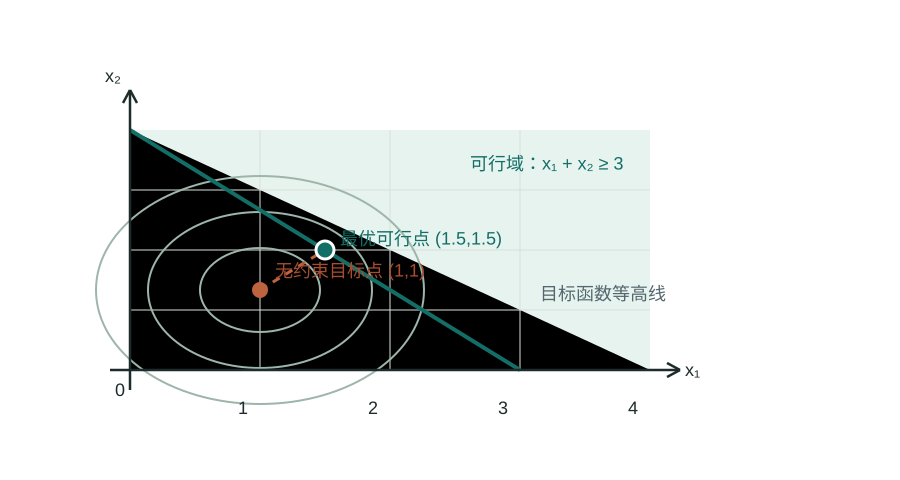

# 1.1 优化问题的数学表达

把一个模糊的“做得更好”，转化为变量、目标函数、约束和可行域。数学建模的第一步不是选择算法，而是明确究竟要决定什么。

## 先问：我们要决定什么？

优化不是“让所有东西都变好”的口号。它要求先选定一个可比较的量：成本、时间、能耗、误差、风险，或经过明确权衡的组合；然后说明哪些决策可以改变，以及哪些现实条件不能违反。

一个优化模型由四类信息构成：

- **决策变量**：可以控制的未知量。
- **目标函数**：给每个方案一个可比较的数值。
- **约束**：定义哪些方案在现实中允许出现。
- **数据与假设**：成本、容量、需求、变量范围，以及模型忽略的因素。

算法只能求解写下的模型，不能自动修复遗漏的成本、错误的单位或不合理的约束。

## 统一的数学形式

令决策向量 (x\in\mathbb R^n)，最常见的非线性优化形式为：

\[
\begin{aligned}
\min_{x\in\mathbb R^n}\quad & f(x)\\
\text{s.t.}\quad & h_j(x)=0,\quad j\in E,\\
& g_i(x)\le 0,\quad i\in I.
\end{aligned}
\]

其中，(f(x)) 是标量目标函数；(h_j) 是等式约束；(g_i) 是不等式约束。本文统一采用 (g_i(x)\le0) 的符号约定，其他资料也可能使用相反方向。

所有满足约束的点构成可行域：

\[
\Omega=\{x\in\mathbb R^n:h_j(x)=0,\ g_i(x)\le0\}.
\]

一个解必须属于可行域。若最小值确实被某个点取得，记为 (x^*\)。最优值存在，与数值算法找到一个近似点，是两件不同的事。

## 从现实问题走到模型

1. **写出决策**：变量应对应可以实际选择的量，并明确单位、维度和取值范围。
2. **选定目标**：决定比较的是总成本、误差还是多目标加权和；权重必须有解释。
3. **翻译限制**：产能、守恒、预算、法规和逻辑条件分别变成等式、不等式或整数条件。
4. **检查边界**：变量是否允许为负？是否有上界？约束方向是否写反？单位是否一致？
5. **验证模型**：代入一个手算方案，检查目标值与每条约束是否符合现实含义。

## 二维例子：离目标最近的可行点

考虑：

\[
\begin{aligned}
\min_{x_1,x_2}\quad &(x_1-1)^2+(x_2-1)^2\\
\text{s.t.}\quad &x_1\ge0,\quad x_2\ge0,\\
&x_1+x_2\ge3.
\end{aligned}
\]



不考虑约束时，目标函数在 ((1,1)) 处为 0，但这个点不满足总量至少为 3 的要求。考虑约束后，最优点变为 ((1.5,1.5))，目标值为 0.5。

验证：令 (u=x_1-1)、(v=x_2-1)，则 (u+v\ge1)。由 ((u+v)^2\le2(u^2+v^2))，可得目标值至少为 (1/2)，等号在 (u=v=1/2) 时成立。

## 动手检查一个候选解

页面中的候选点检查器允许移动 (x_1,x_2)，并实时显示目标值与可行性。目标值更小并不代表方案可用；必须先满足约束。

## Python：枚举一个小网格

下面的程序只为这个二维例子检查有限网格，不是通用优化器。连续空间被离散化，精度受步长限制；本例最优点恰好落在网格上。

```python
"""Evaluate a small constrained optimization model by grid search.

This is a transparent teaching example, not a general-purpose optimizer.
"""
from math import isclose


def objective(x1: float, x2: float) -> float:
    return (x1 - 1.0) ** 2 + (x2 - 1.0) ** 2


def feasible(x1: float, x2: float) -> bool:
    return x1 >= 0.0 and x2 >= 0.0 and x1 + x2 >= 3.0


def grid_search(step: float = 0.05):
    candidates = []
    for i in range(81):
        for j in range(81):
            x1, x2 = i * step, j * step
            if feasible(x1, x2):
                candidates.append((objective(x1, x2), x1, x2))
    return min(candidates)


if __name__ == "__main__":
    value, x1, x2 = grid_search()
    print(f"grid minimizer: ({x1:.2f}, {x2:.2f}), f={value:.4f}")
    assert isclose(x1, 1.5, abs_tol=1e-9)
    assert isclose(x2, 1.5, abs_tol=1e-9)
    assert isclose(value, 0.5, abs_tol=1e-9)
```

## 建模时最容易混淆的事

- **目标值与可行性**：不可行点即使目标值很低，也不能直接作为答案。
- **变量与参数**：变量是要决定的量；参数是当前模型中给定的数据。
- **最小化与最大化**：改变符号可以转换目标方向，但不能改变约束的物理意义。
- **最优解与最优值**：多个决策可能达到同一个最优值；也可能只有下确界而没有可达到的最小点。

## 练习与参考

把约束改为 (x_1+x_2\le1)，并保留同一个目标函数。理想点 ((1,1)) 不可行；由对称性，最优点为 ((0.5,0.5))，目标值为 0.5。

**参考**：Jorge Nocedal, Stephen J. Wright, *Numerical Optimization*, 2nd ed., Springer, 2006，Chapter 1 “Introduction” 与 “Mathematical Formulation”。[出版社书目与版本信息](https://doi.org/10.1007/978-0-387-40065-5)。

[打开独立 HTML 页面](00_1.1._Mathematical_Formulation.html) · [运行 Python 示例](00_1.1._Mathematical_Formulation.py)
