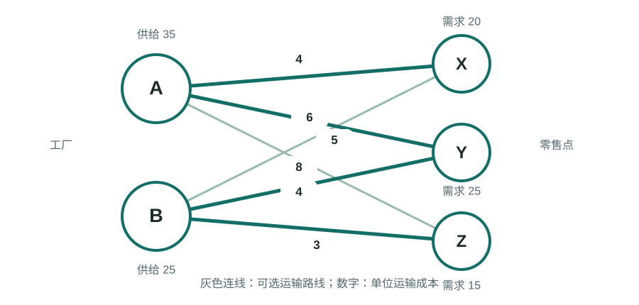

# 1.2 运输问题：把物流决策写成线性规划

两座工厂、三个零售点、有限供给和不同运价。把“怎样发货最省钱”写成一个可检查的线性规划，并验证一组最优运输方案。

## 问题：货从哪里发到哪里？

一家企业有两座工厂 A、B，向三个零售点 X、Y、Z 配送同一种商品。工厂供给分别为 35、25；零售点需求分别为 20、25、15。单位运输成本如下：

| 单位成本 | X | Y | Z | 供给 |
|---|---:|---:|---:|---:|
| A | 4 | 6 | 8 | 35 |
| B | 5 | 4 | 3 | 25 |
| 需求 | 20 | 25 | 15 | 60 |

总供给与总需求均为 60，因此这是一个平衡运输问题。



## 决策变量与线性规划

令 (x_{ij}\) 表示工厂 (i\) 运往零售点 (j\) 的数量。目标是最小化“单位成本 × 发货量”之和：

\[
\min_x\sum_{i=1}^{2}\sum_{j=1}^{3}c_{ij}x_{ij}
\]

约束为：

\[
\begin{aligned}
\sum_{j=1}^{3}x_{ij}&\le s_i, &&i=1,2,\\
\sum_{i=1}^{2}x_{ij}&\ge d_j, &&j=1,2,3,\\
x_{ij}&\ge0.
\end{aligned}
\]

供给约束防止工厂超产，需求约束保证零售点收到足够商品，非负约束排除负发货量。由于总供给恰好等于总需求，任何可行方案都必须用完全部供给并恰好满足需求。

## 一组最优运输计划

| 路线 | A→X | A→Y | A→Z | B→X | B→Y | B→Z |
|---|---:|---:|---:|---:|---:|---:|
| 发货量 | 20 | 15 | 0 | 0 | 10 | 15 |

A 发出 35，B 发出 25；X 收到 20，Y 收到 25，Z 收到 15。总成本：

\[
20\cdot4+15\cdot6+10\cdot4+15\cdot3=255.
\]

## 为什么它是最优的？

令 A 发往 X、Y、Z 的数量分别为 (a,b,c\)。B 的发货量由需求剩余量确定，即 (20-a,25-b,15-c\)。总成本化简为：

\[
C=210+3b+6c.
\]

又因为 (a+b+c=35\) 且 (a\le20\)，所以 (b+c=35-a\ge15\)。由于 (b,c\ge0\)：

\[
C=210+3b+6c\ge210+3(b+c)\ge255.
\]

展示的方案达到 255，因此它是全局最优解；等号要求 (a=20,b=15,c=0\)。

## 沿可行方案移动

页面中的滑块调整 A→X 发货量，并自动构造一族可行方案，实时显示运输计划和总成本。它用于理解约束与成本的关系，不是通用求解器。

## Python：穷举小规模整数方案

```python
"""Enumerate a small integer transportation instance.

The algebraic argument in the article proves the continuous LP optimum.
This finite enumeration independently checks the displayed integral plan.
"""
SUPPLY = (35, 25)
DEMAND = (20, 25, 15)
COST = ((4, 6, 8), (5, 4, 3))


def best_integer_plan():
    best = None
    for ax in range(DEMAND[0] + 1):
        for ay in range(DEMAND[1] + 1):
            az = SUPPLY[0] - ax - ay
            if not 0 <= az <= DEMAND[2]:
                continue

            bx = DEMAND[0] - ax
            by = DEMAND[1] - ay
            bz = DEMAND[2] - az
            if min(bx, by, bz) < 0 or bx + by + bz != SUPPLY[1]:
                continue

            plan = ((ax, ay, az), (bx, by, bz))
            cost = sum(plan[i][j] * COST[i][j]
                       for i in range(2) for j in range(3))
            if best is None or cost < best[0]:
                best = (cost, plan)
    return best


if __name__ == "__main__":
    cost, plan = best_integer_plan()
    print("minimum cost:", cost)
    print("factory A:", plan[0])
    print("factory B:", plan[1])
    assert cost == 255
    assert plan == ((20, 15, 0), (0, 10, 15))
    assert sum(plan[0]) == SUPPLY[0]
    assert sum(plan[1]) == SUPPLY[1]
    assert tuple(plan[0][j] + plan[1][j] for j in range(3)) == DEMAND
```

程序枚举小规模整数方案，检查发货量、供给、需求和总成本。它只适合小型教学例子；实际规模应使用线性规划或最小费用流算法。

## 建模扩展与练习

现实运输模型可能加入路线容量、固定启用成本、时间窗、多商品或车辆类型。供给大于需求时，可以允许剩余库存；供给不足时，则需要缺货变量或调整需求约束。

**练习**：若 A→Z 的单位成本从 8 降到 2，原方案是否仍然最优？请重新化简目标函数，并修改 Python 程序验证。

**参考**：Jorge Nocedal, Stephen J. Wright, *Numerical Optimization*, 2nd ed., Springer, 2006，Chapter 1 “Example: A Transportation Problem”。[出版社书目](https://doi.org/10.1007/978-0-387-40065-5)。本文数值为独立构造的教学数据，并非教材原例。

[打开独立 HTML 页面](01_1.2._Example:_A_Transportation_Problem.html) · [运行 Python 示例](01_1.2._Example:_A_Transportation_Problem.py)
