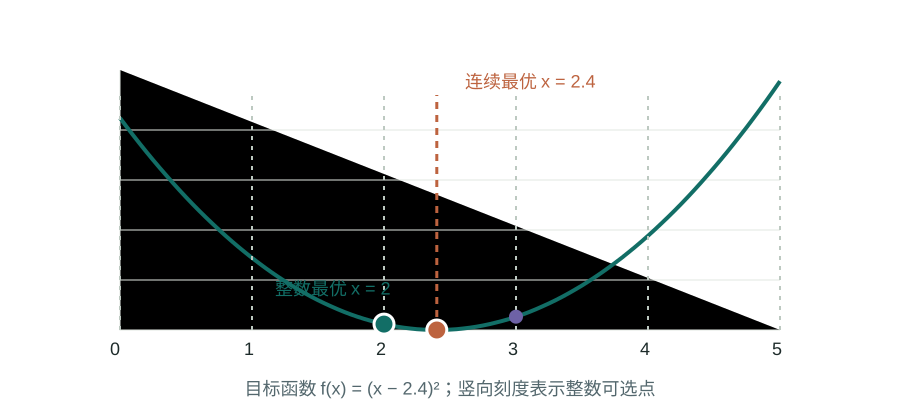

# 1.3 连续优化与离散优化

决策变量能否取任意实数，决定了问题的几何结构、可用算法和计算难度。连续解不能不加检查地四舍五入成整数解。

## 变量的取值空间不同

连续优化中，变量通常取自实数区间或实数向量空间，例如机器参数、长度、温度、流量和投资比例。离散优化中，变量只能从有限或可数集合中选择，例如设备数量、开关状态、路径顺序或设施是否启用。

差别不只是“有没有小数”。连续问题的可行域通常由曲线、曲面或区域组成；离散问题的可行解则是彼此分开的组合。



## 同一个目标函数，两种答案

考虑 (f(x)=(x-2.4)^2\)。

- 若 (x\in[0,5]\)，连续最优解是 (x=2.4\)，目标值为 0。
- 若 (x\in\{0,1,2,3,4,5\}\)，整数最优解是 (x=2\)，目标值为 0.16。

目标函数没有变化，改变的是允许选择的变量集合。连续最优值可以作为整数问题的下界，但不能直接替代整数问题的解。

## 为什么简单取整可能失败

假设容量约束为 (x_1+x_2\le1.2\)，连续可行点为 (0.6,0.6)。若分别四舍五入为 (1,1)，新点就违反容量约束。即使取整后仍可行，也不保证它是整数问题的最优解。

**连续松弛**是放宽整数限制后得到的模型；**整数最优解**必须在原离散可行集合中求得。

## 连续、离散与混合整数

| 类型 | 变量示例 | 典型问题 | 常见方法 |
|---|---|---|---|
| 连续优化 | 实数向量 | 参数拟合、能耗最小化 | 梯度法、牛顿法、内点法 |
| 离散优化 | 整数、二元变量、排列 | 路径、排班、选址 | 动态规划、网络流、分支定界 |
| 混合整数优化 | 连续量 + 整数/二元变量 | 产量与设备启用联合决策 | MILP/MINLP、分解方法 |

不要把“离散”与“难以求解”画等号。最短路径等离散问题可以高效求解；旅行商问题等组合问题在一般情形下具有较高计算复杂度。

## 观察连续候选与整数决策

页面滑块会显示当前连续候选的目标值，以及最近整数点的目标值。离散问题真正的最优值仍需在所有整数可行点中比较。

## Python：比较两个最优值

```python
"""Compare a continuous optimum with an integer-constrained optimum."""
def objective(x: float) -> float:
    return (x - 2.4) ** 2


if __name__ == "__main__":
    continuous_x = 2.4
    integer_x = min(range(6), key=objective)
    print(f"continuous: x={continuous_x:.1f}, f={objective(continuous_x):.2f}")
    print(f"integer:    x={integer_x}, f={objective(integer_x):.2f}")
    assert objective(continuous_x) == 0.0
    assert integer_x == 2
    assert abs(objective(integer_x) - 0.16) < 1e-12
```

## 练习与参考

把目标函数改为 (f(x)=(x-2.7)^2\)，区间仍为 [0,5]，整数集合仍为 {0,1,2,3,4,5}。连续最优点为 2.7；整数最优点为 3，目标值为 0.09。

**参考**：Jorge Nocedal, Stephen J. Wright, *Numerical Optimization*, 2nd ed., Springer, 2006，Chapter 1 “Continuous versus Discrete Optimization”。[出版社书目](https://doi.org/10.1007/978-0-387-40065-5)。

[打开独立 HTML 页面](02_1.3._Continuous_vs._Discrete_Optimization.html) · [运行 Python 示例](02_1.3._Continuous_vs._Discrete_Optimization.py)
