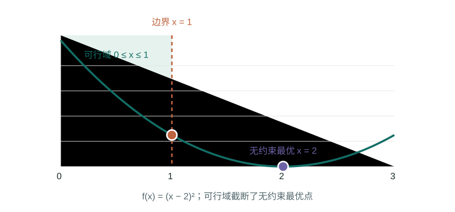

# 1.4 有约束优化与无约束优化

约束会改变可选方案，也会改变最优点的几何位置。最优解可能落在边界上，因此“梯度等于零”不是所有约束问题的必要条件。

## 约束改变了什么？

无约束优化允许变量在指定定义域内自由变化：

\[
\min_x f(x).
\]

有约束优化要求决策满足额外条件，例如容量上限、预算、守恒关系、变量非负或几何边界。无约束问题在整个定义域里寻找目标函数最低点；有约束问题只能在可行域中寻找最低点。

## 一个边界最优点

考虑 (f(x)=(x-2)^2\)。无约束时，最优点为 (x=2\)，目标值为 0。现在加入 (0\le x\le1\)：

\[
\min_{0\le x\le1}(x-2)^2.
\]



有约束最优点变成 (x=1\)，目标值为 1。此处导数 (f'(1)=-2\)，并不等于零。它仍是约束问题的最优点，因为沿允许的方向移动，目标值不会继续下降。

## 从边界条件看 KKT

把上界写成 (g(x)=x-1\le0\)。拉格朗日函数为：

\[
L(x,\lambda)=(x-2)^2+\lambda(x-1).
\]

在 (x=1,\lambda=2\) 处满足：

\[
\begin{aligned}
2(x-2)+\lambda&=0,\\
\lambda&\ge0,\\
\lambda(x-1)&=0.
\end{aligned}
\]

它们分别对应驻点条件、乘子可行性和互补条件。KKT 是约束优化的一阶分析框架；一般非凸问题通常还需要约束资格条件，凸问题可配合凸性得到更强结论。

## 常见处理思路

- **变量消元**：用等式约束解出部分变量，降低维度。
- **投影方法**：每次更新后把点投影回可行集合。
- **拉格朗日乘子与 KKT**：将约束的影响写入驻点条件。
- **罚函数与增广拉格朗日**：把约束违反程度纳入子问题；罚参数过大可能导致数值病态。
- **障碍函数**：通过边界附近增大的代价，使迭代点留在可行域内部。

## 检查候选点是否可行

页面中的滑块展示候选点、目标值和可行性。无约束最优点不是约束问题的答案，除非它本身可行且满足相应最优性条件。

## Python：比较两个问题

```python
"""Show why a constrained optimum can lie on a boundary."""
def objective(x: float) -> float:
    return (x - 2.0) ** 2


def feasible(x: float) -> bool:
    return 0.0 <= x <= 1.0


if __name__ == "__main__":
    unconstrained_x = 2.0
    constrained_x = 1.0
    multiplier = 2.0
    gradient_at_boundary = 2.0 * (constrained_x - 2.0)

    print("unconstrained:", unconstrained_x, objective(unconstrained_x))
    print("constrained:  ", constrained_x, objective(constrained_x))
    print("boundary gradient:", gradient_at_boundary)
    print("KKT multiplier:", multiplier)

    assert not feasible(unconstrained_x)
    assert feasible(constrained_x)
    assert objective(constrained_x) == 1.0
    assert gradient_at_boundary + multiplier == 0.0
    assert multiplier >= 0.0
```

## 方法选择与常见误区

- 先检查无约束解是否可行。
- 约束最优点可能位于边界，梯度不必为零。
- 罚函数会引入参数选择和条件数问题。
- 约束方向与乘子符号必须使用同一套约定。

## 练习与参考

将目标改为 ((x-0.4)^2\)，约束仍为 (0\le x\le1\)。约束不改变最优解，因为 0.4 可行。若目标改为 ((x-1.6)^2\)，无约束最优点不可行，有约束最优点为边界 1。

**参考**：Jorge Nocedal, Stephen J. Wright, *Numerical Optimization*, 2nd ed., Springer, 2006，Chapter 1 “Constrained and Unconstrained Optimization” 与 Chapter 12 “Theory of Constrained Optimization”。[出版社书目](https://doi.org/10.1007/978-0-387-40065-5)。

[打开独立 HTML 页面](03_1.4._Constrained_and_Unconstrained_Optimization.html) · [运行 Python 示例](03_1.4._Constrained_and_Unconstrained_Optimization.py)
