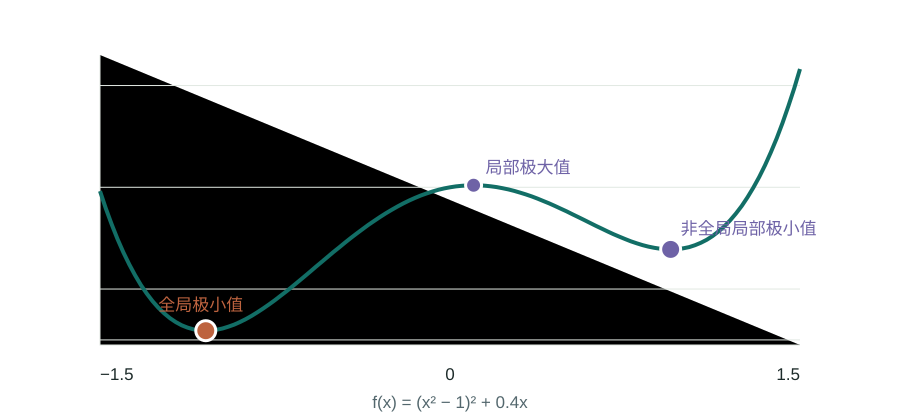

# 1.5 全局最优与局部最优

局部算法通常只探索当前点附近的地形。非凸目标函数可能有多个局部极小值，找到一个稳定的低点，不等于证明它是全局最优。

## 两个不同的最优性概念

设可行域为 \(\Omega\)。点 \(x^*\) 是**全局极小点**，如果对所有可行点 \(x\) 都有：

\[
f(x^*)\le f(x),\quad \forall x\in\Omega.
\]

它是**局部极小点**，如果存在一个以 \(x^*\) 为中心的邻域，使邻域内所有可行点都满足同样的不等式。

全局极小点一定是局部极小点（在通常定义下），但局部极小点不一定是全局极小点。若邻域内其他点都严格更大，则称为严格局部极小点。

## 一个有两个谷底的函数

考虑非凸函数：

\[
f(x)=(x^2-1)^2+0.4x.
\]



其导数为：

\[
f'(x)=4x(x^2-1)+0.4,\qquad
f''(x)=12x^2-4.
\]

驻点数值近似为：

| 驻点 x | 函数值 f(x) | 分类 |
|---:|---:|---|
| −1.04668 | −0.40954 | 全局极小点 |
| 0.10103 | 1.02010 | 局部极大点 |
| 0.94565 | 0.38944 | 非全局局部极小点 |

由于四次项系数为正，函数在无穷远处趋于正无穷；比较两个局部极小点的函数值，左侧谷底更低，因此是全局极小点。

## 初始点为什么重要

梯度下降按

\[
x_{k+1}=x_k-\alpha f'(x_k)
\]

更新。步长合适时，算法沿局部下降方向前进，但最终落在哪个谷底取决于起点和目标函数地形。步长过大仍可能振荡或发散。

本文交互演示固定步长为 0.01，只说明这个函数上的吸引域，不是对所有问题的普遍结论。

## 凸性带来的保证

如果目标函数在凸可行域上是凸函数，那么任何局部极小点都是全局极小点。若目标函数严格凸，则全局极小点至多一个。

非凸并不意味着每个实例都难；它意味着不能仅凭局部驻点就自动获得全局最优保证。

## 实践中怎样降低风险

- **多起点**：从不同初始值运行局部算法，比较结果；但多起点不能单独证明全局最优。
- **利用结构**：检查目标函数和可行域是否凸，或是否存在可分解、可松弛的结构。
- **独立验证**：比较目标值、约束违反、梯度范数和不同算法结果。
- **需要证明时使用全局方法**：例如分支定界、区间方法或可验证的全局下界。

## Python：两个起点，两种结果

```python
"""Illustrate two attraction basins for a nonconvex objective."""
def objective(x: float) -> float:
    return (x * x - 1.0) ** 2 + 0.4 * x


def gradient(x: float) -> float:
    return 4.0 * x * (x * x - 1.0) + 0.4


def gradient_descent(start: float, step: float = 0.01, iterations: int = 5000):
    x = start
    for _ in range(iterations):
        next_x = x - step * gradient(x)
        if abs(next_x - x) < 1e-11:
            x = next_x
            break
        x = next_x
    return x


if __name__ == "__main__":
    left = gradient_descent(-1.5)
    right = gradient_descent(1.5)
    print(f"start -1.5 -> x={left:.6f}, f={objective(left):.6f}")
    print(f"start +1.5 -> x={right:.6f}, f={objective(right):.6f}")
    assert abs(left - (-1.04668)) < 1e-3
    assert abs(right - 0.94565) < 1e-3
    assert objective(left) < objective(right)
```

## 练习与参考

将函数中的线性项 0.4x 改为 0，函数变为 ((x^2-1)^2\)。此时 x=−1 和 x=1 的函数值均为 0，两者都是全局极小点；全局解不一定唯一。

**参考**：Jorge Nocedal, Stephen J. Wright, *Numerical Optimization*, 2nd ed., Springer, 2006，Chapter 1 “Global and Local Optimization” 与 “Convexity”。[出版社书目](https://doi.org/10.1007/978-0-387-40065-5)。

[打开独立 HTML 页面](04_1.5._Global_and_Local_Optimization.html) · [运行 Python 示例](04_1.5._Global_and_Local_Optimization.py)


[下一篇：1.6 随机优化与确定性优化](05_1.6._Stochastic_and_Deterministic_Optimization.html)
