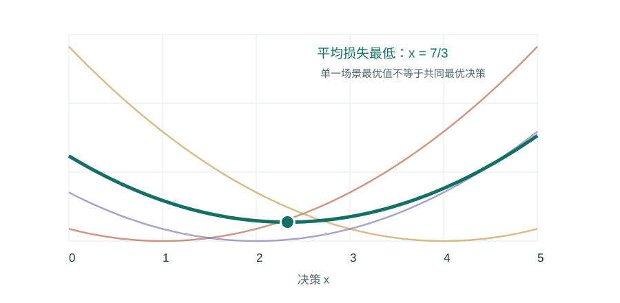

# 1.6 随机优化与确定性优化

同一个决策，在固定数据与不确定需求下可能产生不同的最优选择。关键不是随机算法是否“靠运气”，而是目标或约束是否依赖未知的随机结果。

## 一个发货决策，三种可能的需求

假设企业必须在真实需求揭晓前决定发货量 x。若实际需求为 D，暂以平方偏差 L(x,D)=(x−D)² 表示损失：发多和发少被对称惩罚。这是**为了展示数学结构而设计的玩具成本**，并非通用物流成本函数。

确定性优化把需求当成已知数。例如采用固定预测 D=2 时，最小化 (x−2)² 的答案就是 x=2。随机优化则把 D 看成有分布的随机变量，在决策时无法知道哪一个场景会发生。



*单个场景的低点不同；对同一个预先作出的决策，三种场景平均损失在 x=7/3 达到最小。*

## 把不确定性写进目标函数

若场景 D∈{1,2,4} 各以 1/3 的概率发生，那么在不知道 D 时，合理的风险中性目标是最小化**期望损失** R(x)。决策 x 必须在场景揭晓前固定，不能对每个场景事后分别选择自己的最优值。

$$
\min_x R(x)=\mathbb{E}\big[(x-D)^2\big]=\tfrac13\big[(x-1)^2+(x-2)^2+(x-4)^2\big]
$$

确定性与随机问题都可以使用确定性的数值算法求解。这里“随机”描述的是数据模型，不等于必须使用随机梯度下降；“确定性”也不保证问题简单。

## 为什么最优值是 7/3

平方损失有一个有用的恒等式：期望平方误差等于**对期望的偏差平方**加上**需求方差**。只要二阶矩有限，这个分解成立。

$$
\mathbb E[(x-D)^2]=(x-\mathbb E[D])^2+\operatorname{Var}(D)
$$

在三个等概率场景里，E[D]=(1+2+4)/3=7/3，Var(D)=14/9。因此 x*=7/3≈2.3333，最优平均损失 R*=14/9≈1.5556。若只用固定预测 D=2 选 x=2，再放进三场景里检验，其期望损失为 5/3≈1.6667，比随机模型的最优值高 1/9。

这个差异来自**建模时使用的信息不同**，不是比较了两种算法的优劣。

## 样本平均近似与 Monte Carlo

真实分布可能未知。若我们能从相同分布独立采样 D₁,…,Dₙ，可以用样本平均近似（SAA）构造 Rₙ(x)=Σ L(x,Dᵢ)/n。对当前平方损失，SAA 最优决策是样本均值。

$$
R_n(x)=\frac1n\sum_{i=1}^{n}(x-D_i)^2,\qquad x_n^*=\frac1n\sum_{i=1}^{n}D_i
$$

有限样本均值不一定等于真实期望。独立同分布、有限期望等条件下，样本均值会随样本量增加而收敛；但若场景本身有偏、极端风险重要，或约束必须对每个情景都成立，仅靠最小期望可能不够。

## 观察候选决策的风险

移动 x，比较固定场景的损失、三场景的平均损失，以及理论最优值。初始显示 x=2，便于直接看到确定性预测带来的决策。

**交互实验：** 三种可能需求分别为 1、2、4，各占三分之一概率。 网页提供滑块调整 预先决定的发货量 x（0 至 5）并实时显示结果。

## 用 Python 独立验证

下面的 Python 程序既验证有限场景期望的解析最优解，也使用固定随机种子给出 Monte Carlo 样本均值。它**不是**概率约束求解器，也不把一次随机结果写成可靠的统计结论。

```python
"""Compare a deterministic forecast with a finite-scenario stochastic objective.

Uses the exact three equally likely scenarios (1, 2, 4); no external solver.
"""
from math import isclose
from random import Random

SCENARIOS = (1.0, 2.0, 4.0)

def loss(x: float, demand: float) -> float:
    return (x - demand) ** 2

def scenario_risk(x: float) -> float:
    return sum(loss(x, d) for d in SCENARIOS) / len(SCENARIOS)

def monte_carlo_mean(seed: int = 2026, size: int = 1000) -> float:
    rng = Random(seed)
    return sum(rng.choice(SCENARIOS) for _ in range(size)) / size

if __name__ == "__main__":
    deterministic = 2.0
    stochastic = sum(SCENARIOS) / len(SCENARIOS)
    theoretical_risk = 14.0 / 9.0
    print(f"fixed forecast decision: {deterministic:.6f}")
    print(f"mean-squared-loss decision: {stochastic:.6f}")
    print(f"minimum scenario risk: {scenario_risk(stochastic):.6f}")
    print(f"fixed-seed Monte Carlo sample mean: {monte_carlo_mean():.6f}")
    assert isclose(stochastic, 7.0 / 3.0)
    assert isclose(scenario_risk(stochastic), theoretical_risk)
    assert scenario_risk(stochastic) <= scenario_risk(deterministic)
    assert scenario_risk(stochastic) <= scenario_risk(stochastic + 0.5)
    assert 1.0 <= monte_carlo_mean() <= 4.0
```

## 模型边界与练习

- **风险偏好：**最小期望平方损失不保证最差情景可接受。风险厌恶可以使用分位数、CVaR 或鲁棒目标。
- **两阶段决策：**若需求揭晓后还允许补货或调拨，必须显式建模事后决策与成本。
- **变量约束：**如果只能整箱发货，连续最优 x=7/3 还需要求解整数版本。

**练习：**将场景概率改为 P(D=1)=1/2，P(D=2)=1/4，P(D=4)=1/4。在平方损失下，新的最优发货量为 E[D]=2，最优期望损失为 3/2。

**参考**：Jorge Nocedal and Stephen J. Wright, *Numerical Optimization*, 2nd edition, Springer, 2006，第 1 章。[出版社书目](https://doi.org/10.1007/978-0-387-40065-5)。数值例子与代码独立编写。

[阅读完整 HTML 页面](05_1.6._Stochastic_and_Deterministic_Optimization.html) · [运行 Python 示例](05_1.6._Stochastic_and_Deterministic_Optimization.py)
