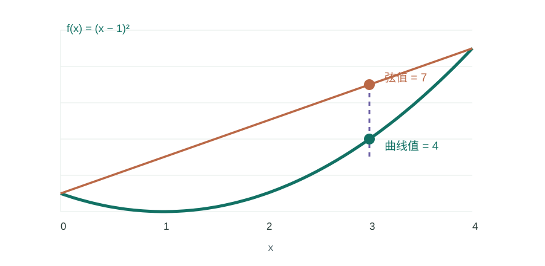

# 1.7 凸性：为什么局部最优可以变成全局最优

凸性把局部几何与全局保证连接起来。观察一条曲线与两端点之间的弦，理解为什么凸优化允许可靠的全局最优性判断。

## 看曲线与弦之间的关系

考虑 f(x)=(x−1)²。任意挑两个输入点，把它们连成一条直线；曲线上两点之间的函数值不会高于这条弦对应的高度。这正是凸函数最直观的几何特征。



*当端点为 x=0 和 x=4 时，插值 x=3 处的曲线值为 4，弦值为 7；弦与曲线的垂直间距就是凸性不等式中的差值。*

## 什么是凸集

一个集合 C 是凸集，意味着任意两点 a、b∈C 之间的全部线段都在 C 内。实数上的区间、欧氏空间中的球、半空间是典型例子；中间挖洞的环形区域通常不是凸集。

$$
\theta a+(1-\theta)b\in C\quad(a,b\in C,\ 0\le\theta\le1)
$$

优化里还需要注意**定义域**。讨论函数在 C 上是否凸，首先要求 C 本身为凸集；否则两点之间的插值可能连函数都没有定义。

## 凸函数的不等式

给定凸定义域 C，函数 f 是凸的，当且仅当任意 a、b∈C 与 θ∈[0,1] 满足下式。左侧是插值处的函数值，右侧是端点函数值按相同权重得到的弦上高度。

$$
f(\theta a+(1-\theta)b)\le\theta f(a)+(1-\theta)f(b)
$$

对于 f(x)=(x−1)²，取 a=0、b=4、θ=1/4。插值点 x=3，左侧 f(3)=4，右侧 1/4·f(0)+3/4·f(4)=7。差 3≥0，符合凸性。对所有 θ∈[0,1]，差恰好是 16θ(1−θ)，因此始终非负。

## 导数与 Hessian 判别

如果一元函数在开区间内二次连续可微，f''(x)≥0 对全部 x 成立，与凸性等价。多维情况下，若函数在开凸域内二次连续可微，Hessian 对所有点均为半正定，就是凸性的充分必要条件。

$$
v^{\mathsf T}\nabla^2 f(x)v\ge0\quad\text{对任意 }v
$$

本例 f''(x)=2>0，因此严格凸；并且在实数域上有唯一最小点 x=1。注意**严格凸**不要求每个点的 Hessian 都正定，例如 x⁴ 严格凸，但在零点的二阶导数为零。

## 从局部极小到全局极小

若目标 f 凸且可行域 C 也是凸集，任何局部极小点都是全局极小点。理由是：若存在更好的远处点 y，连接当前候选点 x 和 y 的线段仍可行；凸性保证沿着这条线段刚离开 x 的点就能改善目标，与局部最优矛盾。

严格凸意味着**若最小点存在则至多一个**，但并不保证存在。例如 eˣ 在整个实数轴上严格凸，函数值始终大于零，却只无限接近零，不会取得最小值。

> 凸优化并不是“所有约束问题都容易”，而是给予可利用的全局结构。不能仅凭目标函数凸就忽略非凸可行域。

## 移动插值权重 θ

改变 θ，展示曲线值和弦值。端点时二者相等；在区间内部，严格凸二次函数的曲线低于连接端点的弦。

**交互实验：** 端点 a=0，b=4，x=θa+(1−θ)b。 网页提供滑块调整 凸组合权重 θ（0 至 1）并实时显示结果。

## 检查不等式并练习

程序对 θ=0,0.01,…,1 进行离散检查，并单独验证 θ=1/4 时的精确值。有限采样**不能替代**全区间的数学证明；这里的证明来自平方展开。

```python
"""Check the convexity inequality for a quadratic teaching example."""
from math import isclose

def f(x: float) -> float:
    return (x - 1.0) ** 2

def chord_gap(theta: float, a: float = 0.0, b: float = 4.0) -> float:
    x = theta * a + (1.0 - theta) * b
    return theta * f(a) + (1.0 - theta) * f(b) - f(x)

if __name__ == "__main__":
    theta = 0.25
    x = theta * 0.0 + (1.0 - theta) * 4.0
    lhs = f(x)
    rhs = theta * f(0.0) + (1.0 - theta) * f(4.0)
    print(f"x={x:.2f}, curve={lhs:.2f}, chord={rhs:.2f}, gap={rhs-lhs:.2f}")
    assert isclose(x, 3.0)
    assert isclose(lhs, 4.0)
    assert isclose(rhs, 7.0)
    for i in range(101):
        assert chord_gap(i / 100.0) >= -1e-12
    assert isclose(chord_gap(0.0), 0.0)
    assert isclose(chord_gap(1.0), 0.0)
```

**练习：**证明非负加权和 αf+βg 在 α,β≥0 且 f、g 均凸时仍凸；再思考如果权重允许负数，结论是否还成立。

**参考**：Jorge Nocedal and Stephen J. Wright, *Numerical Optimization*, 2nd edition, Springer, 2006，第 1 章。[出版社书目](https://doi.org/10.1007/978-0-387-40065-5)。数值例子与代码独立编写。

[阅读完整 HTML 页面](06_1.7._Convexity.html) · [运行 Python 示例](06_1.7._Convexity.py)
