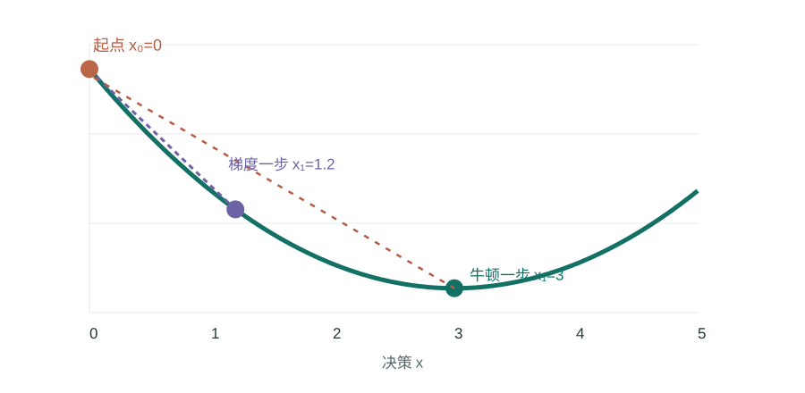

# 1.8 优化算法：从局部信息走向更好的决策

算法反复选择搜索方向和步长，让目标函数沿着可验证的方向改进。梯度下降与牛顿法在同一个二次函数上展示了两种截然不同的更新方式。

## 为什么需要迭代算法

复杂目标函数往往没有可以直接写出的解析最优解。数值算法从起点 x₀ 出发，读取函数值、梯度或曲率信息，再逐次计算新的候选点。每一步都要回答两个问题：**朝哪走**，以及**走多远**。

$$
x_{k+1}=x_k+\alpha_kp_k
$$

这里 pₖ 是方向，αₖ 是步长。线搜索方法首先选方向，再沿该方向选步长；信赖域方法首先限制局部模型可信的范围，再在范围内找步子。这两种思想贯穿后续的数值优化算法。

## 一条可精确求解的抛物线

先使用自构造的目标 f(x)=(x−3)²+1。它的唯一全局最小点是 x*=3，最优值 f*=1。一阶导数为 2(x−3)，二阶导数恒为 2。从起点 x₀=0 开始，比一比梯度法和牛顿法的首步。



*在这个二次目标中，固定步长 0.2 的梯度下降第一步到 x=1.2，而精确使用 Hessian 的牛顿步直接到 x=3。*

## 梯度下降：沿负梯度移动

梯度下降使用 pₖ=−f'(xₖ)。对当前函数，更新是 xₖ₊₁=xₖ−2α(xₖ−3)。如果 α=0.2，则 x₁=0+0.2·6=1.2；后续每一步都更接近 3。

$$
x_{k+1}-3=(1-2\alpha)(x_k-3)
$$

只要 |1−2α|1 则会放大偏差。**这一具体步长范围不能不加修改地套用于其他函数。**

## 牛顿法：利用局部曲率

牛顿法在当前位置用二阶 Taylor 近似目标：f(x+p)≈f(x)+f'(x)p+½f''(x)p²。对正曲率的局部二次模型求最小点，得 p=−f'(x)/f''(x)。

$$
x_{k+1}=x_k-\frac{f'(x_k)}{f''(x_k)}
$$

本例 f''=2，故 x₁=0−(−6)/2=3，一步精确到达最优点。原因是原函数本身就是严格凸二次函数，二阶模型没有近似误差。对于非凸或 Hessian 不正定的问题，纯牛顿方向不一定下降；实践中通常加入线搜索、信赖域或 Hessian 修正。

## 怎样决定停止与验收

- **目标与梯度：**比较目标值下降、梯度范数和相对变化，但梯度小本身不意味着全局最优。
- **约束与数值误差：**有约束问题还要检查可行性与最优性残差；目标值的微小变化也可能只是停滞。
- **成本与稳健性：**牛顿步要计算/求解 Hessian 系统，可能远比一次梯度更新昂贵；高维优化常用拟牛顿或矩阵自由方法。

收敛论证需要明确函数光滑性、步长选择、曲率与初始点条件。单个示例的成功运行不能证明所有起点、所有函数都收敛。

## 一步梯度下降与步长

从 x₀=0 出发，移动步长 α，查看首步目标值、更新点与稳定范围。牛顿步在本例始终等于 3，用作比较。

**交互实验：** α 的推荐范围仅针对本例 f(x)=(x−3)²+1。 网页提供滑块调整 梯度步长 α（0.05 至 1.1）并实时显示结果。

## Python：解析结果与数值迭代

代码检查首步、十步、牛顿步，以及 α>1 时误差增长的反例。算法采用固定步长，不含通用线搜索或信赖域框架。

```python
"""Gradient descent and Newton steps on one strictly convex quadratic."""
from math import isclose

def f(x: float) -> float:
    return (x - 3.0) ** 2 + 1.0

def gradient(x: float) -> float:
    return 2.0 * (x - 3.0)

def hessian(x: float) -> float:
    return 2.0

def gradient_descent(x: float, step: float, count: int) -> float:
    for _ in range(count):
        x -= step * gradient(x)
    return x

def newton_step(x: float) -> float:
    return x - gradient(x) / hessian(x)

if __name__ == "__main__":
    x0 = 0.0
    gd_first = gradient_descent(x0, 0.2, 1)
    gd_tenth = gradient_descent(x0, 0.2, 10)
    newton_first = newton_step(x0)
    unstable = gradient_descent(x0, 1.05, 10)
    print(f"GD (1 step) = {gd_first:.6f}")
    print(f"GD (10 steps) = {gd_tenth:.6f}")
    print(f"Newton (1 step) = {newton_first:.6f}")
    assert isclose(gd_first, 1.2)
    assert isclose(gd_tenth, 3.0 * (1.0 - 0.6 ** 10))
    assert isclose(newton_first, 3.0)
    assert isclose(f(newton_first), 1.0)
    assert abs(unstable - 3.0) > abs(x0 - 3.0)
```

**练习：**把目标改为 10(x−3)²+1，仍用 α=0.2。此时更新误差因子变为 1−20α=−3，迭代发散；合适的稳定步长必须小于 0.1。

**参考**：Jorge Nocedal and Stephen J. Wright, *Numerical Optimization*, 2nd edition, Springer, 2006，第 1 章。[出版社书目](https://doi.org/10.1007/978-0-387-40065-5)。数值例子与代码独立编写。

[阅读完整 HTML 页面](07_1.8._Optimization_Algorithms.html) · [运行 Python 示例](07_1.8._Optimization_Algorithms.py)
