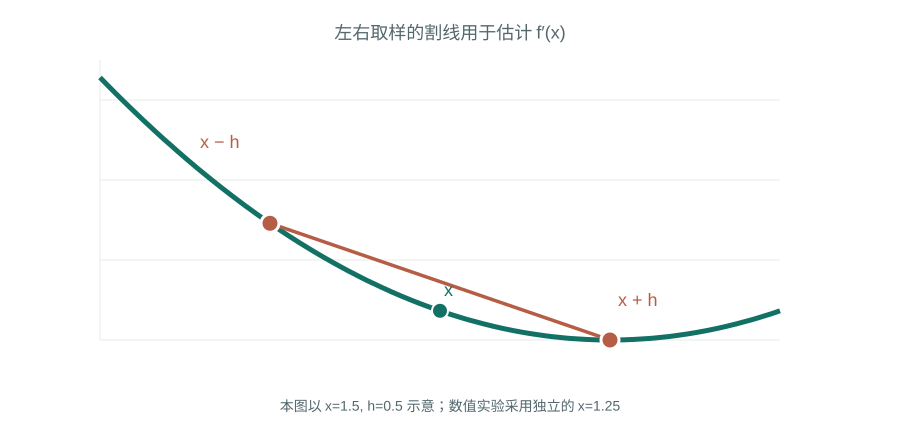

# 1.9 注释与参考：怎样独立核对一个优化结论

一个正确的数学叙述应该能追溯到假设与推导；一个可信的数值结果应该能独立复现。用中心差分检查导数，并建立区分理论、示例与实验的阅读习惯。

## 什么样的结论可以相信

数值优化同时包含定义、定理、算法、数值误差和工程实现。它们的证据标准不同：定义需要精确符号，定理需要完整假设，算法实现需要可执行检查，实验数字则需要版本、环境、随机种子和对照条件。

例如“梯度下降每步都下降”并不是普遍真理；要说明目标光滑性、步长范围和梯度精度。又如“这个优化器很快”只有在数据集、硬件、停止阈值及基线公平时才有可比较意义。

## 把资料分成来源与推导

本课程的章节骨架以 Jorge Nocedal 和 Stephen J. Wright 的 *Numerical Optimization* 第二版为主要参考。出版信息与目录应核对出版社版本，而不能把其他版本的页码、证明或实验结果直接混用。

阅读任何数值结论时，至少把证据分成三类：**来自文献的原始主张**、**可以手算推导的结果**、**来自一次运行的观察**。本文的数值实验是独立构造的教学例子，不声称复现书中的实验表。

| 证据类型 | 应当记录什么 | 最容易出现的错误 |
| --- | --- | --- |
| 定义 / 定理 | 原始来源、章节、符号、前提 | 省略光滑性或凸性条件 |
| 解析推导 | 关键代数步骤、边界条件、极值候选 | 把必要条件当成充分条件 |
| 数值实验 | 代码版本、输入、随机种子、环境、误差阈值 | 只报告一次有利的运行 |

## 用中心差分核对导数

假设推导得到 f(x)=(x−2)²+1，导数应为 f'(x)=2(x−2)。如果实现中把负号写错，优化更新方向就可能完全错误。可以用在 x 两侧取样的中心差分做独立数值检查：

$$
D_hf(x)=\frac{f(x+h)-f(x-h)}{2h}\approx f'(x)
$$



*中心差分用左右等距的两个函数值构造割线斜率。图是几何示意；实验在 x=1.25 处计算。*

对这个特定二次函数，代入公式后所有 h² 项在实数精确运算中抵消，因此中心差分在数学上恰好等于 2(x−2)。但**浮点实现不等于精确实数运算**；h 极小时，两个近似相等的函数值相减会损失有效数字。

## 误差不是只由公式决定

对一般三次连续可微的函数，中心差分的截断误差通常为 O(h²)。但计算机还存在浮点舍入，差商中的除法会放大部分舍入影响，常见的总误差行为可粗略理解为截断项 O(h²) 与舍入项 O(ε/h) 的竞争。

因此“h 越小越准确”并不总成立。误差阈值应结合输入尺度、函数评估精度和机器浮点类型选择；特别不能直接把差分检查当作严格的导数证明。

## 改变差分步长的数量级

固定 x=1.25，此时解析导数为 −1.5。拖动 k，使用 h=10⁻ᵏ 计算中心差分，并观察绝对误差的变化。不同浏览器/硬件的最后几位结果可能略有不同。

**交互实验：** 数值计算使用 JavaScript Number（IEEE 754 双精度）。 网页提供滑块调整 步长指数 k（h=10⁻ᵏ）（1 至 9）并实时显示结果。

## 复现记录的最小清单

- **确定输入：**记录模型、单位、数据、约束和目标函数。
- **固定计算：**注明初始化、随机种子、迭代次数、线搜索或步长、容差。
- **独立检查：**至少检查目标值、约束违反程度、解析导数与数值差分的一致性。
- **保留反例：**若在某些输入上失败，把前提和失败条件写出，而不是只挑成功的截图。

本仓库为每个重构模块提供 Python 示例与证据账本。理论依据、解析推导和有限样本观察会分别标记，避免一张图同时承载多种不相干的事实主张。

## Python：可重复的导数检查

程序检查 h=10⁻¹ 到 10⁻¹¹ 的中心差分。由于二次函数的代数截断误差为零，误差主要来自浮点运算；输出是一组**可复现实验值**，不是对所有函数的普遍误差曲线。

```python
"""Independent derivative check with a central finite difference.

Demonstrates the tradeoff between truncation and floating-point error.
"""
from math import isclose

def f(x: float) -> float:
    return (x - 2.0) ** 2 + 1.0

def analytic_derivative(x: float) -> float:
    return 2.0 * (x - 2.0)

def central_difference(x: float, h: float) -> float:
    return (f(x + h) - f(x - h)) / (2.0 * h)

if __name__ == "__main__":
    x = 1.25
    exact = analytic_derivative(x)
    print(f"analytic derivative = {exact:.12f}")
    for k in (1, 3, 5, 7, 9, 11):
        h = 10.0 ** (-k)
        estimate = central_difference(x, h)
        print(f"h=1e-{k:02d}: estimate={estimate:.12f}, abs_error={abs(estimate-exact):.3e}")
    assert isclose(exact, -1.5)
    assert abs(central_difference(x, 1e-3) - exact) < 1e-9
    assert abs(central_difference(x, 1e-1) - exact) < 1e-12
```

**练习：**将 f(x) 改为 exp(x)，在 x=0 处重复计算。其中心差分为 sinh(h)/h=1+h²/6+O(h⁴)，在 h 不太小时能看到 O(h²) 截断误差，极小 h 时仍受舍入影响。

**参考**：Jorge Nocedal and Stephen J. Wright, *Numerical Optimization*, 2nd edition, Springer, 2006，第 1 章。[出版社书目](https://doi.org/10.1007/978-0-387-40065-5)。数值例子与代码独立编写。

[阅读完整 HTML 页面](08_1.9._Notes_and_References.html) · [运行 Python 示例](08_1.9._Notes_and_References.py)
