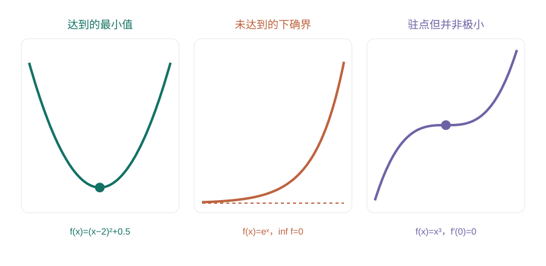

# 2.1 什么才算优化问题的解？

最小点、目标最小值、下确界与驻点不是同一个概念。只有把存在性、必要条件与充分条件分开，才能判断一次算法返回的数字究竟意味着什么。

## 目标值与决策点是两件事

考虑无约束最小化 minₓ f(x)，定义域通常为实数空间。**最优点** x* 是达到最低函数值的决策；**最优值** f* 是该点的函数值。不同最优点可能得到相同最优值，而且有些问题压根没有任何能达到最低值的点。

$$
x^*\in\arg\min_{x\in\mathbb R^n}f(x),\qquad f^*=f(x^*)
$$

局部最优只要求在某个邻域里没有更小值；全局最优则必须和整个可行域的所有点比较。数值算法通常先求一个可检查的近似候选，再通过定理或界证明其最优性。

## 三个看起来相似、结论却不同的图



*左图的二次函数有唯一全局最小点；中图 eˣ 在实数域无限接近零但从不达到零；右图 x³ 在零处导数为零，却不是局部极小点。*

**能取到：**f(x)=(x−2)²+0.5 对所有实数 x 都至少为 0.5，且在 x=2 达到它。故最优点 x*=2，最优值 f*=0.5。

**只有下确界：**f(x)=eˣ 对任意有限 x 都大于零，但当 x→−∞ 时趋近零。因而 infₓ eˣ=0，却不存在最优点 x*。写“最小值为 0”不严谨，应该说“下确界为 0”。

**驻点非极小：**f(x)=x³ 在 x=0 时导数为零，但左边的函数值更小、右边更大，因此零点不是局部极小点。

## 一阶必要条件不是充分条件

若 f 在内点 x* 可微，x* 是局部极小点，则梯度为零。这是一阶**必要条件**；它不保证 x* 真是极小点，更不保证全局最优。

$$
\nabla f(x^*)=0\quad\text{(可微无约束局部最小的必要条件)}
$$

对一元二次可微函数，若 f'(x*)=0 且 f''(x*)>0，则 x* 是严格局部极小点。如果 f''(x*)<0 则是严格局部极大点；如果 f''(x*)=0，二阶检验无法直接定论。多维对应 Hessian 的正定性判断，但严格局部最小也可能出现在 Hessian 不正定的边界情况。

## 解何时存在

存在性与最优性是不同问题。若 f 在**非空紧集**（例如闭且有界的实数域可行集合）上连续，Weierstrass 极值定理保证至少存在一个最小点。无约束实数空间不是紧集，不能直接套用这一结论。

在整个实数空间上，如果 f 连续且强制性增长，即当 ||x||→∞ 时 f(x)→∞，也能保证最小点存在。这个条件是充分条件，不是必要条件；非强制性增长的函数也可能有最小点。

> “求解器停止了”不等于“数学上存在一个全局最小点”。必须先确认求解目标有意义，再解释停止原因。

## 一个数值答案需要哪些检查

- **可行性：**无约束问题没有额外约束，但仍需在定义域内且函数有定义。
- **一阶残差：**检查 ||∇f(x)|| 是否足够小；这通常只是驻点证据。
- **曲率信息：**用 Hessian、方向导数或邻域比较排查鞍点和局部极大点。
- **全局证明：**若目标凸，局部最优可升格为全局最优；若有下界证书，还需核对上下界差。

实际计算会遇到有限精度、数据噪声和停止容差。因此通常报告“近似最优点、目标值、残差和停止理由”，而不是只给一个没有上下文的 x。

## 检查一个二次函数候选点

移动 x，观察 f(x)=(x−2)²+0.5 的目标值、导数和与真实最优点的距离。只有 x=2 同时达到解析最小值和零梯度。

**交互实验：** 当前函数在整个实数域严格凸并且能取到最小值。 网页提供滑块调整 候选点 x（-1 至 5）并实时显示结果。

## Python：三个相互独立的判断

程序同时检查：二次函数的可达到最小值、三次函数的零导数反例、指数函数始终为正却可以无限逼近零。这三件事不能互相替代。

```python
"""Separate an attained minimum, a stationary non-minimum, and an infimum."""
from math import exp, isclose

def quadratic(x: float) -> float:
    return (x - 2.0) ** 2 + 0.5

def quadratic_gradient(x: float) -> float:
    return 2.0 * (x - 2.0)

def cubic(x: float) -> float:
    return x ** 3

def cubic_gradient(x: float) -> float:
    return 3.0 * x ** 2

if __name__ == "__main__":
    minimizer = 2.0
    print("quadratic minimizer:", minimizer, "minimum value:", quadratic(minimizer))
    print("cubic stationary derivative at zero:", cubic_gradient(0.0))
    print("exp(-1), exp(-5), exp(-10):", exp(-1), exp(-5), exp(-10))
    assert isclose(quadratic(minimizer), 0.5)
    for x in (-3.0, 0.0, 1.0, 2.0, 3.5):
        assert quadratic(x) >= quadratic(minimizer)
    assert isclose(quadratic_gradient(minimizer), 0.0)
    assert isclose(cubic_gradient(0.0), 0.0)
    assert cubic(-0.1) < cubic(0.0) < cubic(0.1)
    assert exp(-10) < exp(-5) < exp(-1)
    assert exp(-10) > 0.0
```

**练习：**令 f(x)=x⁴。它在 x=0 时一阶、二阶导数都为零，但 f(x)≥0 且只有在 x=0 取零，因此 x=0 仍是严格全局最小点。此例说明二阶导数等于零时需要其他论证。

**参考**：Jorge Nocedal and Stephen J. Wright, *Numerical Optimization*, 2nd edition, Springer, 2006，第 2 章。[出版社书目](https://doi.org/10.1007/978-0-387-40065-5)。数值例子与代码独立编写。

[阅读完整 HTML 页面](00_2.1._What_Is_a_Solution%3F.html) · [运行 Python 示例](00_2.1._What_Is_a_Solution%3F.py)
