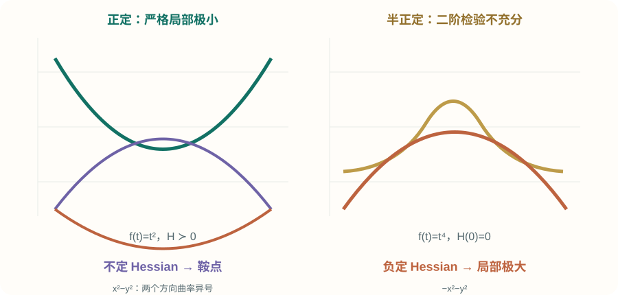

# 2.1 如何识别一个局部极小点

梯度为零并不代表已经找到极小值。要判断一个驻点究竟是极小、极大还是鞍点，需要把一阶条件、Hessian 曲率与更高阶反例放在一起看。

## 一个驻点为什么还不够

设目标函数 f:ℝⁿ→ℝ。点 x* 是局部极小点，意思是存在半径 r>0，使得所有满足 ||x−x*||<r 的点都不比 x* 更好。这个定义只比较一个邻域，不要求它是全空间最好的点。

$$
f(x^*)\le f(x)\quad\text{whenever }\|x-x^*\|<r
$$

若邻域内除 x* 外都严格更差，则称严格局部极小。若比较范围扩大到整个定义域，才是全局极小。无约束问题中的“局部”也默认 x* 是定义域的内点；边界点需要改用可行方向条件。

## 一阶必要条件：梯度必须为零

如果 f 在内点 x* 可微，而且 x* 是局部极小点，那么沿任意方向 v 的一维函数 φ(t)=f(x*+tv) 在 t=0 处有局部极小，因此 φ'(0)=∇f(x*)ᵀv=0。由于 v 任意，得到梯度为零。

$$
\nabla f(x^*)=0
$$

这个条件只排除了仍能沿某个方向一阶下降的点。它同样可能出现在局部极大点、鞍点，甚至平坦的高阶极小点。

## 二阶条件：Hessian 告诉我们曲率

若 f 二次连续可微，Hessian ∇²f(x*) 汇总了所有方向的二阶曲率。对局部极小点，任意方向 v 的二阶方向导数不能为负；因此 Hessian 必须半正定。

$$
v^\mathsf T\nabla^2 f(x^*)v\ge0\quad\text{for every }v
$$

反过来，如果 Hessian 正定，所有非零方向的二阶曲率都为正，那么在足够小的邻域里，二阶项压过高阶余项，x* 是严格局部极小点。半正定只是一条必要条件，不能直接当作充分条件。

$$
\nabla f(x^*)=0,\quad \nabla^2 f(x^*)\succ0\ \Longrightarrow\ x^*\text{ is a strict local minimum}
$$

## 四种曲率结构，四种结论



*正定 Hessian 给出严格局部极小的充分条件；半正定还需检查高阶项；不定 Hessian 产生鞍点；负定 Hessian 对应严格局部极大。*

- **正定：** f(x,y)=x²+y² 在原点有唯一严格全局极小点。
- **半正定但结论不明：** f(x,y)=x⁴+y² 在原点仍是严格极小，但 Hessian 在原点有一个零特征值；仅凭二阶检验无法证明。
- **不定：** f(x,y)=x²−y² 在原点沿 x 轴上升、沿 y 轴下降，是鞍点。
- **负定：** f(x,y)=−x²−y² 在原点有严格局部极大。

> Hessian 正定只保证严格局部极小，不自动保证全局最优。只有再加入凸性等全局结构，才能把局部结论升级为全局结论。

## 交互：改变 Hessian 的两个特征值

把两个滑块看作某个驻点 Hessian 的两个特征值。它们只描述二阶曲率，不包含三阶、四阶项。拖动两个值，观察二阶判别结果；若出现零特征值，仍须检查更高阶项。

**交互实验：** 半正定或半负定且含零特征值时，二阶判别本身不作最终结论。 控件：特征值 λ₁（-2–2）；特征值 λ₂（-2–2）。

## Python：用特征值检查二维 Hessian

下面的程序直接计算对称 2×2 Hessian 的两个特征值，并把正定、负定、不定和半正定/近奇异情形区分开。它是二维教学检查，不是任意维数的特征值求解器。

```python
"""Classify stationary points with exact 2x2 Hessian eigenvalues.

A Hessian test is a local test. A semidefinite Hessian alone is inconclusive.
"""
from math import sqrt, isclose

def eigenvalues_symmetric_2x2(a: float, b: float, c: float) -> tuple[float, float]:
    """Eigenvalues of [[a,b],[b,c]], returned in ascending order."""
    radius = sqrt((a - c) ** 2 + 4.0 * b ** 2)
    return ((a + c - radius) / 2.0, (a + c + radius) / 2.0)

def classify_hessian(a: float, b: float, c: float, tol: float = 1e-10) -> str:
    lo, hi = eigenvalues_symmetric_2x2(a, b, c)
    if lo > tol:
        return "positive definite: strict local minimum is certified"
    if hi < -tol:
        return "negative definite: strict local maximum is certified"
    if lo < -tol and hi > tol:
        return "indefinite: saddle point is certified"
    return "semidefinite or nearly singular: second-order test is inconclusive"

if __name__ == "__main__":
    cases = {
        "x^2+y^2": (2.0, 0.0, 2.0),
        "x^4+y^2 at the origin": (0.0, 0.0, 2.0),
        "x^2-y^2": (2.0, 0.0, -2.0),
        "-x^2-y^2": (-2.0, 0.0, -2.0),
    }
    for name, hessian in cases.items():
        print(name, "->", classify_hessian(*hessian))
    assert classify_hessian(2.0, 0.0, 2.0).startswith("positive definite")
    assert classify_hessian(0.0, 0.0, 2.0).startswith("semidefinite")
    assert classify_hessian(2.0, 0.0, -2.0).startswith("indefinite")
    assert classify_hessian(-2.0, 0.0, -2.0).startswith("negative definite")
    assert isclose(eigenvalues_symmetric_2x2(2.0, 1.0, 2.0)[0], 1.0)
```

**练习：**证明 f(x,y)=x⁴+y² 在原点有严格局部极小值，但 Hessian 仅半正定。指出哪一个方向的二阶项消失，以及哪个更高阶项仍保证函数上升。

## 使用这些条件时要留意什么

- 若函数不可微，一阶梯度条件不适用，需要使用次梯度或方向导数。
- 若 x* 位于约束边界，不能沿所有方向任意移动，应只检查可行方向。
- 若 Hessian 半正定但不正定，结论可能是极小、极大、鞍点或更复杂的高阶平坦结构。
- 数值计算中，特征值接近零时分类会对容差和舍入误差敏感。

**出处：** Jorge Nocedal and Stephen J. Wright, *Numerical Optimization*, 2nd ed., Springer, 2006. Chapter 2, subsection “Recognizing a Local Minimum”, pp. 14–16. [出版社书目](https://doi.org/10.1007/978-0-387-40065-5)。本文的数值例子与程序独立构造。

[返回课程首页](../index.html)
