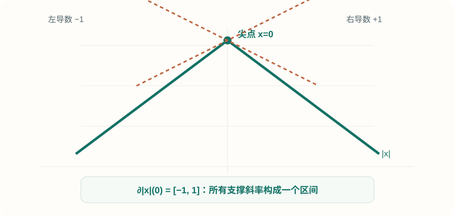

# 2.1 非光滑问题：没有梯度，仍然可以优化

绝对值函数在尖点处不可微，但它仍有清晰的最优解。次梯度把单个导数扩展成一个集合，使稀疏正则化等问题仍能使用严谨的最优性条件。

## 尖点为什么让普通梯度失效

考虑 f(x)=|x|。当 x>0 时导数为 1；当 x<0 时导数为 −1；在 x=0 左右斜率不相等，所以普通导数不存在。可是函数在零点达到全局最小值，且问题并没有因此变得不可求解。

$$
f'_-(0)=-1,\qquad f'_+(0)=1
$$



*在尖点处不存在唯一切线斜率；所有位于 −1 与 1 之间的斜率都构成凸次梯度。*

## 次梯度：用一个区间替代一个斜率

对凸函数 f，向量 g 是 x 处的次梯度，如果对定义域中的每个 y 都满足 f(y)≥f(x)+gᵀ(y−x)。所有这样的 g 组成次微分集合 ∂f(x)。对一元绝对值函数，尖点处的次微分正好是区间 [−1,1]。

$$
\partial |x|=\begin{cases}\{-1\},&x<0\\\left[-1,1\right],&x=0\\\{1\},&x>0\end{cases}
$$

在可微点，次微分退化为只有一个元素的集合 {∇f(x)}。因此它并不是与普通微积分相互冲突的另一套规则，而是把光滑与尖点情况统一起来。

## 凸问题的一阶最优性条件

若 f 是凸函数，那么 x* 是全局最小点，当且仅当零向量属于 x* 处的次微分。这是凸优化中非常实用的 Fermat 条件。它不要求尖点处存在普通梯度。

$$
0\in\partial f(x^*)\quad\Longleftrightarrow\quad x^*\in\arg\min_x f(x)
$$

注意这个充要结论依赖凸性。对一般非凸、不可微函数，某种广义驻点条件通常只能提供必要性或局部信息，不能直接证明全局最优。

## L1 正则化如何把小系数压到零

考虑标量模型：用参数 x 拟合观测 y，同时对 |x| 收取 λ 倍惩罚。平方项希望 x 接近 y，绝对值惩罚希望 x 接近零；两者竞争产生软阈值解。

$$
\min_x\ \frac12(x-y)^2+\lambda|x|,\qquad \lambda\ge0
$$

$$
x^*=\operatorname{sign}(y)\max(|y|-\lambda,0)
$$

例如 y=1.5、λ=0.5 时 x*=1.0；若 |y|≤λ，解直接变成零。这个简单标量模型展示了 L1 惩罚产生稀疏性的机制，但多维回归中变量相关性会使各坐标不能总是独立地软阈值化。

## 交互：观测值与正则强度

移动 y 和 λ，查看最优参数如何从零开始、超过阈值后再随观测值线性增长。

**交互实验：** 解为 sign(y)·max(|y|−λ,0)；λ 越大，更多小幅度信号会被压为零。 控件：观测值 y（-3–3）；正则强度 λ（0–2）。

## Python：次微分与软阈值

代码实现绝对值函数的次微分区间，并直接计算软阈值解。断言在若干候选点附近检查目标值没有更低值；这是有限点检查，解析最优性仍来自凸次梯度条件。

```python
"""Subgradients and the exact soft-threshold solution of a 1-D L1 model."""
from math import isclose

def subgradient_abs(x: float) -> tuple[float, float]:
    if x < 0.0:
        return (-1.0, -1.0)
    if x > 0.0:
        return (1.0, 1.0)
    return (-1.0, 1.0)

def soft_threshold(y: float, lam: float) -> float:
    if lam < 0.0:
        raise ValueError("lambda must be nonnegative")
    if y > lam:
        return y - lam
    if y < -lam:
        return y + lam
    return 0.0

def objective(x: float, y: float, lam: float) -> float:
    return 0.5 * (x - y) ** 2 + lam * abs(x)

if __name__ == "__main__":
    lam = 0.5
    cases = (-2.0, -0.25, 0.25, 2.0)
    for y in cases:
        x = soft_threshold(y, lam)
        print(f"y={y:5.2f} -> x*={x:5.2f}, objective={objective(x, y, lam):.4f}")
    assert subgradient_abs(0.0) == (-1.0, 1.0)
    assert isclose(soft_threshold(2.0, 0.5), 1.5)
    assert isclose(soft_threshold(-2.0, 0.5), -1.5)
    assert isclose(soft_threshold(0.25, 0.5), 0.0)
    for y in (-3.0, -1.0, 0.0, 1.0, 3.0):
        x_star = soft_threshold(y, lam)
        for candidate in (x_star - 0.1, x_star, x_star + 0.1):
            assert objective(x_star, y, lam) <= objective(candidate, y, lam) + 1e-12
```

**练习：**求解 minₓ ½(x+2)²+0.75|x|。先判断解的符号，再写出对应的一阶次梯度方程。

## 边界与常见混淆

- 凸次微分与 Clarke 广义梯度的定义背景不同，不能在所有非凸问题中不加说明地互换。
- L1 正则项不可微，但目标可以是凸的；不可微不等于非凸。
- 对非光滑目标直接套用普通梯度下降，可能在尖点附近出现错误的梯度估计。
- 实际算法常用近端梯度、坐标下降或 bundle 方法；软阈值是特定模型的近端算子，不是任意非光滑问题的通用解法。

**出处：** Jorge Nocedal and Stephen J. Wright, *Numerical Optimization*, 2nd ed., Springer, 2006. Chapter 2, subsection “Nonsmooth Problems”, pp. 17–18. [出版社书目](https://doi.org/10.1007/978-0-387-40065-5)。本文的数值例子与程序独立构造。

[返回课程首页](../index.html)
