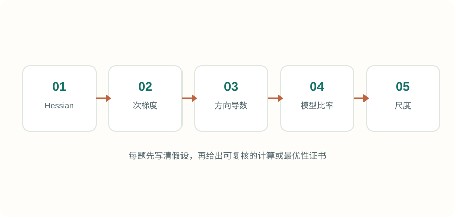

# 2.2 无约束优化练习：从条件到可验证答案

用五道原创小题检查驻点分类、非光滑最优性、下降方向、信赖域模型与变量缩放。每题都给出推导、数值检查和适用边界。

## 先写假设，再写结论

这些题目均为独立构造的教学问题，不是教材习题的复制。除非题目特别说明，变量属于实数空间，目标函数按最小化理解。每道题先给出足够的定义与数据，再要求一个可核对的结果。



*练习从最优性条件开始，逐步进入算法方向、局部模型与数值几何。*

## 题一：求驻点并证明其为全局最小

给定 f(x,y)=x²+xy+y²−4x。求驻点，并判断它是局部极小、局部极大还是鞍点。若能证明全局最优，请给出理由。

$$
\nabla f=\begin{bmatrix}2x+y-4\\x+2y\end{bmatrix},\qquad H=\begin{bmatrix}2&1\\1&2\end{bmatrix}
$$

**展开解答：** 解方程 2x+y=4、x+2y=0，得到 x*=8/3、y*=−4/3。H 的特征值为 1 和 3，故 H 正定；目标是严格凸二次函数，驻点是唯一全局最小点。代回得到 f(x*)=−16/3。

## 题二：L1 惩罚下的最优系数

求解 minₓ ½(x−1.5)²+0.5|x|。写出次梯度最优性条件，并判断最优系数是否为零。

$$
0\in x-y+\lambda\partial|x|
$$

**展开解答：** 这里 y=1.5、λ=0.5。由于 y>λ，软阈值解 x*=y−λ=1。此时 x*>0，次梯度为 {1}，代入得到 x−1.5+0.5=0。

## 题三：判断方向是否下降

在某点梯度为 g=(2,−1)ᵀ。判断 p₁=(−1,−1)ᵀ 与 p₂=(1,2)ᵀ 是否是严格下降方向。

$$
D f(x)[p]=g^\mathsf Tp
$$

**展开解答：** gᵀp₁=2(−1)+(−1)(−1)=−1，因此 p₁ 是下降方向。gᵀp₂=2(1)+(−1)(2)=0，因此 p₂ 不是严格下降方向；一阶信息为零不代表函数沿整条射线恒定。

## 题四：计算信赖域模型比率

取 f(x)=eˣ，当前点 xₖ=0，二阶模型 m(p)=1+p+½p²。若信赖域半径为 0.25，采用 p=−0.25，计算实际下降、预测下降与 ρ。

$$
\rho=\frac{1-e^{-0.25}}{1-(1-0.25+0.5(0.25)^2)}
$$

**展开解答：** 预测下降为 0.25−0.5×0.25²=0.21875。实际下降为 1−e^(−0.25)≈0.221199。故 ρ≈1.0112，大于一，说明真实目标在这一步的下降略好于二阶模型预测。

## 题五：用变量缩放改善条件数

给定 H=diag(25,1)，作变量变换 x=Dz，D=diag(s,1)。求使 DᵀHD=I 的正缩放 s，并计算原始条件数与缩放后条件数。

$$
D^\mathsf THD=\operatorname{diag}(25s^2,1)
$$

**展开解答：** 令 25s²=1，取正值 s=0.2。原始条件数 κ₂(H)=25；变换后 Hessian 为单位矩阵，条件数为 1。

## 交互：选择一题查看核心答案

用滑块切换五道题的关键数值结果。完整推导仍应先独立完成，再展开每题的解答。

**交互实验：** 每个答案对应上方同编号的题目与解析。 控件：题目编号（1–5）。

## Python：把五个结果放进一个回归检查

代码独立计算五道题的关键结果，并用断言检查解析答案。它验证的是这些特定教学例子，不是通用的局部最优性或信赖域求解器。

```python
"""Numerically verify five original exercises from unconstrained optimization."""
from math import exp, isclose

def soft_threshold(y: float, lam: float) -> float:
    return max(-lam, min(lam, y)) * -1.0 + y if abs(y) > lam else 0.0

def exercise_results() -> dict[str, float]:
    # 1) Stationary point of x^2 + xy + y^2 - 4x.
    x, y = 8.0 / 3.0, -4.0 / 3.0
    value = x*x + x*y + y*y - 4.0*x
    # 2) L1-regularized scalar least squares, y=1.5, lambda=0.5.
    sparse_solution = soft_threshold(1.5, 0.5)
    # 3) Directional derivative for g=(2,-1), p=(-1,-1).
    slope = 2.0*(-1.0) + (-1.0)*(-1.0)
    # 4) Trust-region ratio for exp(x), x=0, p=-0.25.
    predicted = 0.25 - 0.5 * 0.25**2
    actual = 1.0 - exp(-0.25)
    ratio = actual / predicted
    # 5) Scale H=diag(100,1) by D=diag(0.1,1).
    scaled_condition = max(100.0*0.1**2, 1.0) / min(100.0*0.1**2, 1.0)
    return {"x": x, "y": y, "quadratic_minimum": value,
            "sparse_solution": sparse_solution, "directional_slope": slope,
            "trust_ratio": ratio, "scaled_condition": scaled_condition}

if __name__ == "__main__":
    result = exercise_results()
    for name, value in result.items():
        print(f"{name}: {value:.8f}")
    assert isclose(result["x"], 8.0/3.0)
    assert isclose(result["y"], -4.0/3.0)
    assert isclose(result["quadratic_minimum"], -16.0/3.0)
    assert isclose(result["sparse_solution"], 1.0)
    assert isclose(result["directional_slope"], -1.0)
    assert result["trust_ratio"] > 1.0
    assert isclose(result["scaled_condition"], 1.0)
```

**建议：**先遮住所有解答独立推导，再运行代码。若自己的答案与程序不同，先检查变量顺序、方向导数符号、目标值与模型预测值是否混淆。

**出处：** Jorge Nocedal and Stephen J. Wright, *Numerical Optimization*, 2nd ed., Springer, 2006. Chapter 2, “Fundamentals of Unconstrained Optimization”, exercises, pp. 27–29. 本页题目为原创练习。 [出版社书目](https://doi.org/10.1007/978-0-387-40065-5)。本文的数值例子与程序独立构造。

[返回课程首页](../index.html)
