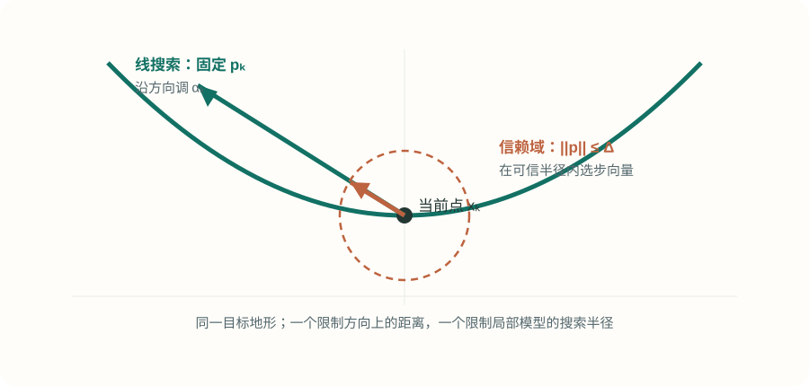

# 2.2 线搜索与信赖域：两种全局化策略

局部模型给出下一步往哪里走，但模型在多大范围内可信？线搜索固定方向再选距离；信赖域先限制模型可信的半径，再在其中寻找步向量。

## 从当前点构造下一步

在无约束最小化 minₓ f(x) 中，算法从当前点 xₖ 计算一个候选移动，再得到 xₖ₊₁。一个通用写法是 xₖ₊₁=xₖ+sₖ。关键设计问题是如何选 sₖ，以及如何避免局部近似把算法带到不可靠的区域。

$$
x_{k+1}=x_k+s_k
$$

线搜索把移动拆成方向 pₖ 和标量步长 αₖ；信赖域方法则直接在一个有界区域内选择向量 sₖ。两者都属于全局化策略：它们控制局部算法在实际目标函数上的行为。

## 策略一：固定方向，沿线寻找步长

线搜索先选一个下降方向 pₖ，再考虑一维函数 φₖ(α)=f(xₖ+αpₖ)，最后选择 αₖ>0。方向决定沿哪条射线走，步长决定在这条射线上走多远。

$$
\phi_k(\alpha)=f(x_k+\alpha p_k),\qquad x_{k+1}=x_k+\alpha_kp_k
$$

若 pₖ 是下降方向，则 φₖ'(0)=∇f(xₖ)ᵀpₖ<0。精确线搜索会最小化 φₖ(α)，但每轮求得精确最小值通常太贵，因此实践中多用满足充分下降与曲率要求的非精确线搜索。

## 策略二：限制局部模型的可信半径

信赖域方法在 xₖ 周围构造局部模型 mₖ(s)，常用二次 Taylor 近似。它不要求模型在整个空间都准确，只要求在当前半径 Δₖ 内足够有用，然后求解一个带范数约束的小问题。

$$
\min_s m_k(s)\quad\text{subject to }\|s\|\le\Delta_k
$$

若实际目标与模型预测一致，可以扩大半径；若模型预测与实际表现差距很大，就缩小半径或拒绝这一步。这里的半径不是变量的物理边界，而是算法对局部模型可信程度的控制。

## 同一个二次目标，两种步子



*在线搜索中先定方向 pₖ，再调 αₖ；在信赖域中，候选步必须位于半径 Δₖ 的球内。*

取 f(x)=4x²，当前点 x₀=1，梯度为 8。线搜索选择 p=−8 并用 α=1/8，位移 αp=−1，直接到达零点。信赖域若半径 Δ=0.4，则步长只能取 p=−0.4，更新到 x=0.6。

这不是说线搜索一定比信赖域好；它只说明两种策略施加约束的位置不同。高维、非凸、Hessian 不定或方向质量差时，两者的实际表现会明显不同。

## 交互：分别改变 α 与 Δ

固定 f(x)=4x²、x₀=1、线搜索方向 p=−8。移动 α 和 Δ，比较两种策略更新后的函数值。

**交互实验：** 线搜索位移为 −8α；本例的信赖域二次子问题位移为 −min(Δ,1)。 控件：线搜索步长 α（0.02–0.2）；信赖域半径 Δ（0.1–1）。

## Python：两个子问题的可复核对照

示例函数是严格凸二次函数，因此两个策略的模型都精确。代码比较精确线搜索步长与受半径限制的信赖域步；它不实现一般维度的线搜索或信赖域求解器。

```python
"""Compare line search and a 1-D trust-region subproblem on one quadratic."""
from math import isclose

def f(x: float) -> float:
    return 4.0 * x * x

def model(x: float, p: float) -> float:
    # Exact quadratic model at x for this objective.
    gradient = 8.0 * x
    hessian = 8.0
    return f(x) + gradient * p + 0.5 * hessian * p * p

if __name__ == "__main__":
    x0 = 1.0
    gradient = 8.0
    direction = -gradient
    exact_line_alpha = 1.0 / 8.0
    line_step = exact_line_alpha * direction
    radius = 0.4
    trust_step = max(-radius, min(radius, -1.0))
    print(f"line search: alpha={exact_line_alpha:.3f}, displacement={line_step:.3f}, f={f(x0+line_step):.3f}")
    print(f"trust region: radius={radius:.3f}, displacement={trust_step:.3f}, f={f(x0+trust_step):.3f}")
    assert isclose(line_step, -1.0)
    assert isclose(f(x0 + line_step), 0.0)
    assert isclose(trust_step, -0.4)
    assert isclose(model(x0, trust_step), f(x0 + trust_step))
    assert abs(trust_step) <= radius
```

**练习：**如果方向 p 不是下降方向，线搜索会遇到什么问题？信赖域是否能在模型曲率不定时仍找到下降步？说明“模型子问题有解”和“实际目标下降”之间的区别。

**出处：** Jorge Nocedal and Stephen J. Wright, *Numerical Optimization*, 2nd ed., Springer, 2006. Chapter 2, “Overview of Algorithms”, subsection “Two Strategies: Line Search and Trust Region”, pp. 18–20. [出版社书目](https://doi.org/10.1007/978-0-387-40065-5)。本文的数值例子与程序独立构造。

[返回课程首页](../../index.html)
