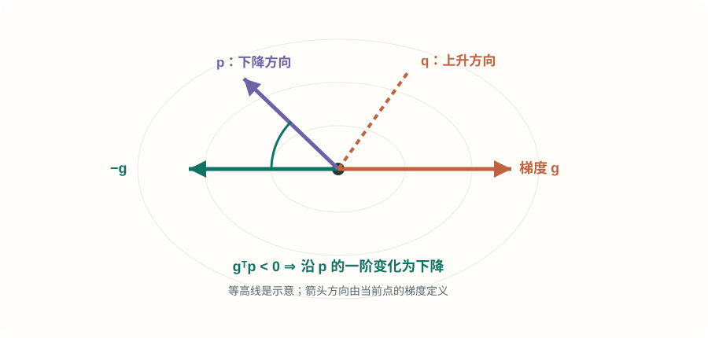

# 2.2 搜索方向：什么方向真的会下降

搜索方向不是任意的箭头。方向导数 gᵀp 决定当前点附近的变化趋势；负梯度、Newton 与拟 Newton 方向的共同目标，是构造有理论保证的下降移动。

## 方向导数决定局部趋势

设 f 可微，当前点梯度 g=∇f(x)。沿方向 p 移动很小的 α>0 时，函数值的一阶变化约为 αgᵀp。因此，gᵀp0 则局部上升；等于零时一阶信息无法判断。

$$
D f(x)[p]=\nabla f(x)^\mathsf Tp
$$

$$
\nabla f(x)^\mathsf Tp<0
$$

## 最速下降：依赖你怎样度量距离

在欧氏范数下，单位长度方向中使 gᵀp 最小的方向是 p=−g/||g||；若不限制单位长度，通常直接取 p=−g。它是当前点的一阶局部下降最快方向，但不代表整个迭代过程最快。

$$
p_{\mathrm{SD}}=-\nabla f(x)
$$

“最速”取决于所选范数。如果变量具有不同单位或尺度，欧氏距离可能不合适；改变度量会改变最速方向。这也是预条件与变量缩放的重要动机。

## Newton 与拟 Newton 方向

Newton 方向通过局部二次模型考虑曲率，求解 H p=−g。若 Hessian H 正定，则 gᵀp=−gᵀH⁻¹g<0，方向必为下降方向。若 H 不定或奇异，Newton 方程得到的方向可能不是下降方向，甚至无法稳定求解。

$$
Hp=-g,\quad H\succ0\ \Longrightarrow\ g^\mathsf Tp=-g^\mathsf TH^{-1}g<0
$$

拟 Newton 方法用近似 Hessian 或其逆矩阵构造方向。若近似矩阵保持正定，方向仍然下降；如果更新破坏正定性，算法通常需要重置、修正或改用信赖域策略。

## 角度越接近负梯度，下降分量越大



*等高线的法向由梯度给出。只要方向与负梯度夹角小于九十度，方向导数就是负数。*

若将方向 p 与负梯度 −g 的夹角记为 θ，且 p、g 均非零，则 gᵀp=−||g||||p||cosθ。因而 |θ|<90° 时严格下降，θ=90° 时一阶变化为零，超过九十度则上升。

## 交互：改变方向角

把梯度固定为 g=(1,0)，令单位方向 p=(-cosθ,sinθ)。拖动 θ，实时观察方向导数的符号。

**交互实验：** θ 处于 −90° 到 90° 之间时，方向是一阶下降方向。 控件：相对负梯度的夹角 θ（度）（-120–120）。

## Python：方向导数与 Newton 方向

程序用点积检查多个方向角，并验证正定 Hessian 下的 Newton 方向具有负方向导数。代码没有实现线搜索；它只回答方向是否值得尝试。

```python
"""Check descent directions using the directional derivative g^T p."""
from math import cos, sin, radians, isclose

def directional_derivative(gradient: tuple[float, float], direction: tuple[float, float]) -> float:
    return sum(g * p for g, p in zip(gradient, direction))

def direction_at_angle(degrees: float) -> tuple[float, float]:
    # Gradient is (1, 0); angle is measured from the negative-gradient axis.
    theta = radians(degrees)
    return (-cos(theta), sin(theta))

if __name__ == "__main__":
    gradient = (1.0, 0.0)
    for angle in (0.0, 30.0, 60.0, 90.0, 120.0):
        direction = direction_at_angle(angle)
        slope = directional_derivative(gradient, direction)
        print(f"angle={angle:5.1f}°, g^T p={slope: .4f}, descent={slope < 0}")
    assert directional_derivative(gradient, direction_at_angle(0.0)) == -1.0
    assert directional_derivative(gradient, direction_at_angle(60.0)) < 0.0
    assert isclose(directional_derivative(gradient, direction_at_angle(90.0)), 0.0, abs_tol=1e-12)
    assert directional_derivative(gradient, direction_at_angle(120.0)) > 0.0
    # For H positive definite, the exact Newton direction is a descent direction.
    g = (2.0, -1.0)
    h_diag = (2.0, 4.0)
    p_newton = (-g[0] / h_diag[0], -g[1] / h_diag[1])
    assert directional_derivative(g, p_newton) < 0.0
```

**练习：**给定 g=(2,−1)，判断 p₁=(−1,−1) 与 p₂=(1,2) 是否为下降方向。再说明 gᵀp=0 是否意味着沿该方向函数值完全不变。

## 方向质量与步长策略必须配合

- 下降方向只保证足够小的正步长会下降，不保证任意大步长都下降。
- 方向导数接近零时，理论上下降但数值上可能非常缓慢。
- Newton 方向只有在 Hessian 正定等条件下才自动下降；非凸问题需修正或全局化。
- 预条件矩阵会改变方向，也会改变“单位步长”所代表的几何尺度。

**出处：** Jorge Nocedal and Stephen J. Wright, *Numerical Optimization*, 2nd ed., Springer, 2006. Chapter 2, “Overview of Algorithms”, subsection “Search Directions for Line Search Methods”, pp. 20–24. [出版社书目](https://doi.org/10.1007/978-0-387-40065-5)。本文的数值例子与程序独立构造。

[返回课程首页](../../index.html)
