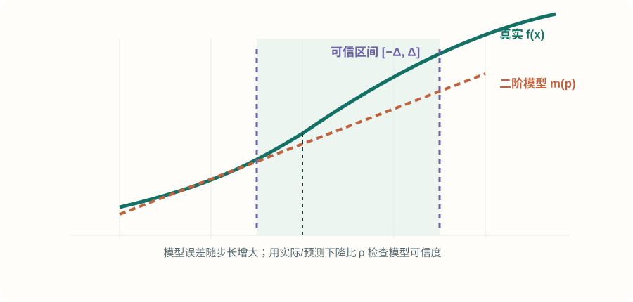

# 2.2 信赖域模型：局部近似与实际改进

二阶 Taylor 模型可以快速预测目标变化，但预测只在一定范围内可信。信赖域方法用实际下降与预测下降的比值，决定接受步子还是调整半径。

## 从 Taylor 展开得到局部模型

在当前点 xₖ，设 f 二次连续可微。对小步 s，二阶 Taylor 展开给出 f(xₖ+s)≈f(xₖ)+gₖᵀs+½sᵀBₖs，其中 gₖ 是梯度，Bₖ 常取 Hessian 或其近似。

$$
m_k(s)=f(x_k)+g_k^\mathsf Ts+\frac12s^\mathsf TB_ks
$$

若 Bₖ=∇²f(xₖ)，模型在当前点匹配函数值、一阶导数与二阶导数；但离开当前点越远，高阶余项通常越大。若 Bₖ 是近似矩阵，还会叠加模型构造误差。

## 把模型限制在可信半径内

信赖域子问题是在球形或其他范数球内最小化 mₖ(s)。半径 Δₖ>0 限定算法愿意相信当前模型的最大步长；半径并非问题本身的约束，而是算法内部的控制参数。

$$
\min_s\ m_k(s)\quad\text{s.t.}\quad\|s\|_2\le\Delta_k
$$

即使 Bₖ 不定，受限子问题仍然有最优解（连续二次函数在紧致球上取到最小值）。但精确求解子问题可能很贵，因此常见算法只求近似步，例如 Cauchy 点、Dogleg 或截断共轭梯度。

## 用实际下降与预测下降比较模型

令 sₖ 是候选步。模型预测的下降量是 mₖ(0)−mₖ(sₖ)，真实目标下降量是 f(xₖ)−f(xₖ+sₖ)。两者的比值 ρₖ 用来评价模型对这一步的预测是否可信。

$$
\rho_k=\frac{f(x_k)-f(x_k+s_k)}{m_k(0)-m_k(s_k)}
$$

- ρₖ 很小或为负：实际下降比预测差，通常拒绝步子并缩小 Δₖ。
- ρₖ 处于中间区间：模型尚可，接受或保留半径。
- ρₖ 接近 1 且步子触及边界：模型预测准确，可考虑扩大 Δₖ。

> 上面的更新策略是常见的阈值规则，不是唯一参数化。若预测下降非正，ρₖ 不应直接计算；应先检查模型步是否有效。

## 指数函数上的一个可复核例子

取 f(x)=eˣ，当前点 xₖ=0。此时 f(0)=1、f'(0)=1、f''(0)=1，所以二阶模型 m(p)=1+p+½p²。若 Δ=0.5，模型在区间内的最小点为 p=−0.5。



*绿色曲线是真实指数函数，橙色虚线是二阶模型；阴影表示当前模型被信赖的局部区域。*

真实下降为 1−e⁻⁰·⁵≈0.3935，预测下降为 1−(1−0.5+0.125)=0.375，因此 ρ≈1.049。比值大于一说明真实目标比模型预测下降得更多，并不违反信赖域条件。

## 交互：调整信赖域半径

改变 Δ。模型的无约束最小步为 −1，因此受限步为 p=−min(Δ,1)。页面会显示预测下降、实际下降与 ρ。

**交互实验：** 示例固定 f(x)=eˣ、xₖ=0，二阶模型 m(p)=1+p+½p²。 控件：信赖域半径 Δ（0.05–1.5）。

## Python：计算实际/预测下降比

程序对不同半径计算模型步和 ρ，并检查步长始终在信赖域内、预测下降为正。它是一个一维解析例子，不是通用的信赖域子问题算法。

```python
"""Evaluate a trust-region quadratic model and its actual/predicted ratio."""
from math import exp, isclose

def objective(x: float) -> float:
    return exp(x)

def model(p: float) -> float:
    # Second-order Taylor model at x=0: f(0) + f'(0)p + 1/2 f''(0)p^2.
    return 1.0 + p + 0.5 * p * p

def trust_step(radius: float) -> float:
    # The unconstrained model minimizer is -1; project it onto [-radius, radius].
    return -min(radius, 1.0)

def reduction_ratio(radius: float) -> float:
    p = trust_step(radius)
    predicted = model(0.0) - model(p)
    actual = objective(0.0) - objective(p)
    if predicted <= 0.0:
        raise ValueError("the model step must predict positive reduction")
    return actual / predicted

if __name__ == "__main__":
    for radius in (0.1, 0.25, 0.5, 1.0, 1.5):
        p = trust_step(radius)
        print(f"Delta={radius:.2f}, p={p:.2f}, rho={reduction_ratio(radius):.6f}")
        assert abs(p) <= radius
        assert reduction_ratio(radius) > 0.0
    assert isclose(trust_step(0.25), -0.25)
    assert isclose(trust_step(1.5), -1.0)
    assert reduction_ratio(0.5) > 1.0
```

**练习：**解释为什么当 ρ1，是否意味着模型一定在整个信赖域内准确？

**出处：** Jorge Nocedal and Stephen J. Wright, *Numerical Optimization*, 2nd ed., Springer, 2006. Chapter 2, “Overview of Algorithms”, subsection “Models for Trust-Region Methods”, pp. 25–26. [出版社书目](https://doi.org/10.1007/978-0-387-40065-5)。本文的数值例子与程序独立构造。

[返回课程首页](../../index.html)
