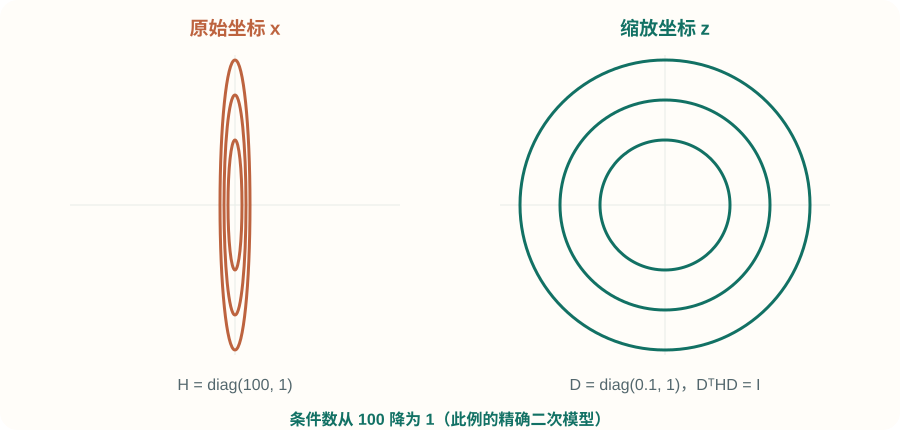

# 2.2 尺度变换：让优化问题更容易数值求解

当变量的单位和典型数量级差异很大时，等高线会变得狭长，算法容易走出锯齿路径。合理的变量缩放能改善几何条件，但不能替代模型本身的分析。

## 同一问题中的变量可能有不同单位

假设 x₁ 表示以米计的距离，x₂ 表示以微秒计的时间。直接用欧氏距离比较两个变量的变化，隐含了单位可以互换的假设。数值优化算法会因此把某个变量的巨大数值尺度误当成几何上的重要性。

缩放先选择一组无量纲或典型量级接近的坐标 z，再通过 x=Dz 映射回原变量。若 D 是可逆的正对角矩阵，这只是一个坐标变换，不改变原问题的最优决策。

## 变量变换怎样影响梯度与 Hessian

令 x=Dz，并定义新坐标下的目标 F(z)=f(Dz)。链式法则说明梯度和 Hessian 都会被 D 左右变换。若 D 为对角缩放矩阵，尺度选择就会改变二阶曲率的特征值分布。

$$
\nabla_zF(z)=D^\mathsf T\nabla_xf(Dz),\qquad\nabla_z^2F(z)=D^\mathsf T\nabla_x^2f(Dz)D
$$

正比例缩放不会改变最优点在原空间中的含义，却可能显著改变 Hessian 的条件数、线搜索步长以及信赖域球在原变量中的形状。

## 一个把椭圆变成圆的例子

考虑 f(x)=½(100x₁²+x₂²)，其 Hessian 为 diag(100,1)，二范数条件数为 100。取 x₁=0.1z₁、x₂=z₂，即 D=diag(0.1,1)，新 Hessian 变成单位矩阵，条件数降为 1。

$$
H=\begin{bmatrix}100&0\\0&1\end{bmatrix},\quad D=\begin{bmatrix}0.1&0\\0&1\end{bmatrix},\quad D^\mathsf THD=I
$$



*在这个对角二次例子里，缩放把狭长椭圆等高线变为圆；条件数从 100 变成 1。*

这是一个经过精确设计的教学例子，不意味着任意问题都能用单一对角缩放消除病态。若 Hessian 有强烈变量耦合，可能需要更一般的预条件或线性变换。

## 变量缩放与目标缩放不是一回事

若将目标改成 c f(x)，其中 c>0，最优点不变，梯度和 Hessian 同时乘以 c，Hessian 的条件数也不变。但是绝对梯度容差、函数值容差和数值溢出风险会变化。变量缩放改变坐标几何；目标缩放改变函数值单位。

> 不要把“梯度很小”作为唯一停止标准。目标整体乘上很小的常数，也会让梯度范数变小，却没有让解更接近最优。

## 交互：改变第一维的缩放因子

固定原 Hessian H=diag(100,1)，移动 s 使 x₁=s z₁。观察新 Hessian diag(100s²,1) 的条件数。

**交互实验：** 缩放后的条件数为 max(100s²,1)/min(100s²,1)。 控件：第一维缩放因子 s（0.05–1）。

## Python：直接计算条件数变化

程序使用对角矩阵特征值的精确比值，不需要 NumPy。对一般非对角矩阵，应计算谱条件数或使用稳定的线性代数库，而不能只看对角元素。

```python
"""Show how diagonal variable scaling changes a quadratic condition number."""
from math import isclose

def condition_number_diagonal(a: float, b: float) -> float:
    if a <= 0.0 or b <= 0.0:
        raise ValueError("this example requires positive eigenvalues")
    return max(a, b) / min(a, b)

def scaled_condition(scale_x: float) -> float:
    # x = D z, D = diag(scale_x, 1), H = diag(100, 1).
    return condition_number_diagonal(100.0 * scale_x ** 2, 1.0)

if __name__ == "__main__":
    print("original condition number:", condition_number_diagonal(100.0, 1.0))
    for scale in (1.0, 0.5, 0.2, 0.1, 0.05):
        print(f"scale_x={scale:.2f} -> condition={scaled_condition(scale):.3f}")
    assert isclose(condition_number_diagonal(100.0, 1.0), 100.0)
    assert isclose(scaled_condition(0.1), 1.0)
    assert isclose(scaled_condition(0.2), 4.0)
```

**练习：**若 H=diag(25,1)，选择哪一个 x₁=s z₁ 可以使缩放后的 Hessian 成为单位矩阵？讨论变量缩放后，原空间中的球形信赖域会变成什么形状。

**出处：** Jorge Nocedal and Stephen J. Wright, *Numerical Optimization*, 2nd ed., Springer, 2006. Chapter 2, “Overview of Algorithms”, subsection “Scaling”, p. 26. [出版社书目](https://doi.org/10.1007/978-0-387-40065-5)。本文的数值例子与程序独立构造。

[返回课程首页](../../index.html)
