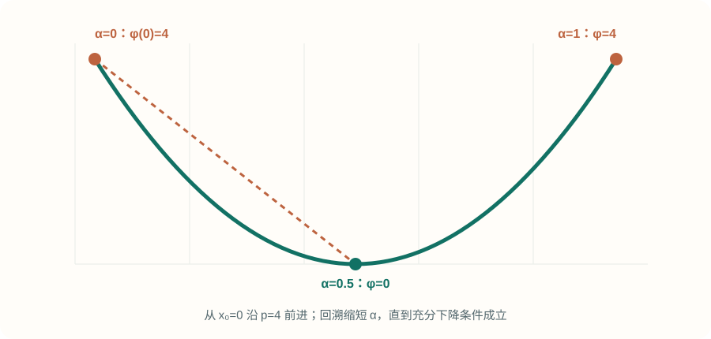

# 3.1 步长选择：沿着下降方向走多远

方向导数只说明足够小的步子是否下降，并不能决定走多远。步长条件在函数下降、曲率信息与计算成本之间折中，是线搜索算法的核心。

## 把多维问题压到一条直线上

给定当前点 xₖ 和下降方向 pₖ，线搜索考虑 φ(α)=f(xₖ+αpₖ)，只在 α>0 的一维射线上选择步长。链式法则给出 φ'(0)=∇f(xₖ)ᵀpₖ；当它为负时，足够小的正步长会带来下降。

$$
\phi(\alpha)=f(x_k+\alpha p_k),\qquad\phi'(0)=\nabla f(x_k)^\mathsf Tp_k<0
$$

精确线搜索要解 min_{α>0} φ(α)，通常每轮计算成本太高。非精确线搜索只要求步长满足一组可检查的不等式，从而在函数评估次数与理论收敛条件之间折中。

## 先看一个可以手算的例子

令 f(x)=(x−2)²，当前点 x₀=0，选 p=4。于是 φ(α)=(4α−2)²，起点函数值为 4，沿方向的初始斜率为 −16。α=0.5 正好到达最小点；α=1 则走过头，函数值又回到 4。



*沿 p=4 移动时，α=1 走过头；回溯到 α=0.5 到达最小值。实际算法通常只要求满足下降和曲率条件，不必精确求一维最小点。*

## Armijo：要求足够下降

Armijo 条件也称充分下降条件。它要求新点的函数值至少比起点下降一个与 α 成正比的量。c₁ 通常是很小的正数，且必须满足 0<c₁<1。

$$
\phi(\alpha)\le\phi(0)+c_1\alpha\phi'(0),\qquad0<c_1<1
$$

只满足 Armijo 可能接受非常小的步长。步长虽下降，却可能让算法每次只移动一点点，因此通常还会加入曲率条件来避免过小步长。

## Wolfe 与强 Wolfe：兼顾曲率

弱 Wolfe 条件在 Armijo 之外要求新点方向导数不再过于负。这里 φ'(0)<0，故右侧 c₂φ'(0) 仍为负数。常用参数满足 0<c₁<c₂<1。

$$
\phi'(\alpha)\ge c_2\phi'(0),\qquad0<c_1<c_2<1
$$

强 Wolfe 条件把曲率要求改为斜率绝对值足够小：|φ'(α)|≤c₂|φ'(0)|。它同时限制方向导数不能过于负，也不能在新点变成过大的正值。

## Goldstein：给函数值下降设上下界

Goldstein 条件通过两个不等式夹住新点函数值，既防止下降太少，也避免选择过小步长。参数 0<c<1/2。与 Wolfe 条件相比，它只使用函数值，不直接检查新点方向导数。

$$
\phi(0)+(1-c)\alpha\phi'(0)\le\phi(\alpha)\le\phi(0)+c\alpha\phi'(0)
$$

在前面的二次例子里，α=0.5 时 φ=0、φ'(0)=−16。取 c=0.2，Goldstein 的允许区间为 [−2.4,2.4]，所以该步满足条件。

## 回溯：从大步长开始逐次缩短

回溯线搜索从 α₀>0 开始检查 Armijo 条件。若不满足，就令 α←ρα，其中 0<ρ<1，重复检查。对可微目标和下降方向，在常见连续性条件下，充分小的正步长最终会满足 Armijo，因此回溯可以终止。

$$
\alpha\leftarrow\rho\alpha,\qquad0<\rho<1
$$

- 选择初始步长 α₀，常见做法是先尝试 1。
- 若 Armijo 不满足，缩短步长 α←ρα。
- 重复直到满足条件；记录函数评估次数与最终步长。

> 如果 p 不是下降方向，φ'(0)≥0，不能指望足够小的正步长满足通常的 Armijo 下降要求。实际实现还应设置最大回溯次数，避免异常输入导致无限循环。

## 交互：观察 Armijo 与 Wolfe 条件

固定 f(x)=(x−2)²、x₀=0、p=4。移动 α，页面计算 φ(α)、Armijo 上界、弱 Wolfe、强 Wolfe 与 Goldstein 是否成立。

**交互实验：** 参数 c₁=10⁻⁴、c₂=0.9、Goldstein c=0.2。 控件：候选步长 α（0.05–1）。

## Python：四种条件与有界回溯

程序使用解析函数与导数，分别检查 Armijo、弱 Wolfe、强 Wolfe、Goldstein，并将回溯循环限制为最多 100 次。它只用于这个一维示例，后续章节再讨论一般的 Wolfe 搜索算法。

```python
"""Armijo, weak/strong Wolfe, Goldstein and backtracking on a scalar line."""
from math import isclose

def f(x: float) -> float:
    return (x - 2.0) ** 2

def phi(alpha: float) -> float:
    # x0=0 and descent direction p=4.
    return f(4.0 * alpha)

def phi_prime(alpha: float) -> float:
    return 32.0 * alpha - 16.0

def armijo(alpha: float, c1: float = 1e-4) -> bool:
    return phi(alpha) <= phi(0.0) + c1 * alpha * phi_prime(0.0)

def weak_wolfe(alpha: float, c1: float = 1e-4, c2: float = 0.9) -> bool:
    return armijo(alpha, c1) and phi_prime(alpha) >= c2 * phi_prime(0.0)

def strong_wolfe(alpha: float, c1: float = 1e-4, c2: float = 0.9) -> bool:
    return armijo(alpha, c1) and abs(phi_prime(alpha)) <= c2 * abs(phi_prime(0.0))

def goldstein(alpha: float, c: float = 0.2) -> bool:
    lower = phi(0.0) + (1.0 - c) * alpha * phi_prime(0.0)
    upper = phi(0.0) + c * alpha * phi_prime(0.0)
    return lower <= phi(alpha) <= upper

def backtracking(alpha0: float = 1.0, rho: float = 0.5, c1: float = 1e-4) -> float:
    if alpha0 <= 0.0 or not 0.0 < rho < 1.0 or not 0.0 < c1 < 1.0:
        raise ValueError("require alpha0>0 and rho,c1 in (0,1)")
    alpha = alpha0
    for _ in range(100):
        if armijo(alpha, c1):
            return alpha
        alpha *= rho
    raise RuntimeError("Armijo backtracking did not terminate within 100 trials")

if __name__ == "__main__":
    selected = backtracking()
    print("alpha=1 Armijo:", armijo(1.0))
    print(f"backtracking selected alpha={selected:.6f}, phi={phi(selected):.6f}")
    print("weak Wolfe at alpha=0.5:", weak_wolfe(0.5))
    print("strong Wolfe at alpha=0.5:", strong_wolfe(0.5))
    print("Goldstein at alpha=0.5:", goldstein(0.5))
    assert not armijo(1.0)
    assert isclose(selected, 0.5)
    assert armijo(selected)
    assert weak_wolfe(0.5)
    assert strong_wolfe(0.5)
    assert goldstein(0.5)
```

**练习：**证明在 φ'(0)<0 且 φ' 连续的条件下，充分小的 α 会满足 Armijo。为什么仅凭 Armijo 条件无法保证步长不会过小？

**出处：** Jorge Nocedal and Stephen J. Wright, *Numerical Optimization*, 2nd ed., Springer, 2006. Chapter 3, Section 3.1 “Step Length”, including Wolfe, Goldstein, sufficient decrease and backtracking, pp. 31–37. [出版社书目](https://doi.org/10.1007/978-0-387-40065-5)。本文的数值例子与程序独立构造。

[返回课程首页](../index.html)
