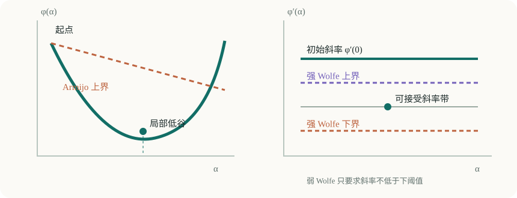

# 3.1.1 Wolfe 条件：让步长既下降又不过短

只要求函数值变小，算法可能接受几乎不动的步子；只追求大步，又可能越过有用区域。Wolfe 条件把“下降多少”和“还剩多少下降空间”放进同一套检查。



*图解：Wolfe 条件分别检查函数值充分下降与候选点方向导数。*

## 一维化：把多维目标沿搜索方向展开

在点 x_k 处，给定下降方向 p_k，满足 ∇f(x_k)^T p_k < 0。定义

$$\phi(\alpha)=f(x_k+\alpha p_k),\quad \phi'(0)=\nabla f(x_k)^T p_k<0.$$

若只要求 φ(α)<φ(0)，任意足够小的步长都可能通过，迭代可能持续取得极小改进。Wolfe 条件增加曲率检查，防止算法在仍有很大下降空间时就停止。

## 弱 Wolfe 条件

令 0<c1<c2<1。Armijo 充分下降条件与弱 Wolfe 曲率条件为

$$\phi(\alpha)\leq\phi(0)+c_1\alpha\phi'(0),$$
$$\phi'(\alpha)\geq c_2\phi'(0).$$

由于 φ'(0)<0，曲率阈值也是负数。它要求新点斜率不要仍然过度负，并不要求斜率必须转正。

## 强 Wolfe 条件

强 Wolfe 把曲率约束改成绝对值形式：

$$|\phi'(\alpha)|\leq c_2|\phi'(0)|.$$

它同时限制新斜率不能过度负、也不能过度正。因此强 Wolfe 会排除一部分已经越过一维极小点很远的候选步。

## 存在性与算法边界

若 φ 连续可微、初始方向是下降方向，且 φ 在正射线上有下界，则在 0<c1<c2<1 下，存在满足弱 Wolfe 和强 Wolfe 的步长。这个存在性结论不意味着简单的 Armijo 回溯就能找到 Wolfe 步；后者还需要处理曲率区间。

## 可手算例子

取 φ(α)=(4α−2)^2，因此 φ(0)=4、φ'(0)=−16。取 c1=10^-4、c2=0.9：
- α=0.5 到达一维极小点，斜率为 0，弱与强 Wolfe 都通过。
- α=0.99 仍满足 Armijo，且斜率 15.68 大于 -14.4，所以弱 Wolfe 通过；但 |15.68|>14.4，强 Wolfe 拒绝。

## Python 可复现检查

```python
"""Compare weak and strong Wolfe conditions on a one-dimensional line."""
def phi(alpha: float) -> float:
    return (4.0 * alpha - 2.0) ** 2

def dphi(alpha: float) -> float:
    return 32.0 * alpha - 16.0

def conditions(alpha: float, c1: float = 1e-4, c2: float = 0.9):
    if not (0.0 < c1 < c2 < 1.0):
        raise ValueError("require 0 < c1 < c2 < 1")
    f0, slope0 = phi(0.0), dphi(0.0)
    armijo = phi(alpha) <= f0 + c1 * alpha * slope0
    weak = armijo and dphi(alpha) >= c2 * slope0
    strong = armijo and abs(dphi(alpha)) <= c2 * abs(slope0)
    return armijo, weak, strong

if __name__ == "__main__":
    at_minimum = conditions(0.50)
    overshot = conditions(0.99)
    print("alpha=0.50:", at_minimum, "phi' =", dphi(0.50))
    print("alpha=0.99:", overshot, "phi' =", dphi(0.99))
    assert at_minimum == (True, True, True)
    assert overshot == (True, True, False)
    assert abs(dphi(0.99)) > 0.9 * abs(dphi(0.0))
```

## 假设与边界

Wolfe 条件要求方向为下降方向；若 φ'(0)≥0，标准不等式不再表达通常的下降线搜索问题。

## 参考文献

- Nocedal, J. & Wright, S. J. *Numerical Optimization*, 2nd ed., Springer, 2006, Section 3.1.1, pp. 33–36. [DOI](https://doi.org/10.1007/978-0-387-40065-5)
- [第二版教材 PDF（核对公式与定理定位）](https://deeplearningpku.github.io/literature/Nocedal_Wright_Numerical_optimization_v2.pdf)

本文的图解、例子与代码独立编写。