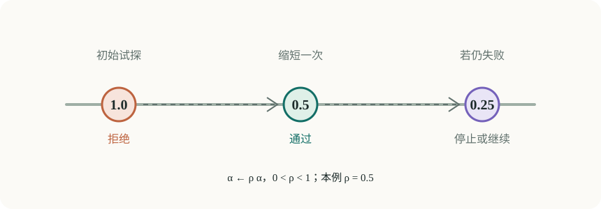

# 3.1.3 充分下降与回溯：从大步长逐次缩短

回溯线搜索不是盲目地把步长缩小，而是用一个可证明会在有限次内通过的充分下降条件，控制每次迭代的函数评估成本。
 
## 为什么只看函数值下降仍不够



*图解：回溯以几何比例缩短步长，直到满足 Armijo。*

设当前点 $x_k$、下降方向 $p_k$，并定义 $\phi(\alpha)=f(x_k+\alpha p_k)$。方向下降意味着 φ′(0)<0，因此存在足够小的正步长使函数值下降。但仅检查 φ(α)<φ(0) 过于宽松：一个极小的 α 也能通过，函数值虽下降，迭代却可能几乎停滞。

Armijo 条件把“足够下降”量化为与初始斜率和步长成正比的下降量。给定 c∈(0,1)，要求候选点落在起点切线模型的充分下降一侧。

## Armijo 条件的几何意义
$$\phi(\alpha)\leq\phi(0)+c\alpha\phi'(0),\quad 0<c<1.$$
右侧是斜率为 cφ′(0) 的直线。由于 φ′(0)<0 且 c<1，这条线比原函数在 α=0 处的切线更平缓。候选步只有在函数曲线低于该线时才接受。常用的 c 值很小，例如 10⁻⁴；这意味着只要求一小部分线性预测下降真正兑现。

> 图解：示例中 α=1 走过头而不满足 Armijo；乘以 ρ=0.5 后，α=0.5 到达一维极小点并通过。实际回溯不要求精确到达极小点。

## 回溯算法与有限终止

回溯只使用 Armijo 条件：先选初始步长 ᾱ>0，再选择缩短因子 ρ∈(0,1)。若候选步不满足条件，就令 α←ρα 并重试。Newton 与拟 Newton 方法常从 ᾱ=1 开始；最速下降或共轭梯度方法也可以使用其他初始步长。

- 输入下降方向 $p_k$、初始步长 $\bar\alpha>0$、$\rho\in(0,1)$ 和 $c\in(0,1)$。

- 计算 φ(α)，检查 Armijo 不等式。

- 若失败，缩短 $\alpha\leftarrow\rho\alpha$；若通过，接受 $\alpha_k=\alpha$。

若每次缩短比例固定为 ρ，接受步长不会比上一个被拒绝的步长小超过一个 ρ 因子。若 ρ 在固定区间 [ρ lo ,ρ hi ]⊂(0,1) 内变化，也可以保留类似的上下界控制。

## 为什么足够小的步长一定通过

因为 φ 在 0 处可微，
$$\lim_{\alpha\downarrow0}\frac{\phi(\alpha)-\phi(0)}{\alpha}=\phi'(0)<c\phi'(0).$$
最后一个严格不等式成立，是因为 φ′(0)<0 且 c<1。于是当 α 足够小时，(φ(α)−φ(0))/α 会小于 cφ′(0)，也就是 Armijo 条件成立。几何序列 $\alpha_j=\rho^j\bar\alpha$ 会趋于 0，因此在精确算术下，回溯经过有限次试探后必然遇到一个可接受步长。

实现提醒： 有限终止定理依赖下降方向、可微性和精确的条件检查。浮点程序仍应设置最大试探次数、非有限数检查和最小步长保护；这些是数值工程防护，不替代理论假设。

## 一次完整的回溯过程

取 φ(α)=(4α−2)²、φ(0)=4、φ′(0)=−16，c=10⁻⁴，ᾱ=1，ρ=0.5。第一次试探 α=1 时 φ(1)=4，而 Armijo 上界约为 3.9984，因此拒绝。第二次 α=0.5 时 φ(0.5)=0，上界约为 3.9992，因此接受。这里两次函数值试探就结束；这只是一个容易手算的示例，不代表一般问题只需两次评估。


## Python 可复现检查

```python
"""Armijo backtracking with a finite iteration guard."""
def phi(alpha: float) -> float:
    return (4.0 * alpha - 2.0) ** 2

def dphi0() -> float:
    return -16.0

def armijo(alpha: float, c: float = 1e-4) -> bool:
    return phi(alpha) <= phi(0.0) + c * alpha * dphi0()

def backtracking(alpha0: float = 1.0, rho: float = 0.5,
                 c: float = 1e-4, max_trials: int = 100):
    if alpha0 <= 0.0 or not (0.0 < rho < 1.0) or not (0.0 < c < 1.0):
        raise ValueError("require alpha0 > 0 and rho,c in (0,1)")
    alpha = alpha0
    for trials in range(1, max_trials + 1):
        if armijo(alpha, c):
            return alpha, trials
        alpha *= rho
    raise RuntimeError("backtracking exceeded max_trials")

if __name__ == "__main__":
    alpha, trials = backtracking()
    print(f"accepted alpha={alpha:.6f} after {trials} trials")
    print(f"phi(alpha)={phi(alpha):.6f}")
    assert alpha == 0.5
    assert trials == 2
    assert armijo(alpha)
    assert not armijo(1.0)
```

## 假设与边界

回溯算法只保证 Armijo 充分下降，不保证 Wolfe 曲率条件。它的有限终止依赖 φ 在起点可微且 φ′(0)<0。

## 参考文献

- Nocedal, J. & Wright, S. J. *Numerical Optimization*, 2nd ed., Springer, 2006, Section 3.1.3, “Sufficient Decrease and Backtracking”, pp. 37–38. [DOI](https://doi.org/10.1007/978-0-387-40065-5)
- [第二版教材 PDF（核对公式与定理定位）](https://deeplearningpku.github.io/literature/Nocedal_Wright_Numerical_optimization_v2.pdf)

本文的图解、数值例子与程序独立编写。
