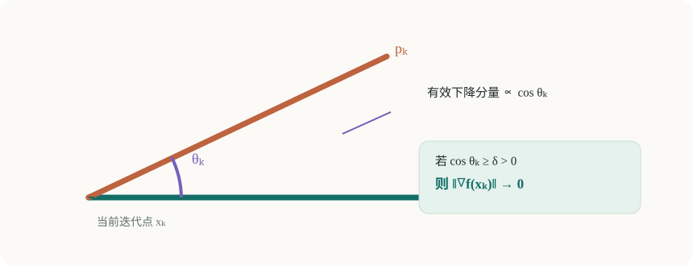

# 3.2 线搜索方法的全局收敛：Zoutendijk 条件

合适的步长还不够，搜索方向也不能长期接近梯度的正交方向。Zoutendijk 条件把每一步的有效下降累积起来，揭示全局收敛真正依赖什么。
 
## 步长合适，方向也必须合适



*图解：Zoutendijk 条件的关键角度，是搜索方向与负梯度之间的夹角。*

线搜索迭代写成 $x_{k+1}=x_k+\alpha_k p_k$。Wolfe 条件控制 α k ，但即使步长选择合理，如果 p k 越来越接近等高线切向方向，梯度也可能不再显著下降。全局收敛分析因此必须同时考察步长与方向。

> 图解：cos θ 衡量搜索方向在负梯度方向上的归一化投影。θ 越接近 90°，同样长度的搜索步越少沿最速下降方向前进。

## 方向与最速下降方向的夹角

令 g k =∇f(x k )，p k 为下降方向。定义 θ k 为 p k 与 −g k 的夹角，则 cos θ k 为正：
$$\cos\theta_k=\frac{-g_k^\top p_k}{\|g_k\|\,\|p_k\|}.$$
最速下降方向 p k =−g k 时，cos θ k =1。若搜索方向几乎与梯度正交，cos θ k 接近 0，线搜索即使找到满足 Wolfe 的 α，也无法弥补方向本身缺少有效下降分量的问题。

## Zoutendijk 定理与证明主线

假设：f 在包含初始水平集 {x:f(x)≤f(x₀)} 的开邻域内连续可微；f 在整个空间有下界；∇f 在该邻域内 Lipschitz 连续；每个 p k 都是下降方向；α k 满足 Wolfe 条件。则有
$$\sum_{k=0}^\infty\cos^2\theta_k\,\|g_k\|^2<\infty.$$
证明的关键是两条不等式。Wolfe 曲率条件给出新旧梯度差在 p k 上的投影下界；Lipschitz 梯度给出同一投影的上界。合并后可得一个步长下界，再代入 Armijo 充分下降条件，得到
$$f_{k+1}\leq f_k-\frac{c_1(1-c_2)}{L}\cos^2\theta_k\,\|g_k\|^2.$$
把每轮下降量相加，函数值始终不低于其下界，所以这些非负下降项的总和必须有限。这就是 Zoutendijk 条件。

## 从级数有限到梯度趋零

若还能保证存在 δ>0，使所有迭代都有 cos θ k ≥δ（搜索方向不会长期接近与梯度正交），那么 Zoutendijk 级数有限立即推出 ‖∇f(x k )‖→0。最速下降法满足 cos θ k =1，因此在这些假设和 Wolfe 线搜索下，梯度范数趋于零。

对 Newton-like 方向 $p_k=-B_k^{-1}g_k$，若 $B_k$ 正定，且存在 $M>0$ 使 $\|B_k\|\,\|B_k^{-1}\|\le M$，则 $\cos\theta_k\ge1/M$；因此也能得到梯度趋零。

## 全局收敛不等于收敛到极小点

这里的“全局收敛”指从所考虑的初始点出发，梯度范数趋于零，而不是保证极限点一定是局部极小点。驻点可能是鞍点或局部极大点。要得到更强结论，还需要方向策略利用负曲率信息等额外机制。

不要过度解读： Zoutendijk 条件本身只保证加权梯度平方可求和。若 cos θ k →0，梯度未必趋零；必须再加入夹角有正下界的方向条件。


## Python 可复现检查

```python
"""Illustrate why the angle lower bound matters in Zoutendijk's condition."""
def partial_sum_angle_bounded(n: int, delta: float) -> float:
    # cos(theta_k)=delta and ||g_k||=1/(k+1).
    return sum((delta ** 2) / ((k + 1) ** 2) for k in range(n))

def partial_sum_vanishing_angle(n: int) -> float:
    # ||g_k||=1 while cos(theta_k)=1/(k+1).
    return sum(1.0 / ((k + 1) ** 2) for k in range(n))

if __name__ == "__main__":
    n, delta = 100, 0.5
    bounded = partial_sum_angle_bounded(n, delta)
    vanishing = partial_sum_vanishing_angle(n)
    print("angle bounded: weighted sum =", bounded, "; gradient -> 0")
    print("angle vanishes: weighted sum =", vanishing, "; gradient stays 1")
    assert bounded < 1.0
    assert vanishing < 2.0
    assert abs(partial_sum_angle_bounded(n, delta) -
               delta ** 2 * partial_sum_vanishing_angle(n)) < 1e-12
```

## 假设与边界

Zoutendijk 定理依赖水平集邻域内的 Lipschitz 梯度、目标下界、下降方向与 Wolfe 步长。结论是梯度趋零，不是迭代点必然收敛到局部极小点。

## 参考文献

- Nocedal, J. & Wright, S. J. *Numerical Optimization*, 2nd ed., Springer, 2006, Section 3.2, “Convergence of Line Search Methods”, pp. 37–41. [DOI](https://doi.org/10.1007/978-0-387-40065-5)
- [第二版教材 PDF（核对公式与定理定位）](https://deeplearningpku.github.io/literature/Nocedal_Wright_Numerical_optimization_v2.pdf)

本文的图解、数值例子与程序独立编写。
