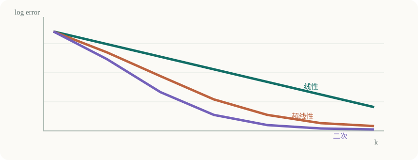

# 3.3 收敛速度：线性、超线性与二次

“算法收敛了”只回答最终是否接近解；“收敛得多快”则回答误差每轮缩小多少。不同的收敛阶，描述的是误差递减的不同规律。
 
## 为什么还要研究收敛速度



*图解：Q-线性、Q-超线性与 Q-二次误差下降轨迹。*

设算法生成迭代点 x k ，目标解为 x*。如果 ‖x k −x*‖→0，我们知道迭代点在靠近解；但这并不说明误差下降得快。比如每轮误差减半，与每轮把误差平方，二者都收敛，后者在误差足够小时会快得多。

收敛速度通常是局部概念：我们先假设迭代已经进入解附近，再研究后续误差的递推关系。它不能替代全局化策略，也不自动说明算法从任意初始点都能进入这个邻域。

> 图解：示意曲线从同一初始误差出发。线性收敛有近似固定的误差比例；超线性和二次收敛的相邻误差比例逐步趋于零。

## 用误差序列定义收敛阶

记 $e_k=\|x_k-x^*\|$，假设 $e_k>0$ 且 $e_k\to0$。常用的 Q-收敛定义是：

$$\limsup_{k\to\infty}\frac{e_{k+1}}{e_k}\le q<1.$$
$$\lim_{k\to\infty}\frac{e_{k+1}}{e_k}=0.$$
$$e_{k+1}\le C e_k^2.$$

Q-线性表示相邻误差最终以一个小于 1 的固定比例缩小；超线性表示这个比例趋于 0；二次收敛要求误差下一轮被当前误差的平方控制，C 是与 k 无关的常数。二次收敛必然超线性，但超线性不必然二次。

## 三种速度如何区分

| 收敛类型 | 典型误差递推 | 关键比值 | 几何直觉 |
|---|---|---|---|
| Q-线性 | eₖ₊₁=0.5 eₖ | 相邻比值→0.5 | 每轮按固定比例缩小 |
| Q-超线性 | eₖ₊₁=eₖ^1.5 | 相邻比值→0 | 缩小比例越来越强 |
| Q-二次 | eₖ₊₁=eₖ² | eₖ₊₁/eₖ²=1 | 局部误差快速平方缩小 | 

还要区分 Q-线性与 R-线性。Q-线性直接约束相邻误差的比值；R-线性只要求误差能被某个几何序列 Cq k 从上方控制，允许误差本身有一定振荡。除非题目明确指定，讨论收敛阶时应写清采用哪一种定义。

## 全局收敛与局部速度并不冲突

全局收敛分析回答：在给定假设下，算法从指定初始点出发是否能把梯度推向零或进入解附近？局部收敛速度分析回答：一旦迭代足够接近解，误差递推有多快？一种算法可以拥有可靠的全局化步骤，却只有线性局部速度；也可以有很快的局部 Newton 速度，却需要阻尼或信赖域才能安全地从远处开始。

阅读定理时检查： “二次收敛”通常需要足够接近解、足够光滑和非奇异 Hessian 等条件。它不是对任意初始点、任意非凸函数和任意步长的保证。


## Python 可复现检查

```python
"""Compare Q-linear, Q-superlinear and Q-quadratic error recurrences."""
def sequence(update, initial: float = 0.5, steps: int = 8):
    values = [initial]
    for _ in range(steps):
        values.append(update(values[-1]))
    return values

if __name__ == "__main__":
    linear = sequence(lambda e: 0.5 * e)
    superlinear = sequence(lambda e: e ** 1.5)
    quadratic = sequence(lambda e: e ** 2)
    print("k=4 errors:", linear[4], superlinear[4], quadratic[4])
    print("superlinear ratio:", superlinear[5] / superlinear[4])
    print("quadratic ratio:", quadratic[5] / (quadratic[4] ** 2))
    assert linear[4] == 0.03125
    assert superlinear[5] / superlinear[4] < superlinear[2] / superlinear[1]
    assert abs(quadratic[5] / (quadratic[4] ** 2) - 1.0) < 1e-12
```

## 假设与边界

本页讨论的是误差序列的局部收敛阶。对优化算法应用这些定义时，必须先确认迭代确实收敛到指定解，并满足相应局部正则性条件。

## 参考文献

- Nocedal, J. & Wright, S. J. *Numerical Optimization*, 2nd ed., Springer, 2006, Section 3.3, “Rate of Convergence”, pp. 41–42; convergence terminology summarized in Appendix A. [DOI](https://doi.org/10.1007/978-0-387-40065-5)
- [第二版教材 PDF（核对公式与定理定位）](https://deeplearningpku.github.io/literature/Nocedal_Wright_Numerical_optimization_v2.pdf)

本文的图解、数值例子与程序独立编写。
