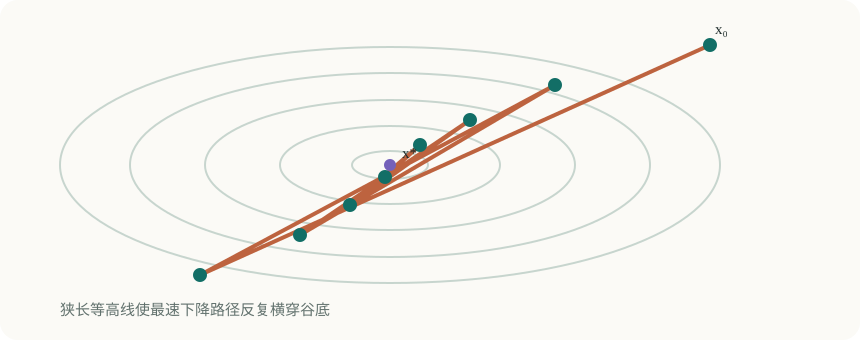

# 3.3.1 最速下降法：条件数如何拖慢收敛

最速下降每一步都沿负梯度走，看起来是最直接的方向；但在狭长椭圆等高线中，它会左右折返。精确线搜索也无法消除病态条件数带来的慢收敛。
 
## 从强凸二次函数开始



*图解：狭长等高线下的最速下降锯齿路径。*

考虑 f(x)=½xᵀQx−bᵀx，其中 Q 对称正定。梯度为 g=Qx−b，唯一极小点 x* 满足 Qx*=b。误差 e=x−x*，于是 g=Qe。这个二次模型让最速下降法的每一步都可以精确计算，并能把收敛速度与 Q 的特征值联系起来。
$$f(x)=\frac12 x^\top Qx-b^\top x,\qquad g=Qx-b,\quad Q=Q^\top\succ0.$$
Q 的特征值决定等高线椭圆的长短轴。若所有特征值相同，等高线是圆；若最大与最小特征值差距很大，等高线会变得狭长。

## 精确线搜索步长如何推导

最速下降方向 $p_k=-g_k$。沿该方向的一维函数为 f(x k −αg k )。对 α 求导并令其为零：
$$\alpha_k=\frac{g_k^\top g_k}{g_k^\top Qg_k}.$$
更新为 $x_{k+1}=x_k-\alpha_k g_k$。这一步把当前方向上的一维二次函数精确最小化；但它只在当前直线上最优，不代表下一轮方向仍指向全局解。

## 条件数给出的最坏情况界

定义 Q-能量范数 ‖e‖ Q ²=eᵀQe。对这个二次目标，f(x)−f(x*)=½‖x−x*‖ Q ²。若 Q 的最小和最大特征值分别为 λ min 、λ max ，条件数 κ=λ max /λ min ，精确线搜索的最速下降满足
$$\|e_{k+1}\|_Q^2\le\left(\frac{\kappa-1}{\kappa+1}\right)^2\|e_k\|_Q^2.$$

κ=1 时收缩因子为 0，算法一步到达解；κ 越大，因子越接近 1，最坏情况下降越慢。这个界是对强凸二次目标和精确线搜索的理论上界，不是每一步实际收缩比例的精确预测。

## 为什么会出现锯齿路径

在狭长椭圆等高线中，负梯度往往被较大曲率方向主导。精确线搜索沿该方向走到当前直线的最低点，但下一轮梯度可能转向另一条轴，于是路径在椭圆谷底两侧来回折返。条件数越大，这种锯齿越明显。

这也解释了为什么更高阶方法会尝试利用曲率信息：它们不是只沿欧氏负梯度方向移动，而是对不同特征方向进行尺度校正。


## Python 可复现检查

```python
"""Exact-line-search steepest descent on a 2-D SPD quadratic."""
def objective(x, kappa):
    return 0.5 * (x[0] ** 2 + kappa * x[1] ** 2)

def steepest_descent(kappa: float, steps: int = 10):
    if kappa < 1.0 or steps < 1:
        raise ValueError("require kappa >= 1 and steps >= 1")
    x = (1.0, 1.0)
    history = [objective(x, kappa)]
    for _ in range(steps):
        g = (x[0], kappa * x[1])
        numerator = g[0] ** 2 + g[1] ** 2
        if numerator < 1e-28:
            break
        denominator = g[0] ** 2 + kappa * g[1] ** 2
        alpha = numerator / denominator
        x = (x[0] - alpha * g[0], x[1] - alpha * g[1])
        history.append(objective(x, kappa))
    return x, history

if __name__ == "__main__":
    kappa = 25.0
    x, history = steepest_descent(kappa, 10)
    factor = ((kappa - 1.0) / (kappa + 1.0)) ** 2
    ratios = [history[i + 1] / history[i] for i in range(len(history) - 1)]
    print("x after iterations:", x)
    print("objective:", history[-1])
    print("worst-case factor:", factor)
    print("largest observed ratio:", max(ratios))
    assert all(r <= factor + 1e-12 for r in ratios)
    assert history[-1] < history[0]
```

## 假设与边界

收缩界假设 Q 对称正定且每步进行精确线搜索。一般非线性函数的局部结论还需要 Hessian 在极小点正定等假设。

## 参考文献

- Nocedal, J. & Wright, S. J. *Numerical Optimization*, 2nd ed., Springer, 2006, Section 3.3.1, “Convergence Rate of Steepest Descent”, pp. 42–44, equations (3.24)–(3.29). [DOI](https://doi.org/10.1007/978-0-387-40065-5)
- [第二版教材 PDF（核对公式与定理定位）](https://deeplearningpku.github.io/literature/Nocedal_Wright_Numerical_optimization_v2.pdf)

本文的图解、数值例子与程序独立编写。
