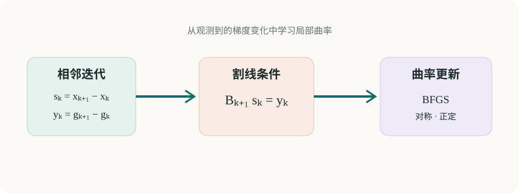

# 3.3.3 拟 Newton 法：用梯度差近似曲率

Newton 法需要 Hessian；拟 Newton 法不直接求 Hessian，而是从相邻迭代的位移与梯度变化中学习曲率，并在合适的 Wolfe 线搜索下获得超线性收敛。
 
## 为什么要近似 Hessian



*图解：割线条件把相邻迭代的位移与梯度变化联系起来。*

Newton 方向需要求解 H k p k =−g k 。当 Hessian 的计算或存储成本较高时，可以改用对称正定矩阵 B k 近似 Hessian，并定义 p k =−B k −1 g k 。只要 B k 正定，方向就是下降方向。
$p_k=-B_k^{-1}g_k.$ 
拟 Newton 更新的目标不是逐元素重建 Hessian，而是让 B k 在新获得的方向信息上足够准确。每次迭代只需保存向量 s k 和 y k ，便可构造低秩修正。

## 割线条件：让近似曲率解释梯度变化

定义步长位移 s k =x k+1 −x k ，梯度变化 y k =g k+1 −g k 。若 Hessian 在这段线段上近似常数，则 y k ≈H k s k 。拟 Newton 方法要求新矩阵满足割线方程：

$B_{k+1}s_k=y_k.$ 

这个方程只约束 B k+1 在一个方向 s k 上的作用，不能唯一决定整个矩阵。因此更新公式还需要额外准则，例如尽量少改变旧矩阵、保持对称与正定。

## BFGS 如何保持正定性

一个经典的 Hessian 近似更新是 BFGS：

$$B_{k+1}=B_k-\frac{B_ks_ks_k^\top B_k}{s_k^\top B_ks_k}+\frac{y_ky_k^\top}{y_k^\top s_k}.$$

若 B k 正定且曲率条件 y k ᵀs k >0 成立，BFGS 更新保持正定。弱 Wolfe 曲率条件给出 $y_k^\top s_k=\alpha_k(g_{k+1}-g_k)^\top p_k\ge\alpha_k(c_2-1)g_k^\top p_k>0$，因为 c_2−1<0 且 g_k^T p_k<0。因此在 B_k 正定时，BFGS 更新保持正定。

## Dennis–Moré 条件与超线性收敛

拟 Newton 法不必让 B k 在所有方向都收敛到 H*。足够的条件是：沿实际搜索方向，近似 Hessian 与真实 Hessian 的差相对步长越来越小：

$$\lim_{k\to\infty}\frac{\|(B_k-\nabla^2 f(x^*))p_k\|}{\|p_k\|}=0.$$

若 x_k 收敛到 x*、∇f(x*)=0 且 H*=∇²f(x*) 正定，方向满足 Dennis–Moré 条件，并使用 0<c1≤1/2、c1<c2<1 的 Wolfe 参数，则 α=1 在足够后期会成为可接受步长；若算法此后持续接受单位步长，迭代就超线性收敛。BFGS 是满足这一结构的经典方法，但其完整全局与局部收敛理论还依赖更多假设。

## 为什么必须优先尝试单位步长

单位步长不是装饰性的默认值。局部超线性理论说明：在接近解后，α=1 最终满足 Wolfe 条件。若线搜索每次都从一个极小的上界开始，或从不尝试 α=1，就可能主动错过 Newton 型快速收敛区间。实际拟 Newton 线搜索通常先试 α=1，若通过则直接接受，否则再括区间和缩短。

本节结论： 拟 Newton 的快速局部收敛来自“方向上的 Hessian 近似足够准确”与“最终采用单位步长”的配合；单独写出 BFGS 更新式，并不能自动推出超线性收敛。


## Python 可复现检查

```python
"""A small 2-D BFGS experiment with exact line search on a quadratic."""
def dot(a, b):
    return a[0] * b[0] + a[1] * b[1]

def matvec(A, x):
    return (A[0][0] * x[0] + A[0][1] * x[1],
            A[1][0] * x[0] + A[1][1] * x[1])

def solve2(A, b):
    det = A[0][0] * A[1][1] - A[0][1] * A[1][0]
    if det <= 0.0:
        raise ValueError("B must remain positive definite")
    return ((A[1][1] * b[0] - A[0][1] * b[1]) / det,
            (-A[1][0] * b[0] + A[0][0] * b[1]) / det)

def bfgs_demo(scale: float = 1.0):
    Q = ((4.0, 1.0), (1.0, 3.0))
    B = [[scale, 0.0], [0.0, 1.0]]
    x = (2.0, -1.0)
    records = []
    for _ in range(5):
        g = matvec(Q, x)
        if (dot(g, g) ** 0.5) < 1e-10:
            break
        p = solve2(B, (-g[0], -g[1]))
        alpha = -dot(g, p) / dot(p, matvec(Q, p))
        s = (alpha * p[0], alpha * p[1])
        x_new = (x[0] + s[0], x[1] + s[1])
        g_new = matvec(Q, x_new)
        y = (g_new[0] - g[0], g_new[1] - g[1])
        Bs = matvec(B, s)
        sBs, ys = dot(s, Bs), dot(y, s)
        if sBs <= 0.0 or ys <= 0.0:
            raise ArithmeticError("BFGS curvature condition failed")
        B_new = [[B[i][j] - Bs[i] * Bs[j] / sBs + y[i] * y[j] / ys
                  for j in range(2)] for i in range(2)]
        residual = matvec(B_new, s)
        secant_error = max(abs(residual[i] - y[i]) for i in range(2))
        det = B_new[0][0] * B_new[1][1] - B_new[0][1] * B_new[1][0]
        records.append((ys, secant_error, B_new[0][0], det))
        B, x = B_new, x_new
    return x, records

if __name__ == "__main__":
    x, records = bfgs_demo()
    print("final x:", x)
    print("curvature y^T s:", [r[0] for r in records])
    print("secant residuals:", [r[1] for r in records])
    assert len(records) >= 2
    assert all(r[0] > 0.0 for r in records)
    assert all(r[1] < 1e-10 for r in records)
    assert all(r[2] > 0.0 and r[3] > 0.0 for r in records)
```

## 假设与边界

超线性收敛需要迭代收敛到 Hessian 正定的解、方向近似满足 Dennis–Moré 条件，并在后期接受单位步长。二维精确线搜索实验只验证更新代数，不是一般非线性收敛证明。

## 参考文献

- Nocedal, J. & Wright, S. J. *Numerical Optimization*, 2nd ed., Springer, 2006, Section 3.3.3, “Quasi-Newton Methods”, pp. 46–48, Theorems 3.6–3.7. [DOI](https://doi.org/10.1007/978-0-387-40065-5)
- [第二版教材 PDF（核对公式与定理定位）](https://deeplearningpku.github.io/literature/Nocedal_Wright_Numerical_optimization_v2.pdf)

本文的图解、数值例子与程序独立编写。
