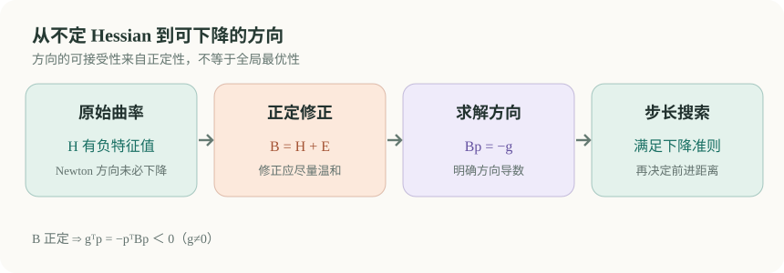

# 3.4 Hessian 修正：让 Newton 方向成为下降方向

Newton 法使用局部二次模型提供搜索方向；若 Hessian 不正定，这个方向可能不是下降方向。通过构造正定矩阵 B=H+E，可以在保持曲率信息的同时恢复下降性。

## Newton 方程为什么可能失效

给定二阶可微目标 f(x)，在当前点记 g=∇f(x)、H=∇²f(x)。普通 Newton 方向满足 Hp=−g。若 H 正定且 g 非零，便有 gᵀp=−pᵀHp＜0；这意味着沿 p 取足够小的正步长，目标下降。

若 H 含负特征值，二次模型在某些方向向下弯曲，方程给出的 p 可能正交于梯度，甚至使 gᵀp＞0。不能只因为解出了线性方程就称其为“下降方向”。

$$
B=H+E\succ0,\quad Bp=-g,\quad g^\top p=-p^\top Bp<0.
$$

## 修正 E 应解决什么问题

设计 B=H+E 时有两条要求：首先，B 必须有足够正的曲率，以免方向求解不稳定；其次，在 H 已经足够正定时，最好不修改，借此保留 Newton 法的局部快速收敛。

仅让每一轮 B 正定还不够形成完整的全局收敛论证。常用的有界修正分解性质要求：当沿迭代出现的 Hessian 序列有界时，修正矩阵的条件数也一致有界。配合目标水平集紧性及合适线搜索，才能获得梯度趋零的全局化结果。

实现方式可以是剪裁负特征值、加 τI、修正 Cholesky 分解，或者在对称不定分解的块上修正。它们改变的矩阵结构和成本并不相同。



*先修正曲率、再计算方向和步长，是线搜索 Newton 法的重要全局化思路；正定修正本身不保证目标全局有界。*

## 二维反例：普通 Newton 步没有下降性

取 f(x,y)=x²−y²，在 (1,1) 处 g=(2,−2)，H=diag(2,−2)。普通 Newton 解 pᴺ=(−1,−1)，于是 gᵀpᴺ=0；该方向不是严格下降方向。

把 H 加上 3I，可得 B=diag(5,1)，于是 p=(−0.4,2)，gᵀp=−4.8＜0。这个例子只演示方向导数的变化：f 本身向下无界，因此不能据此宣称迭代存在全局极小解。

## 下降方向与收敛定理的边界

正定 B 保证局部方向下降，却不保证 α=1 的函数值下降，也不保证在所有目标上收敛到最小值。仍需线搜索确定 α，满足 Armijo 或 Wolfe 等条件。

某些目标在解附近 Hessian 为奇异或近奇异矩阵，修正可能一直无法消失，此时局部速度不一定保留 Newton 的二次收敛。若某个方法声称“全局收敛”，务必检查紧性、光滑性、修正矩阵条件数和步长规则。

## 交互实验

固定 H=diag(2,−2)、g=(2,−2)。调整 τ，只有 τ＞2 时 B=H+τI 正定，才可以保证搜索方向严格下降。。可在对应的 [HTML 交互页面](./09_3.4._Newton’s_Method_with_Hessian_Modification.html) 调整参数。

## Python：独立计算与断言

直接求解对角线性系统，比较原 Newton 方向与正定修正方向的梯度内积。仅使用 Python 标准库。

```python
"""Hessian modification: a direction can be non-descent before correction."""
def direction(tau: float):
    g = (2.0, -2.0)
    h = (2.0 + tau, -2.0 + tau)
    if abs(h[0]) < 1e-12 or abs(h[1]) < 1e-12:
        raise ValueError("singular modified Hessian")
    p = (-g[0] / h[0], -g[1] / h[1])
    return p, sum(g[i] * p[i] for i in range(2))

if __name__ == "__main__":
    p0, slope0 = direction(0.0)
    p, slope = direction(3.0)
    print("raw Newton:", p0, "directional derivative:", slope0)
    print("modified Newton:", p, "directional derivative:", slope)
    assert p0 == (-1.0, -1.0) and slope0 == 0.0
    assert p == (-0.4, 2.0)
    assert abs(slope + 4.8) < 1e-12
```

自检：若 τ=1，B 的两个特征值是多少？为什么此时不能仅靠求解 Bp=−g 判断方向必定下降？

## 适用边界

示例目标 f=x²−y² 无下界，只用于方向反例；全局收敛需要额外的目标下界/紧性、光滑性、线搜索及有界修正性质。

## 参考依据

- Nocedal & Wright, *Numerical Optimization*, 2nd ed., Section 3.4, Algorithm 3.2 and Theorem 3.8, pp. 48–49。[出版信息](https://doi.org/10.1007/978-0-387-40065-5)；[正文 PDF](https://deeplearningpku.github.io/literature/Nocedal_Wright_Numerical_optimization_v2.pdf)。

图形与数值例子为独立构造。
