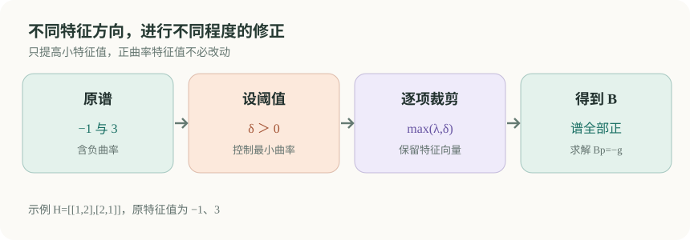

# 3.4.1 特征值修正：只修复不可靠的曲率方向

对称 Hessian 可以拆成特征向量与特征值。把过小或为负的特征值提升到正阈值，就能保留可信曲率，同时得到正定矩阵。

## 把曲率写在特征向量坐标中

若 H 对称，则存在正交矩阵 Q 和实对角矩阵 Λ，使 H=QΛQᵀ。每个特征值 λᵢ 表示沿对应单位特征向量的二阶曲率。λᵢ＞0 表示该方向上的局部二次模型向上弯曲，λᵢ＜0 则说明模型沿该方向向下弯曲。

取正阈值 δ＞0，构造 B=Q diag(max(λᵢ,δ)) Qᵀ。如此 B 的最小特征值至少为 δ，且如果 H 的全部特征值原本都大于 δ，就无需做任何修正。

$$
H=Q\Lambda Q^\top,\qquad B=Q\operatorname{diag}(\max\{\lambda_i,\delta\})Q^\top.
$$

## 在二维矩阵上逐项计算

考虑 H=[[1,2],[2,1]]，特征向量 u₊=(1,1)/√2 对应特征值 3，u₋=(1,−1)/√2 对应特征值 −1。取 δ=1，则修正特征值为 3 和 1，重建 B=[[2,1],[1,2]]。

给定 g=(1,2)，求解 Bp=−g，可得 p=(0,−1)，方向导数 gᵀp=−2。这个例子显示：修正后的方向既利用原矩阵的正曲率方向，又避免向负曲率方向求 Newton 方程。

不应把特征值“取绝对值”与“夹到 δ”混为一谈。前者会把 −100 改成 100；后者则把它改成 δ，二者求得的方向可能差别巨大。



*谱修正改变特征值，却保留对称矩阵的特征向量方向；与统一平移整个谱的 τI 策略不同。*

## δ 是稳定性与局部精度的折中

δ 很小时，B 虽然正定，仍可能病态；δ 很大时，B 的所有特征值都可能被抬高，方向更像缩放后的梯度下降，失去部分 Newton 曲率信息。

精确特征值分解在大规模稠密问题中通常昂贵，不能把这一小尺寸实现直接称为适合大规模优化的修改方法。数值算法可以使用矩阵分解等方式间接实现类似保护。

## 为什么正定性不自动保证快速收敛

修正保证 g≠0 时 gᵀp＜0，但步长大小仍需单独选择；某个大的单位步未必下降。

若解附近 H 足够正定且阈值 δ 小于其最小特征值，则修正终会消失，方向恢复普通 Newton 形式。若 Hessian 在解处接近奇异，修正可能持续存在，快速局部收敛结论不能照搬。

## 交互实验

固定 H=[[1,2],[2,1]]、g=(1,2)；改变特征值下界 δ，观察修正后的方向导数与矩阵条件数。。可在对应的 [HTML 交互页面](./10_3.4.1._Eigenvalue_Modification.html) 调整参数。

## Python：独立计算与断言

利用二维矩阵已知的正交特征向量，手动重建修正矩阵并核对正定和下降性；无需 NumPy。

```python
"""Spectral floor of a symmetric 2-by-2 Hessian."""
def spectral_step(delta: float):
    if delta <= 0:
        raise ValueError("delta must be positive")
    positive, negative = max(3.0, delta), max(-1.0, delta)
    b11 = (positive + negative) / 2
    b12 = (positive - negative) / 2
    determinant = positive * negative
    g = (1.0, 2.0)
    p = ((-b11*g[0]+b12*g[1])/determinant,
         (b12*g[0]-b11*g[1])/determinant)
    return (b11,b12),p,g[0]*p[0]+g[1]*p[1], max(positive,negative)/min(positive,negative)

if __name__ == "__main__":
    B,p,slope,kappa = spectral_step(1.0)
    print("B entries:",B,"direction:",p,"slope:",slope,"condition number:",kappa)
    assert B == (2.0,1.0)
    assert p == (0.0,-1.0)
    assert slope == -2.0 and kappa == 3.0
    assert spectral_step(0.5)[2] < 0.0
```

自检：若 δ=4，两个特征值都会提升到 4，为什么新方向不再有原始矩阵的各向异性？

## 适用边界

这里使用解析可得的二维特征分解；一般大规模矩阵的完整谱分解成本高。修正后必须再配合步长判据。

## 参考依据

- Nocedal & Wright, *Numerical Optimization*, 2nd ed., Section 3.4, Eigenvalue Modification, pp. 49–51。[出版信息](https://doi.org/10.1007/978-0-387-40065-5)；[正文 PDF](https://deeplearningpku.github.io/literature/Nocedal_Wright_Numerical_optimization_v2.pdf)。

图形与数值例子为独立构造。
