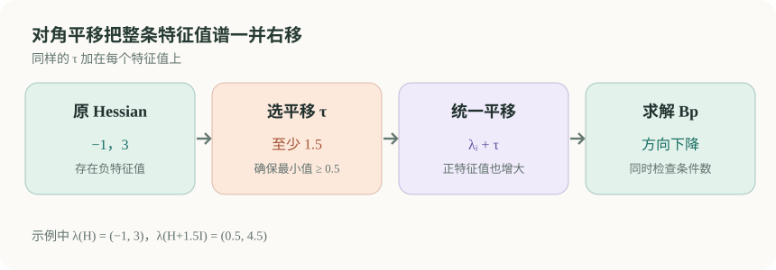

# 3.4.2 对角平移：为什么给 Hessian 加上 τI

不必显式求出所有特征值，也可以试探一个标量 τ，使 H+τI 变成正定矩阵。这个方法实现简单，却会同时改变每个特征方向上的曲率。

## 最小特征值为什么决定平移量

对称矩阵 H 的特征值为 λ₁,…,λₙ。由于 I 与 H 共用特征向量，H+τI 的特征值恰好是 λᵢ+τ。因此，要保证所有特征值至少达到 δ＞0，只需 τ≥δ−λ_min(H)，同时取 τ≥0。

实际优化中通常不能廉价地知道最小特征值，特别是在大规模矩阵上。常用策略是尝试 Cholesky 分解；失败则增大 τ，直到分解成功。数值容差和最大尝试次数仍必须设置。

$$
B=H+\tau I,\qquad\lambda_{\min}(B)=\lambda_{\min}(H)+\tau\ge\delta.
$$

## 算一个含负曲率的二次模型

取 H=diag(−1,3)、g=(1,2)、安全阈值 δ=0.5。此时 λ_min(H)=−1，最小允许平移 τ=1.5，得到 B=diag(0.5,4.5)。解 Bp=−g，得到 p=(−2,−4/9)，且 gᵀp=−26/9，确实下降。

如果将 H 的特征值分别裁剪至 δ，则得到 B_clip=diag(0.5,3)，与平移得到的 diag(0.5,4.5) 不同。前者条件数为 6，后者为 9。它们都正定，但对原始曲率的改动范围不同。

τ=1 时 B 的最小特征值为零，矩阵奇异；τ=0.5 时 B 仍不定。解法不能仅靠查看对角线上是否出现正数就宣称正定。



*平移操作只需一个标量，却会同时提高正曲率与负曲率；它通常并非对原 Hessian 的最小改动。*

## 如何利用 Cholesky 的成功与失败

简单的数值策略是：先尝试 τ=0；若分解失败，设置一个与矩阵规模相关的正初值，并将 τ 逐步放大（例如每次倍增）后重试。成功时返回正定矩阵的 Cholesky 因子，通过三角代回代解出方向。

不同于直接求特征分解，分解失败本身可成为是否需要增大修正的反馈。严格实现还需考虑舍入误差、规模归一化、试探次数与近奇异矩阵，不能以一个二维演示替代通用数值库。

## 为什么 τ 过大也不是好事

当 τ 远大于 ‖H‖ 时，(H+τI)⁻¹近似 (1/τ)I，求得的方向趋近 −g/τ，即缩放后的最速下降方向。这样虽然保持下降性，却可能大幅牺牲 Newton 的曲率加速。

一种合格的修正策略不仅追求正定，还要在 H 已足够正定时尽可能保持 E=0。若解处 Hessian 正定，过度平移会妨碍进入使用单位步长的快速局部区间。

## 交互实验

固定 H=diag(−1,3)、g=(1,2)，调整 τ。只有 τ＞1 才严格正定；界面展示特征值和下降方向。。可在对应的 [HTML 交互页面](./11_3.4.2._Adding_a_Multiple_of_the_Identity.html) 调整参数。

## Python：独立计算与断言

对已知特征值的二维矩阵计算最小安全平移，并对比统一平移与特征值裁剪的条件数。

```python
"""Shift a symmetric Hessian by tau times the identity."""
def shifted(tau: float):
    return (-1.0 + tau, 3.0 + tau)

def shifted_step(tau: float):
    a, b = shifted(tau)
    if a <= 0 or b <= 0:
        raise ValueError("H+tau*I is not positive definite")
    p = (-1.0 / a, -2.0 / b)
    slope = p[0] + 2.0*p[1]
    return p, slope, max(a,b)/min(a,b)

if __name__ == "__main__":
    tau = 1.5
    assert shifted(tau) == (0.5, 4.5)
    p, slope, kappa = shifted_step(tau)
    print("modified direction:",p,"slope:",slope,"condition:",kappa)
    assert abs(slope + 26.0/9.0) < 1e-12
    assert kappa == 9.0
    assert (3.0/0.5) == 6.0  # spectral clipping comparison
    try:
        shifted_step(0.5)
        raise AssertionError("indefinite matrix should be rejected")
    except ValueError:
        pass
```

自检：当 τ=2 时，两个修正特征值分别是多少？正定是否意味着条件数比 τ=1.5 更好？

## 适用边界

对角平移的阈值计算示例依赖已知二维特征值；大型问题中宜用数值分解、容差、次数上限与缩放策略。

## 参考依据

- Nocedal & Wright, *Numerical Optimization*, 2nd ed., Section 3.4, Adding a Multiple of the Identity, Algorithm 3.3, pp. 51–52。[出版信息](https://doi.org/10.1007/978-0-387-40065-5)；[正文 PDF](https://deeplearningpku.github.io/literature/Nocedal_Wright_Numerical_optimization_v2.pdf)。

图形与数值例子为独立构造。
