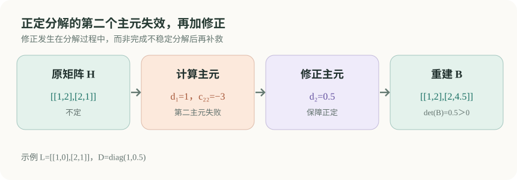

# 3.4.3 修正 Cholesky：在分解过程中保护正定性

普通 Cholesky 需要所有主元为正；遇到负主元时，修正 Cholesky 不是先硬算出不稳定因子，而是在分解过程中调整主元，并控制三角因子的大小。

## 普通 LDLᵀ 分解为何在不定矩阵上有问题

对称正定矩阵 A 可以分解为 A=LDLᵀ，其中 L 是单位下三角矩阵，D 是正对角矩阵。若未经保护就对不定矩阵执行这类分解，可能遇到零主元或负主元；零主元会使除法中断，负主元则无法对应一个正定的 LDLᵀ 因子分解。

修正 Cholesky 的核心是在计算每个主元时加入安全保护，确保 dⱼ≥δ＞0，同时限制某些三角因子元素的大小。教材给出包含参数 β 的主元规则，意图是同时约束主元下界和因子规模。

$$
d_j=\max\left(|c_{jj}|,\left(\frac{\theta_j}{\beta}\right)^2,\delta\right),\quad \theta_j=\max_{i>j}|c_{ij}|.
$$

## 二维例子：第二个主元从 −3 变为正数

设 H=[[1,2],[2,1]]。第一个主元 d₁=1，乘子 l₂₁=2。未修正的第二个主元为 c₂₂=1−l₂₁²d₁=−3，因此不能用正对角 D 表示原矩阵。

取一个教学版的保护规则 d₂=max(c₂₂,δ)，并固定 δ=0.5。可得 L=[[1,0],[2,1]]、D=diag(1,0.5)，所以 B=LDLᵀ=[[1,2],[2,4.5]]，det(B)=0.5＞0，满足正定。

当 g=(1,1) 时，解 Bp=−g 得 p=(−5,2)，方向导数 gᵀp=−3。请注意：这里用的是简化的二维主元截断，不等同于教材完整的 β 约束和对称置换算法。



*这个二维例子只演示主元修正机制；完整修改分解还需置换、控制 L 与 D 的增长和舍入误差。*

## 主元正定与数值稳定不是同一个结论

若只要求每个 dⱼ＞0，却允许 L 中的元素无限大，重建矩阵可能非常病态。教材进一步引入 β，要求 |lᵢⱼ√dⱼ|≤β，并在必要时对行列进行对称置换，减小所需修正。

例如 c₂₁=2 时，如果 δ 很小，l₂₁=2/d₁ 的增长可能导致较大的舍入误差和矩阵修正。稳定实现须根据矩阵规模设置阈值，同时保存或控制因子结构。

## 工程使用边界

这个二维分解可用标准库完成，但不能用在任意高维不定矩阵上作为工业级求解器。真正的修正 Cholesky 通常结合合适的主元策略、尺度、误差控制与失败后回退。

即使 B=LDLᵀ 正定，计算得到的下降方向也必须通过线搜索确定步长。修正越大，离原 Newton 方向可能越远。

## 交互实验

固定 H=[[1,2],[2,1]] 与 g=(1,1)，先算 d₁=1，再把第二主元从 −3 提升为 δ；观察重建 B 的行列式与方向导数。。可在对应的 [HTML 交互页面](./12_3.4.3._Modified_Cholesky_Factorization.html) 调整参数。

## Python：独立计算与断言

实现一个确定的二维 LDLᵀ 主元截断玩具模型，验证重建结果、行列式与下降方向。完整算法还需 β 限制和对称置换。

```python
"""Two-dimensional pivot modification: pedagogical LDL^T example."""
def modified_ldl(delta: float):
    if delta <= 0:
        raise ValueError("delta must be positive")
    d1 = max(1.0, delta)
    l21 = 2.0/d1
    raw2 = 1.0-l21*l21*d1
    d2 = max(raw2, delta)
    b11, b12, b22 = d1, l21*d1, l21*l21*d1+d2
    det = b11*b22-b12*b12
    p = ((-b22+b12)/det,(b12-b11)/det)
    return (d1,d2), (b11,b12,b22), p, sum(p)

if __name__ == "__main__":
    D,B,p,slope = modified_ldl(0.5)
    print("D:",D,"B:",B,"p:",p,"slope:",slope)
    assert D == (1.0,0.5)
    assert B == (1.0,2.0,4.5)
    assert p == (-5.0,2.0)
    assert slope == -3.0
    for delta in (0.25,1.0,2.0):
        d,b,p,slope = modified_ldl(delta)
        assert d[0]>0 and d[1]>0 and b[0]*b[2]-b[1]**2>0
        assert slope<0
```

自检：为什么仅把原 H 的对角线改成正数，不一定得到正定矩阵？在本例中 determinant 与 d₁d₂ 为什么相等？

## 适用边界

Python 例子是二维单步主元保护，并未实现教材的 β 因子上界、行列置换或高维稳定分解。不得视为完整修正 Cholesky 库。

## 参考依据

- Nocedal & Wright, *Numerical Optimization*, 2nd ed., Section 3.4, Modified Cholesky Factorization, equations (3.46)–(3.50), pp. 52–54。[出版信息](https://doi.org/10.1007/978-0-387-40065-5)；[正文 PDF](https://deeplearningpku.github.io/literature/Nocedal_Wright_Numerical_optimization_v2.pdf)。

图形与数值例子为独立构造。
