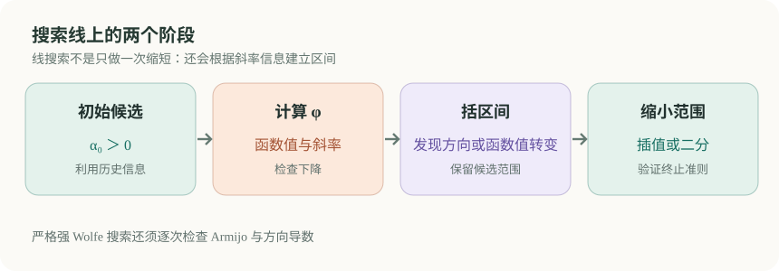

# 3.5 步长搜索算法：从试探、括区间到接受

搜索方向 p 确定以后，还要决定沿 p 前进多远。对于一般非线性目标，精确求一维极小点通常不划算；实际算法在有限次函数或方向导数评估内寻找满足下降准则的步长。

## 把多维问题沿一条方向压成一维

在当前点 xₖ，给定方向 pₖ，定义 φ(α)=f(xₖ+αpₖ)。若 ∇f(xₖ)ᵀpₖ＜0，说明 α=0 的初始斜率为负。步长搜索希望寻找 α＞0，使函数值得到充分下降，并在需要时满足 Wolfe 曲率条件。

对于 Hessian 为 Q 的强凸二次目标，沿固定方向的一维极小点有闭式解：α*=−(gᵀp)/(pᵀQp)，前提是 pᵀQp＞0。对一般非线性目标则通常需要迭代式的试探。

$$
\phi(\alpha)=f(x_k+\alpha p_k),\quad\phi'(0)=\nabla f(x_k)^\top p_k<0.
$$

## 搜索通常分为括区间与选择两个阶段

第一个阶段从一个初值试探，观察函数值是否上升、下降不足，或方向导数是否换号，以确定一个包含有用候选步长的区间。第二个阶段在已知区间中通过插值或安全二分寻找可接受的步。

不同线搜索使用不同停止条件。Armijo 回溯只要求充分下降；满足 Wolfe 或强 Wolfe 的搜索还要检查新点方向导数。即使一维函数在局部很规则，提前接受符合条件的 α 也可能比精确找到极小点更划算。



*括区间是为了控制候选步的搜索范围；Wolfe 搜索还必须验证终止条件，区间二分本身不是完整的 Wolfe 算法。*

## 一个可手算的区间压缩实验

设 φ(α)=(α−2)²，φ′(α)=2(α−2)。在 α=0 斜率为 −4，在 α=5 斜率为 6，因此 [0,5] 包含唯一的一维极小点 α*=2。

仅作为严格凸一维函数的示例，每轮按中点的导数符号更新区间：中点斜率为正，把右端移至中点；斜率为负，把左端移至中点。经过四轮，中点序列为 2.5、1.25、1.875、2.1875，得到新区间 [1.875,2.1875]。

这段符号二分证明的是本例极小点被包含。对于一般非凸函数以及强 Wolfe 条件，算法 3.5/3.6 所需的区间不变量与终止检查更加复杂，不可把二分教学例子称为完整实现。

## 效率和失败模式

若只使用函数值信息，却缺少方向导数，判断“是否已经足够远”通常更困难，可能重复很多次函数计算。若允许插值候选无限靠近端点，区间收缩会很慢，因此实际算法要对插值设安全范围并保留二分回退。

当 φ 在起点不是下降方向、没有下界、计算中产生 NaN，或步长已小到浮点精度无法更新 x 时，必须明确报告失败，而不是凭空宣称存在可接受步长。

## 交互实验

固定 φ(α)=(α−2)² 和初始区间 [0,5]；改变二分轮数，观察极小点被保留的区间宽度。。可在对应的 [HTML 交互页面](./14_3.5._Step_Length_Selection_Algorithms.html) 调整参数。

## Python：独立计算与断言

仅对严格凸一维二次函数演示导数符号二分。这个算法不是通用强 Wolfe 搜索实现。

```python
"""Derivative-sign bisection on a strictly convex quadratic."""
def dphi(alpha):
    return 2.0*(alpha-2.0)

def bracket(steps=4):
    left, right = 0.0, 5.0
    if not (dphi(left) < 0 and dphi(right) > 0):
        raise ValueError("the bracket must straddle a stationary point")
    history = []
    for _ in range(steps):
        midpoint = (left+right)/2.0
        history.append(midpoint)
        if dphi(midpoint) > 0:
            right = midpoint
        elif dphi(midpoint) < 0:
            left = midpoint
        else:
            left = right = midpoint
            break
    return (left,right),history

if __name__ == "__main__":
    interval, trials = bracket(4)
    print("candidates:",trials,"bracket:",interval)
    assert trials == [2.5,1.25,1.875,2.1875]
    assert interval == (1.875,2.1875)
    assert interval[0] < 2.0 < interval[1]
```

自检：若初始右端换成 α=1，为什么不能再使用方向导数异号这一假设？

## 适用边界

仅展示凸二次函数的括区间机制，不构成一般非凸目标、Armijo 或强 Wolfe 搜索的完整算法。

## 参考依据

- Nocedal & Wright, *Numerical Optimization*, 2nd ed., Section 3.5, Step-Length Selection Algorithms, pp. 56–57。[出版信息](https://doi.org/10.1007/978-0-387-40065-5)；[正文 PDF](https://deeplearningpku.github.io/literature/Nocedal_Wright_Numerical_optimization_v2.pdf)。

图形与数值例子为独立构造。
