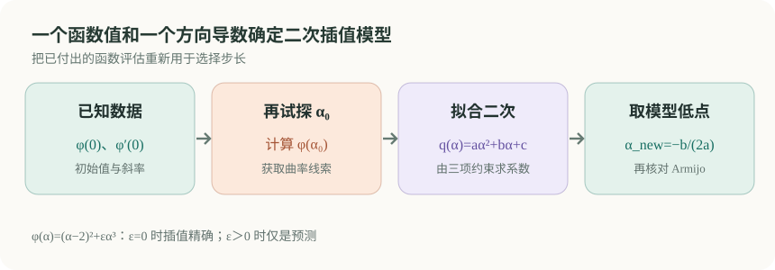

# 3.5.1 插值线搜索：从函数值估计下一个候选步

当一次试探步长没有达到充分下降，单纯把步长减半是一种安全选择；插值则利用已评估的函数值和初始斜率，预测曲线低谷可能在哪里。

## 最少需要哪些信息来构造二次模型

沿下降方向定义 φ(α)=f(x+αp)，其初始方向导数 d₀=φ′(0)＜0。已知 φ(0)、d₀ 和一次正试探 α₀ 的 φ(α₀)，就足以唯一决定一个二次插值模型 q(α)=aα²+d₀α+φ(0)。

插值二次系数为 a=[φ(α₀)−φ(0)−d₀α₀]/α₀²。若 a＞0，模型极小点位于 α_new=−d₀/(2a)。这仍是模型的极小点，真正的函数值与 Armijo 或 Wolfe 判据必须在 α_new 重新检查。

$$
\alpha_{\mathrm{new}}=-\frac{\phi'(0)\alpha_0^2}{2[\phi(\alpha_0)-\phi(0)-\alpha_0\phi'(0)]}.
$$

## 为什么插值有时精确，有时会有偏差

先取 φ(α)=(α−2)²。它本身就是二次函数，已知 φ(0)=4、φ′(0)=−4，并在 α₀=1 处计算 φ(1)=1。代入插值公式得到 α_new=2，与真实一维极小点完全一致。

现在引入一个非二次扰动 εα³：φ(α)=(α−2)²+εα³，且仍在 α₀=1 试探。此时 φ(0)=4、φ′(0)=−4、φ(1)=1+ε，因此 α_new=2/(1+ε)。

例如 ε=0.25 时，插值预测 α_new=1.6，但真正的驻点由 2(α−2)+0.75α²=0 给出 α*=4/3≈1.3333。插值改善了候选搜索，却不是一次就精确解出非二次函数。



*插值得到的是一个模型候选，而不是无条件接受的最终步长；当插值点过近或模型曲率不可靠时需要安全防护。*

## 为什么不能不加保护地相信插值结果

当二次模型曲率系数 a 接近零、为负，或因为浮点消去出现不稳定值时，公式可能给出极大、极小甚至负的候选步。工程实现一般要求候选点位于当前可接受区间的安全内段，过于接近边界则退回二分或几何缩小。

进一步利用相邻两点的 φ 和 φ′，可以构造三次插值，更好地反映曲率变化，但也增加实现与数值稳定性问题。是否使用三次插值通常与梯度评估成本有关。

## 如何区分模型更新与终止判据

插值策略解决“下一次试哪里”；Armijo 或 Wolfe 条件解决“本次是否可以接受”。一个正确的线搜索不能把插值器输出直接当作最终 α。

此处的多项式仅用来建立一维候选，不说明原目标函数的全局凸性，也不保证浮点条件下导数总是准确可用。

## 交互实验

固定初始斜率 φ′(0)=−4 和试探点 α₀=1，令 φ(α)=(α−2)²+εα³；调节 ε，比较二次插值候选与真正的驻点。。可在对应的 [HTML 交互页面](./15_3.5.1._Interpolation.html) 调整参数。

## Python：独立计算与断言

用三个函数信息构建二次插值，解析对照三次扰动后的真实驻点，并检查候选方向的函数值。

```python
"""Quadratic interpolation from phi(0), phi'(0), phi(alpha0)."""
from math import sqrt

def phi(alpha: float, eps: float):
    return (alpha-2.0)**2 + eps*alpha**3

def candidate(alpha0: float, eps: float):
    slope0 = -4.0
    denom = 2.0*(phi(alpha0,eps)-phi(0.0,eps)-slope0*alpha0)
    if alpha0 <= 0.0 or denom <= 1e-12:
        raise ValueError("invalid interpolation curvature")
    return -slope0*alpha0**2/denom

def optimum(eps: float):
    if eps == 0.0:
        return 2.0
    return (-2.0 + sqrt(4.0 + 48.0*eps))/(6.0*eps)

if __name__ == "__main__":
    assert candidate(1.0,0.0) == 2.0
    a = candidate(1.0,0.25)
    exact = optimum(0.25)
    print("candidate:",a,"stationary point:",exact)
    assert abs(a-1.6)<1e-12
    assert abs(exact-4.0/3.0)<1e-12
    assert phi(a,0.25)<phi(0.0,0.25)
    assert abs(a-exact)>0.1
```

自检：当 ε→0 时公式为什么回到 α=2？若插值二次系数为负，应如何拒绝这个候选？

## 适用边界

二次插值输出只是搜索候选。其精度依赖局部函数形状；一般线搜索仍需检查下降条件、区间安全范围和浮点异常。

## 参考依据

- Nocedal & Wright, *Numerical Optimization*, 2nd ed., Section 3.5, Interpolation, equations (3.57)–(3.59), pp. 57–59。[出版信息](https://doi.org/10.1007/978-0-387-40065-5)；[正文 PDF](https://deeplearningpku.github.io/literature/Nocedal_Wright_Numerical_optimization_v2.pdf)。

图形与数值例子为独立构造。
