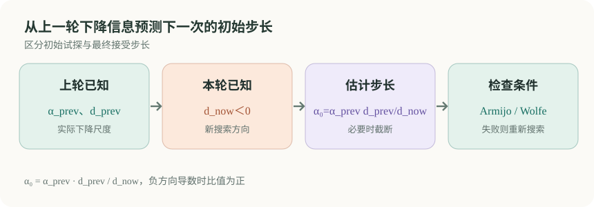

# 3.5.2 初始步长：一个好的猜测可以省掉多少搜索

线搜索从 α₀ 开始试探。Newton 与拟 Newton 方法一般首先尝试完整步长 1；对梯度法与共轭梯度法，可以把上一轮的步长和方向导数转化为新猜测，但猜测仍需验证。

## 初始步长是猜测，不是最优性证据

给定下降方向 pₖ 后，线搜索需要从某个正步长开始评估。初始值 α₀ 越接近实际可接受区间，越有机会减少函数与梯度评估次数；但是过大的 α₀ 可能越过低谷，过小的 α₀ 可能提前停止或导致多次扩展。

在 Newton 和拟 Newton 方法中，一旦进入良好的局部区域，单位步长常常最终会被接受；因此应优先尝试 α₀=1，而不是总沿用一个极小的历史步长。

## 利用相邻两次方向导数的比例

梯度法或非线性共轭梯度方向的尺度可能随迭代变化。一种候选策略认为“上一次实际取得的线性预测下降”可以提供数量级参考：让新一轮初始步长与当前方向导数的乘积，等于上一次步长与旧方向导数的乘积。

记上一轮接受步长为 α_prev，两个起点方向导数分别为 d_prev＜0 和 d_now＜0，则 α₀=α_prev d_prev/d_now。该式在两个斜率都为负时给出正数；如果当前斜率几乎为零，数值结果可能异常大，必须施加步长上下限。

$$
\alpha_0=\alpha_{\mathrm{prev}}\frac{d_{\mathrm{prev}}}{d_{\mathrm{now}}},\quad d_{\mathrm{now}}=\nabla f(x_k)^\top p_k<0.
$$



*历史信息有助于减少搜索调用，但不应当覆盖 Newton 型方向优先试 α=1 的局部快速收敛策略。*

## 把猜测放入实际的一维函数检查

假设上一轮 α_prev=0.5、方向导数 d_prev=−8，而当前方向导数 d_now=−4。比例策略提出 α₀=1。为展示接受检查，取当前线搜索函数 φ(α)=(α−2)²；其初始方向导数恰好为 −4。

在 α=1，函数值从 φ(0)=4 降到 1；取 c₁=10⁻⁴、c₂=0.9，Armijo 上界为 3.9996，而 |φ′(1)|=2≤3.6，强 Wolfe 通过。因此这个候选可接受。

如果上一轮 α_prev=2，同样的比例策略提出 α₀=4，此时 φ(4)=4、没有充分下降，Armijo 拒绝。这并不说明比例策略错误，而是说明初始猜测与终止判据的职责不同。

## 其他初始策略及失败防护

另一种常见初值利用上两轮目标值差和当前方向导数：α₀=2(fₖ−fₖ₋₁)/d_now。这来自一个简化的二次插值模型；如果目标值没有下降或 d_now 不是负值，就需要回退策略。

一个可靠实现应检查初值的有限性、正性和合理上下界；如果历史斜率太小，回退到安全默认值，并在最终接受前重新执行线搜索准则。

## 交互实验

固定 d_prev=−8、d_now=−4，当前 φ(α)=(α−2)²；改变上一轮 α_prev，观察建议的 α₀ 和 Armijo/强 Wolfe 检查。。可在对应的 [HTML 交互页面](./16_3.5.2._Initial_Step_Length.html) 调整参数。

## Python：独立计算与断言

按上一轮/当前方向导数比例给出候选，并将它送回函数值和强 Wolfe 曲率判据检查；展示接受与拒绝两种情况。

```python
"""Warm-start line search with previous directional derivative."""
def initial_guess(alpha_prev, d_prev=-8.0, d_now=-4.0):
    if alpha_prev <= 0 or d_prev >= 0 or d_now >= 0:
        raise ValueError("positive previous step and negative slopes required")
    return max(0.1, min(4.0, alpha_prev*d_prev/d_now))

def conditions(alpha, c1=1e-4, c2=0.9):
    phi = lambda a: (a-2.0)**2
    dphi = lambda a: 2.0*(a-2.0)
    armijo = phi(alpha) <= phi(0.0)+c1*alpha*dphi(0.0)
    strong = armijo and abs(dphi(alpha)) <= c2*abs(dphi(0.0))
    return armijo, strong

if __name__ == "__main__":
    a = initial_guess(0.5)
    b = initial_guess(2.0)
    print("initial guesses:",a,b,"conditions:",conditions(a),conditions(b))
    assert a == 1.0 and b == 4.0
    assert conditions(a) == (True,True)
    assert conditions(b) == (False,False)
    assert abs(2.0*(3.0-5.0)/(-4.0)-1.0)<1e-12
```

自检：若 d_now 接近零，比例初值会发生什么？为什么必须设置上界或回退策略？

## 适用边界

方向导数比例与函数值差是启发式初始猜测，不能替代 Armijo/Wolfe 终止条件；Newton 型方法应优先尝试 α=1。

## 参考依据

- Nocedal & Wright, *Numerical Optimization*, 2nd ed., Section 3.5, Initial Step Length, equation (3.60), pp. 59–60。[出版信息](https://doi.org/10.1007/978-0-387-40065-5)；[正文 PDF](https://deeplearningpku.github.io/literature/Nocedal_Wright_Numerical_optimization_v2.pdf)。

图形与数值例子为独立构造。
