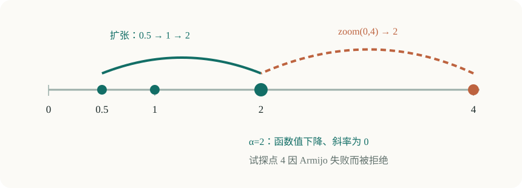

# 3.5.3 Wolfe 搜索：扩张试探与 zoom 如何协作

给定下降方向以后，不能靠一次缩短就保证满足强 Wolfe 条件。先扩大试探寻找合适区间，再由 zoom 收缩区间并同时检查函数值与方向导数，才能找到可靠的步长。

## 两个条件分别阻止什么错误

在当前点 x 选择下降方向 p，记 φ(α)=f(x+αp)，并假设 φ′(0)＜0。充分下降（Armijo）阻止走得过远或函数值不降；强 Wolfe 曲率条件阻止停在仍然过陡的坡上。两者必须同时成立。

选择 0＜c₁＜c₂＜1，要求 φ(α)≤φ(0)+c₁αφ′(0)，并要求 |φ′(α)|≤c₂|φ′(0)|。满足条件的正步长不一定是一维精确极小点；它只需要在这次迭代上足够合理。

$$
\phi(\alpha)\le\phi(0)+c_1\alpha\phi'(0),\quad|\phi'(\alpha)|\le c_2|\phi'(0)|.
$$

## 第一阶段：扩张试探，直到可接受或出现括区间

从 α₀=0 与正试探 α₁ 开始；每次计算 φ(αᵢ)。若 Armijo 失败，或者 i＞1 时函数值没有继续下降，就用相邻两次试探作为 zoom 端点。否则检查斜率：如果强 Wolfe 已通过，立即接受；如果 φ′(αᵢ)≥0，说明已经越过某个下降趋势的转折，再调用 zoom。

若以上情形都没出现，尝试更大的 αᵢ₊₁。这是和回溯的关键区别：起始步长过小时，算法可能需要扩张，而不是不断缩小。数值实现必须限制最大试探步和扩张次数。



*外层搜索可以逐步增加 α 来发现曲率变化；当试探超出可接受区域，zoom 通过安全插值或二分收缩括区间。图示是教学流程，具体接受条件以不等式为准。*

## 第二阶段：zoom 维持什么不变量

zoom 使用一对端点 α_lo、α_hi。区间内部应包含符合强 Wolfe 的步长；α_lo 是已探索且满足 Armijo 的较好函数值点；两个端点的方向关系保持特定符号条件。插值、二分只负责产生新的候选 α_j，不能替代 Armijo 和曲率检查。

若 α_j 的函数值不充分下降，或没有优于 α_lo，就用 α_j 更新另一端点；否则检查曲率，满足就接受。不满足时，依据导数符号调整两个端点。要避免每次插值都贴近边界，通常保留安全内段或二分回退。

## 一次完整的可复现路径

固定 φ(α)=(α−2)²，φ′(0)=−4，c₁=10⁻⁴，c₂=0.1。从初始 α₁=4 试探：φ(4)=4，而 Armijo 上界约 3.9984，不通过。调用 zoom(0,4)，其中点为 α=2；此时 φ(2)=0 且 φ′(2)=0，同时满足两个条件，立即接受。

若改从 α₁=0.5 开始，尽管 Armijo 已满足，但 φ′(0.5)=−3，绝对值大于 0.4，曲率条件失败。外层扩张至 α=1 仍未通过，再到 α=2 时才通过。可见“函数值已经下降”不等于“满足强 Wolfe”。

## 保证、停止与工程保护

教科书的存在性与算法结论依赖下降方向、φ 足够光滑、沿方向有下界和 0＜c₁＜c₂＜1。实际程序还应当检查非有限数、区间宽度、浮点停滞、最大迭代数与最大步长，失败时明确抛错。

下面提供的是基于二分 zoom 与几何扩张的教学实现，保留强 Wolfe 的两个停止条件和主要区间分支，但没有实现专业线搜索库的三次插值、舍入误差容错与全部数值防护。

## 交互数值实验

练习：如果将 c₂ 从 0.1 增大到 0.9，可接受步长集合会如何变化？这是否意味着更接近精确极小点？ [交互版 HTML](./17_3.5.3._A_Line_Search_Algorithm_for_the_Wolfe_Conditions.html)。

## Python：可复现的断言

从不同起点运行线搜索，并且用独立断言检查返回步长的 Armijo 与强 Wolfe 条件；不把二分 zoom 误称为完整工业算法。

```python
"""Strong Wolfe search with safeguarded bisection-based zoom."""
def phi(a):
    return (a - 2.0) ** 2

def dphi(a):
    return 2.0 * (a - 2.0)

def wolfe_search(initial=4.0, c1=1e-4, c2=0.1, maximum=16.0):
    if not (0.0 < c1 < c2 < 1.0 and 0.0 < initial < maximum):
        raise ValueError("invalid Wolfe parameters or step bound")
    f0, g0 = phi(0.0), dphi(0.0)
    if g0 >= 0.0:
        raise ValueError("direction is not descending")
    trace = []
    def sufficient(a):
        return phi(a) <= f0 + c1 * a * g0
    def zoom(lo, hi):
        for _ in range(60):
            a = (lo + hi) / 2.0
            trace.append(("zoom", a))
            if abs(hi - lo) < 1e-12:
                raise RuntimeError("zoom stagnated")
            if not sufficient(a) or phi(a) >= phi(lo):
                hi = a
            else:
                ga = dphi(a)
                if abs(ga) <= -c2 * g0:
                    return a, trace
                if ga * (hi - lo) >= 0.0:
                    hi = lo
                lo = a
        raise RuntimeError("zoom iteration limit")
    prev, a = 0.0, initial
    for i in range(60):
        trace.append(("expand", a))
        if not sufficient(a) or (i > 0 and phi(a) >= phi(prev)):
            return zoom(prev, a)
        ga = dphi(a)
        if abs(ga) <= -c2 * g0:
            return a, trace
        if ga >= 0.0:
            return zoom(a, prev)
        prev, a = a, min(2.0 * a, maximum)
        if a == prev:
            raise RuntimeError("maximum step reached")
    raise RuntimeError("search iteration limit")

if __name__ == "__main__":
    for start in (0.5, 1.0, 3.0, 4.0):
        alpha, history = wolfe_search(initial=start)
        print(start, alpha, history)
        assert phi(alpha) <= phi(0) + 1e-4 * alpha * dphi(0)
        assert abs(dphi(alpha)) <= 0.1 * abs(dphi(0))
    assert wolfe_search(4.0)[0] == 2.0
    assert wolfe_search(0.5)[0] == 2.0
```

## 结论适用边界

强 Wolfe 搜索在理论上依赖光滑性、下降方向与沿线下界；当前 Python 程序仅演示有界一维二次函数与二分 zoom，不能替代成熟的鲁棒数值实现。

## 参考文献

- Nocedal & Wright, *Numerical Optimization*, 2nd ed., Chapter 3, Section 3.5, Algorithms 3.5–3.6, pp. 60–63。[出版信息](https://doi.org/10.1007/978-0-387-40065-5)；[原书 PDF](https://deeplearningpku.github.io/literature/Nocedal_Wright_Numerical_optimization_v2.pdf)。

本文的数值实验、图形和练习均为独立构造。
