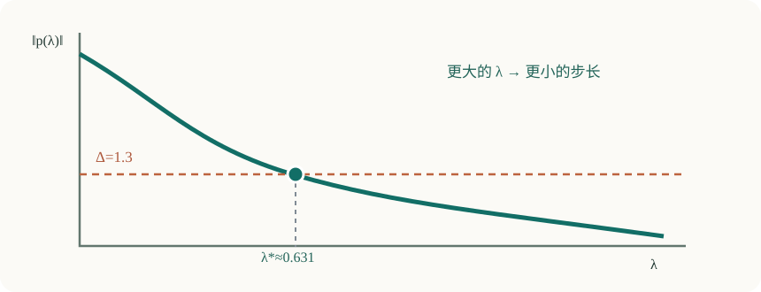

# 4.3 信赖域子问题求解：为什么把半径约束变成 λ 的根问题

二次模型最小化受球形信赖域约束时，解通常满足一个带对角平移的线性方程。通过调节单一乘子 λ，让解的范数匹配给定半径，可以把高维约束问题压缩成一维求根。

## 从受约束二次模型到乘子条件

考虑 min q(p)=gᵀp+½pᵀBp，满足 ‖p‖₂≤Δ，B 是实对称矩阵。全局最优解 p* 存在 λ≥0，使 (B+λI)p*=−g、B+λI 半正定、‖p*‖≤Δ、λ(Δ−‖p*‖)=0。

若 B 正定且无约束 Newton 步 pᴺ=−B⁻¹g 已在球内，λ=0，直接取 pᴺ。否则大多需要 λ＞0 和 ‖p(λ)‖=Δ。

$$
(B+\lambda I)p=-g,\quad B+\lambda I\succeq0,\quad\lambda(\Delta-\|p\|)=0.
$$

## 为何 λ 足够大时出现单调的范数曲线

对称矩阵可以谱分解 B=Q diag(μᵢ)Qᵀ。在 B+λI 正定的区域 λ＞−μ_min，p(λ)=−(B+λI)⁻¹g，由此 ‖p(λ)‖²=Σ(qᵢᵀg)²/(μᵢ+λ)²。

每个分母随 λ 增大，因而范数连续且非增，并在 λ→∞ 时趋向 0。若梯度在最负特征子空间上有非零投影，λ 接近 −μ_min 时范数趋于无穷，便能通过一维根搜索匹配球半径。



*当 λ 增大，‖(B+λI)⁻¹g‖ 下降；如果 Newton 点落在球外，连续曲线与指定半径相交，交点确定球面最优步。此图采用正定示例。*

## 二维例子：乘子的数值位置

取 B=diag(4,1)、g=(2,2)、Δ=1.3。无约束步为 pᴺ=(−0.5,−2)，范数约为 2.06155，超出信赖域。

求解 (2/(4+λ))²+(2/(1+λ))²=1.3²，可得 λ≈0.63109456；对应 p≈(−0.43186335,−1.22617048)，恰好在球面上，模型下降约 2.19130873。

## 稳定求根与原始公式的区别

可以先找到一个 λ_hi，使 ‖p(λ_hi)‖≤Δ，再在 [0,λ_hi] 上二分；当 B 不定时，必须把左端提升至 −μ_min 之上，不能试图 Cholesky 分解不正定的 B+λI。

经典方法还可利用 Cholesky 分解及对 1/‖p(λ)‖ 的 Newton 迭代快速更新 λ，但需要保护起点、步长范围、因子分解失败及浮点极端情况。

## 何时一维求根失效

若 g 与最小特征子空间正交，即使 λ→−μ_min 的极限，‖p(λ)‖ 也可能小于 Δ；这时在开区间内找不到范数等于 Δ 的 λ。

这就是 Hard Case：须取边界值 λ=−μ_min，再沿最小特征值的零空间补一个分量，使步长范数等于 Δ。下方程序限定 B 正定；不应将它套用于 Hard Case。

## 交互实验

调整 Δ，观察 λ 从正数回到零的临界半径；若 Hessian 出现负特征值，为什么二分搜索的左端点需要更严格的限制？ [阅读交互网页](./02_4.3._Iterative_Solution_of_the_Subproblem.html)。

## Python：复现与断言

```python
"""Secular-equation bisection for a symmetric positive definite 2-D B."""
from math import hypot

def step(lam):
    return (-2.0/(4.0+lam),-2.0/(1.0+lam))

def solve(radius):
    if radius<=0:
        raise ValueError("radius must be positive")
    if hypot(*step(0))<=radius:
        return 0.0,step(0)
    lo,hi=0.0,1.0
    while hypot(*step(hi))>radius:
        hi*=2.0
    for _ in range(80):
        mid=(lo+hi)/2
        if hypot(*step(mid))>radius:
            lo=mid
        else:
            hi=mid
    lam=(lo+hi)/2
    return lam,step(lam)

def drop(p):
    return -(2*p[0]+2*p[1]+.5*(4*p[0]**2+p[1]**2))

if __name__=="__main__":
    lam,p=solve(1.3)
    print(lam,p,drop(p))
    assert abs(lam-0.6310945588223069)<1e-9
    assert abs(hypot(*p)-1.3)<1e-10
    assert abs(drop(p)-2.1913087311268886)<1e-9
    assert solve(2.5)[0]==0
```

## 适用范围

此演示只对二维对角正定模型实现二分搜索；一般不定矩阵、重复最小特征值和 Hard Case 需要额外分支与稳定分解。

## 参考资料

- Nocedal & Wright, *Numerical Optimization*, 2nd ed., Section 4.3, Iterative Solution of the Subproblem, Algorithm 4.3 and equations (4.37)–(4.44), pp. 83–87。[出版信息](https://doi.org/10.1007/978-0-387-40065-5)；[原书 PDF](https://deeplearningpku.github.io/literature/Nocedal_Wright_Numerical_optimization_v2.pdf)。

图形和数值为独立构造的教学例子。
