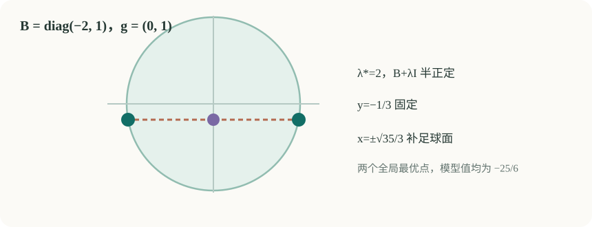

# 4.3.1 Hard Case：最小特征子空间没有梯度分量时怎么办

当梯度正交于 Hessian 的最负特征子空间，一维 secular 方程可能永远找不到要求的半径。恰当的解不是放弃负曲率方向，而是在临界乘子处沿零空间补足边界长度。

## 为什么通用的乘子求根步骤失灵

考虑 q(p)=gᵀp+½pᵀBp，限制 ‖p‖≤Δ。假设 B 的最小特征值 μ_min＜0，且 g 完全正交于对应最小特征子空间。

对于 λ＞−μ_min，B+λI 正定，p(λ)=−(B+λI)⁻¹g。因为 g 在最小特征子空间上没有分量，临界 λ 附近的范数不一定发散。若它的临界极限小于 Δ，则 ‖p(λ)‖=Δ 在此开区间没有根。

$$
Q_{\min}^{\top}g=0,\quad \lim_{\lambda\downarrow-\mu_{\min}}\|p(\lambda)\|<\Delta.
$$

## 二维不定模型的精确反例

构造 B=diag(−2,1)、g=(0,1)，Δ=2。最负特征方向是 x 轴，梯度只在 y 轴，因此 g 与负特征子空间正交。

对任意 λ＞2，p(λ)=(0,−1/(1+λ))，其范数小于 1/3，远小于 Δ=2。即便 λ 无限接近 2，范数也只趋近 1/3；所以直接二分 ‖p(λ)‖−2 必定失败。



*模型具有负曲率 x 方向，但梯度只沿 y 方向。临界乘子下先求出 y 分量，再用零空间 x 分量走到圆周，从而利用负曲率取得更低模型值。*

## 临界乘子与零空间补偿

取 λ*=−μ_min=2，此时 B+2I=diag(0,3) 是半正定奇异矩阵。方程 (B+2I)p=−g 只要求 p_y=−1/3，p_x 可以为任意实数。

要满足边界范数 ‖p‖=2，必须取 p_x=±√(4−1/9)=±√35/3。这样得到两个不同但同为全局最优的解。

$$
p=(\pm\sqrt{35}/3,-1/3),\qquad\lambda^*=2,\quad\|p\|=2.
$$

## 为什么补充的分量确实改善模型

把 p_y=−1/3 与 p_x²=35/9 代入 q，可得 q(p)=−25/6≈−4.16667；只使用最小范数解 p=(0,−1/3) 时 q=−5/18≈−0.27778。

负曲率项 −p_x² 使边界补充分量显著降低模型值。单靠最小范数伪逆解会错失这个机会。补充的两个符号都可行且目标相同，因此全局最小解不必唯一。

## Hard Case 与数值稳定性的边界

对于多重最小特征值，必须使用相应整个特征子空间而不是只考虑一个指定的特征向量。若 g 投影只是接近零而非严格零，浮点数会产生 near-hard case，需要阈值与稳健的特征/分解处理。

本页用已知二维对角矩阵给出封闭形式解，并未实现任意大小的不定矩阵分解。程序验证全局性所用的是标准乘子证书。

## 交互实验

调节 Δ＞1/3，观察为什么最优步的 y 分量固定为 −1/3，而 x 方向的绝对值随半径增加。 [阅读交互网页](./03_4.3.1._The_Hard_Case.html)。

## Python：复现与断言

```python
"""An exact hard-case trust-region minimizer using the null space."""
from math import sqrt,hypot

def solution(radius):
    if radius <= 1/3:
        raise ValueError("the pictured hard case requires radius > 1/3")
    x=sqrt(radius**2-1/9)
    return (x,-1/3),2.0

def model(p):
    x,y=p
    return y-x*x+0.5*y*y

if __name__=="__main__":
    p,lam=solution(2.0)
    other=(-p[0],p[1])
    print(p,other,model(p))
    assert abs(hypot(*p)-2.0)<1e-12
    assert lam==2.0
    assert abs(model(p)+25/6)<1e-12
    assert abs(model(other)-model(p))<1e-12
    # Stationarity and positive semidefiniteness:
    # B+2I = diag(0,3), (B+2I)p = (0,-1) = -g.
    assert abs(3*p[1]+1)<1e-12
    for candidate in ((0,0),(0,-2),(1,-1),(-1,-1)):
        if hypot(*candidate)<=2:
            assert model(candidate)>=model(p)-1e-12
```

## 适用范围

Hard Case 的核心是梯度在最小特征子空间上的投影为零且临界范数不足；一般问题必须考虑多个特征值及舍入误差。

## 参考资料

- Nocedal & Wright, *Numerical Optimization*, 2nd ed., Section 4.3, The Hard Case, equations (4.41) and (4.45), pp. 87–88。[出版信息](https://doi.org/10.1007/978-0-387-40065-5)；[原书 PDF](https://deeplearningpku.github.io/literature/Nocedal_Wright_Numerical_optimization_v2.pdf)。

图形和数值为独立构造的教学例子。
