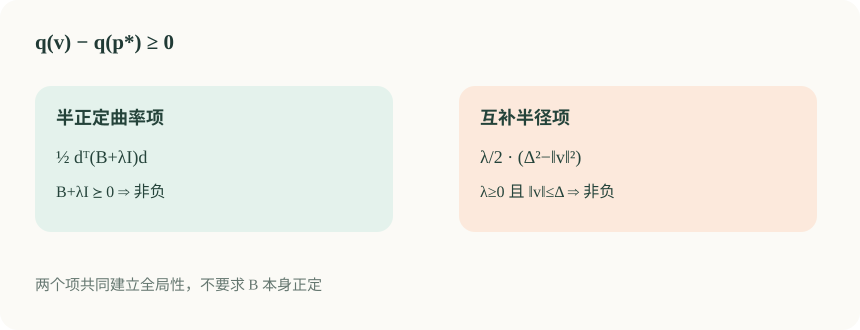

# 4.3.2 信赖域全局最优证书：从乘子条件到模型不等式

一个满足一阶驻点条件的球内步长，不一定是非凸二次模型的全局最优解。信赖域的关键特殊性是：只要找到合适的非负乘子，使修正 Hessian 半正定且满足互补条件，就能给出可验证的全局最优证书。

## 先陈述需要证明的充分必要条件

考虑 min q(p)=gᵀp+½pᵀBp，‖p‖≤Δ，B 为实对称矩阵。一个全局最小点 p* 存在 λ≥0，使 (B+λI)p*=−g、B+λI 半正定、‖p*‖≤Δ、λ(Δ−‖p*‖)=0。

与普通的边界 KKT 一阶条件不同，B+λI 半正定这一额外要求是区分全局最优与可能的局部非全局驻点的关键。

$$
(B+\lambda I)p^*=-g,\quad B+\lambda I\succeq0,\quad\lambda(\Delta-\|p^*\|)=0.
$$

## 核心恒等式：把全局性还原成两个非负项

设 v 为任意可行点，令 d=v−p*。对 q(v)−q(p*) 展开，并利用 g+Bp*=−λp*，可以整理为两个项：½dᵀ(B+λI)d 与 (λ/2)(‖p*‖²−‖v‖²)。

第一项由于 B+λI 半正定而非负。若 λ=0，第二项为零；若 λ＞0，互补条件要求 ‖p*‖=Δ，而任何可行 v 都满足 ‖v‖≤Δ，因此第二项也非负。故 q(v)≥q(p*)，证明充分性。

$$
q(v)-q(p^*)=\frac12(v-p^*)^\top(B+\lambda I)(v-p^*)+\frac{\lambda}{2}(\|p^*\|^2-\|v\|^2)\ge0.
$$



*修正曲率项与边界互补项同时非负，所以任意球内测试步的模型值不低于证书点。单独检查梯度为零或单独检查球面可行都不够。*

## 必要性为何不是普通凸优化的直接推论

如果 B 本身不定，原二次函数并不凸，因此不能直接引用凸问题的 KKT 充分性。一个重要的结构性结论是球约束二次问题没有一般非凸约束问题常见的对偶间隙。

在 B 的特征基中考察 p(λ)=−(B+λI)⁻¹g：若 Newton 步已可行且 B 半正定，可取 λ=0；若否则搜索 λ＞max{0,−μ_min} 使 ‖p(λ)‖=Δ；如果此搜索到最小特征值边界仍无法到达球面，就进入 Hard Case，取奇异边界乘子并补充零空间分量。这样构造满足证书条件的点。

## 半正定但奇异的情况不要误称唯一解

无约束二次函数 q(p) 取得最小值，当且仅当 B 半正定且 g 属于 B 的值域；这时满足 Bp=−g 的点都是全局最小点。只有 B 正定时才保证无约束最小点唯一。

对于信赖域问题，证书允许 B+λI 奇异。零空间的自由度不必破坏全局性，但会出现多个最优解，因此不应把求逆作为条件的一部分。

## 数值示例：证书可以给出一个可测试的下界

回到 B=diag(−2,1)、g=(0,1)、Δ=2。取 λ=2、p*=(√35/3,−1/3)。则 B+λI=diag(0,3)，半正定；乘子方程成立；p* 在球面上。

任取球内 v，q(v)−q(p*)=½·3(v_y+1/3)²+ (2/2)(4−‖v‖²)≥0。Python 会对一个完整的角度网格进行采样，同时直接核查上述恒等式；有限采样只是补充，真正的全局性来自解析证书。

## 交互实验

改变球内测试点 v 的角度，观察差值 q(v)−q(p*) 与两项非负证书为何一致；能否仅靠网格采样证明全局最优？ [阅读交互网页](./04_4.3.2._Proof_of_Theorem_4.1.html)。

## Python：复现与断言

```python
"""Verify an exact global trust-region certificate and its identity."""
from math import sqrt,cos,sin,pi,hypot

DELTA=2.0
LAM=2.0
STAR=(sqrt(35)/3,-1/3)

def q(p):
    x,y=p
    return y-x*x+.5*y*y

def gap_identity(v):
    d=(v[0]-STAR[0],v[1]-STAR[1])
    first=.5*3*d[1]*d[1] # B+lambda I = diag(0,3)
    second=.5*LAM*(DELTA**2-v[0]**2-v[1]**2)
    return first+second

if __name__=="__main__":
    assert abs(hypot(*STAR)-DELTA)<1e-12
    assert abs(3*STAR[1]+1)<1e-12
    for radius in (0.0,.5,1.0,2.0):
        for angle in range(0,360,15):
            t=angle*pi/180
            v=(radius*cos(t),radius*sin(t))
            observed=q(v)-q(STAR)
            predicted=gap_identity(v)
            assert abs(observed-predicted)<1e-11
            assert observed>=-1e-11
    print("certificate passed; model optimum:",q(STAR))
    assert abs(q(STAR)+25/6)<1e-12
```

## 适用范围

页面给出证书的完整充分性推导，并通过谱方法解释必要性的构造逻辑；没有将网格数值采样冒充定理证明。

## 参考资料

- Nocedal & Wright, *Numerical Optimization*, 2nd ed., Section 4.3, Proof of Theorem 4.1 and Lemma 4.7, pp. 89–91; theorem conditions (4.8)。[出版信息](https://doi.org/10.1007/978-0-387-40065-5)；[原书 PDF](https://deeplearningpku.github.io/literature/Nocedal_Wright_Numerical_optimization_v2.pdf)。

图形和数值为独立构造的教学例子。
