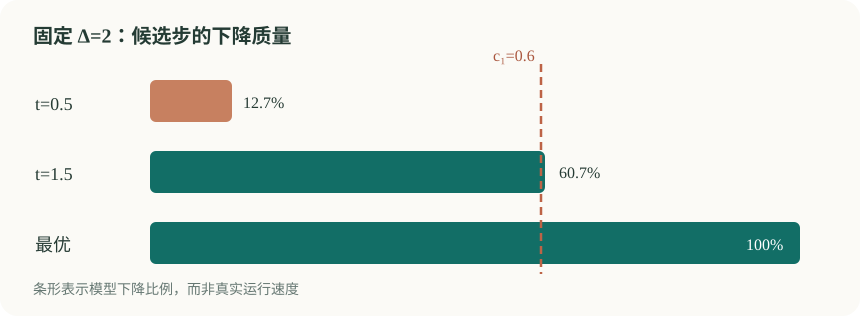

# 4.3.3 近精确子问题：固定比例模型下降与二阶信息

信赖域子问题不必解到机器精度；但近似步必须保证相对于真正最优模型下降的足够比例，并限制步长长度。否则方法可能忽略鞍点处有用的负曲率。

## 只盯着求根误差为什么不够

设 q(p)=gᵀp+½pᵀBp，限制 ‖p‖≤Δ，最优模型步为 p*。用乘子 λ 求解精确子问题可能需要多次矩阵分解。但外层信赖域方法真正关注的是候选 p 减少了多少模型值，而不只关心方程残差。

## 近精确模型下降的两个约束

原书条件 (4.52) 要求 q(0)−q(p)≥c₁[q(0)−q(p*)]，其中 c₁∈(0,1] 是固定比例，还要满足 ‖p‖≤γΔ，γ＞0 是固定的长度因子。理论采用的 γΔ 长度控制，不应被误解成可以在严格球约束的实现中任意越界。

$$
q(0)-q(p)\ge c_1\left[q(0)-q(p^*)\right],\qquad\|p\|\le\gamma\Delta.
$$



*在同一半径下，利用负曲率方向能够取得比零步或最速下降更大的模型减少；柱长代表原创建模例子的模型下降占最优下降的比例。*

## 用一个二维不定模型直接算比例

取 B=diag(−2,1)、g=(0,1)、Δ=2。精确子问题的两个最优点为 (±√35/3,−1/3)，最优预测下降是 25/6≈4.166667。构造候选 p(t)=(t,−1/3)，若 t²+1/9≤4 则可行，预测下降为 t²+5/18。t=1.5 的下降比例约 60.67%；t=0.5 的比例约 12.67%。

## 为什么二阶信息能帮助脱离鞍点

若换成 g=(0,0)、B=diag(−2,1)、Δ=2，零梯度方向无法给出任何 Cauchy 下降，但边界上的 (±2,0) 仍使二次模型下降 4。要求固定比例最优模型下降的近精确准则，会迫使算法识别这类负曲率，而不能仅返回 p=0。

## 哪些结论需要额外假设

若真实 Bₖ=∇²f(xₖ)，再结合光滑性、外层接受机制、目标水平集与有界性等条件，才可能得出二阶必要条件相关的全局极限点结论。一次模拟满足 60% 比例不等于整条迭代轨迹已经有二阶收敛保证。

## 交互实验

[交互网页](./05_4.3.3._Convergence_of_Algorithms_Based_on_Nearly_Exact_Solutions.html) 可调节 t 与模型下降比例。

## Python 实验

```python
"""Test near-exact trust-region model reduction in an exact 2-D case."""
from math import hypot,sqrt
OPTIMAL=25.0/6.0
def trial(t):
    p=(t,-1.0/3.0)
    if hypot(*p)>2.0+1e-12:
        raise ValueError("infeasible trust-region step")
    reduction=t*t+5.0/18.0
    return p,reduction,reduction/OPTIMAL
if __name__=="__main__":
    for t in (0.5,1.0,1.5,sqrt(35)/3):
        p,d,r=trial(t)
        print(t,p,d,r)
        assert 0<r<=1+1e-12
    assert trial(1.5)[2]>=.6
    assert trial(.5)[2]<.6
    assert abs(trial(sqrt(35)/3)[2]-1)<1e-12
    # With g=0, B=diag(-2,1), p=(2,0) reduces the model by 4.
    assert -0.5*(-2*2**2)==4.0
```

## 边界与参考

本页使用可解析的二维 Hard Case 来确定最优下降，不构成一般不定 Hessian 的近精确子问题求解器。

Nocedal & Wright, *Numerical Optimization*, 2nd ed., Section 4.3, conditions (4.52) and Theorem 4.8, pp. 91–92。[出版信息](https://doi.org/10.1007/978-0-387-40065-5)；[原书 PDF](https://deeplearningpku.github.io/literature/Nocedal_Wright_Numerical_optimization_v2.pdf)。
