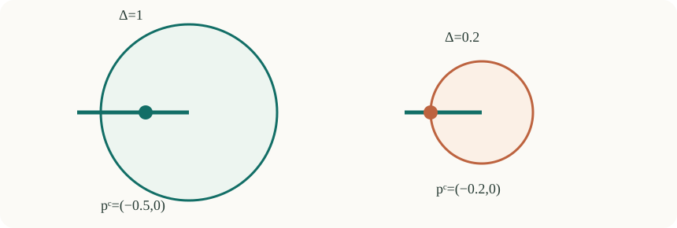

# 4.1.1 Cauchy 点：信赖域内最廉价的充分下降

即使二次模型的 Hessian 可能不定，沿负梯度射线在信赖域内最小化二次模型仍能得到一个可靠的基准步长。Cauchy 点的价值不是完全解出子问题，而是保证可计算的预测下降。

## 在什么范围内相信二次模型

给定当前点 x，使用二次模型 m(p)=f(x)+gᵀp+½pᵀBp；其中 g=∇f(x)，B 为对称曲率矩阵。信赖域半径 Δ＞0，把候选步限制在欧氏球 ‖p‖≤Δ 之内。

因为 B 可能有负特征值，二次模型在整个空间上未必有最小值，但封闭的信赖域球总允许搜索一个有界候选。模型下降是 m(0)−m(p)，不等于实际目标 f(x)−f(x+p)。

$$
m(p)=f(x)+g^\top p+\tfrac12p^\top Bp,\quad \|p\|\le\Delta.
$$

## Cauchy 点的构造

令 p=−tg，t≥0；满足信赖域约束意味着 t≤Δ/‖g‖。沿射线的模型下降为 t‖g‖²−½t²gᵀBg，因此只需要求解一个一维二次函数。

若 gᵀBg＞0，最佳 t=min{‖g‖²/(gᵀBg),Δ/‖g‖}；若 gᵀBg≤0，模型沿射线持续下降，最佳 t 位于边界 Δ/‖g‖。当 g=0 时应另行处理，不能除以梯度范数。



*同一个负梯度方向上，半径较大时 Cauchy 点落在球内；半径缩小时，步长被截到球边界。圆表示球的几何约束。*

## 两个半径的可重复算例

取 g=(2,0)、B=diag(4,1)。沿负梯度的无约束最优 t=¼，对应 p=(−0.5,0)，预测下降为 0.5。若 Δ=1，该点在球内，直接可用。

当 Δ=0.2 时，只能取 t=0.1，即 p=(−0.2,0)，预测下降变成 0.32。半径越小，模型能够探索的范围越有限，但仍保证这条射线上的最佳下降。

## 为什么它是所有其他近似方法的标尺

Cauchy 点可能不是球上模型的全局最优步，却能提供廉价的最低下降基线。其他方法只要保证至少取得固定正比例的 Cauchy 下降，就有希望满足全局收敛证明中的子问题质量条件。

Dogleg 与二维子空间法利用模型曲率改进方向，但不需要每次都求出高维球约束二次模型的精确极小点。

## 完整外层算法还需要做什么

模型预测下降越多不等于真实目标下降越多。外层信赖域方法会计算实际下降与预测下降之比，决定接受还是拒绝该步，并按模型可靠性调整下一轮的 Δ。

这里的标准库程序只计算一个固定二次模型的 Cauchy 点，没有实现外层接受规则、半径更新或对一般非凸函数的全局收敛控制。

## 参数交互

尝试把 Δ 从 0.1 调到 1.5，观察何时 Cauchy 点从信赖域边界转入球内部。 [在 HTML 页面中操作](./00_4.1.1._The_Cauchy_Point.html)。

## Python 实验

```python
"""Compute Cauchy steps for a simple two-dimensional quadratic model."""
from math import hypot

def cauchy(radius):
    if radius <= 0:
        raise ValueError("radius must be positive")
    g = (2.0, 0.0)
    norm = hypot(*g)
    gg = norm**2
    gBg = 4.0*g[0]**2 + g[1]**2
    t = min(gg/gBg, radius/norm) if gBg > 0 else radius/norm
    p = (-t*g[0], -t*g[1])
    reduction = -(2*p[0] + 0.5*(4*p[0]**2+p[1]**2))
    return p, reduction

if __name__ == "__main__":
    p, decrease = cauchy(1.0)
    print("delta=1:", p, decrease)
    assert p == (-0.5, 0.0) and abs(decrease-0.5)<1e-12
    p, decrease = cauchy(0.2)
    assert abs(p[0]+0.2)<1e-12
    assert abs(decrease-0.32)<1e-12
```

## 适用边界

Cauchy 点沿负梯度射线最优，未必是球约束子问题的全局最优；需要外层 ρ 判据来检查真实目标下降。

## 参考依据

- Nocedal & Wright, *Numerical Optimization*, 2nd ed., Chapter 4, Section 4.1, Algorithm 4.2, pp. 71–73。[出版信息](https://doi.org/10.1007/978-0-387-40065-5)；[原书 PDF](https://deeplearningpku.github.io/literature/Nocedal_Wright_Numerical_optimization_v2.pdf)。

本页所有教学数值、图和程序均独立编写。
