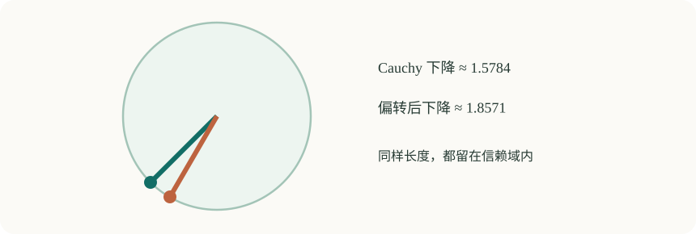

# 4.1.2 超越 Cauchy 点：曲率使更好的方向出现

Cauchy 点为信赖域算法建立最低下降保障，但它总沿负梯度方向，无法充分利用各个方向不同的曲率。允许搜索另一条球内方向，就可能在相同半径下明显减少更多模型值。

## Cauchy 下降是保底，不是最佳解

考虑 m(p)=fₖ+gᵀp+½pᵀBp 和 ‖p‖≤Δ。Cauchy 点在负梯度方向上最优，但未必在球内所有方向上最优。其原因是 B 只用于确定射线上走多远，没有真正改变走的方向。

一个近似子问题求解器常以取得 Cauchy 下降的固定正比例作为质量条件。在正定模型且计算成本允许时，更好的候选点甚至可以超过完整的 Cauchy 下降。

$$
m(0)-m(p)\ge\kappa_C\,[m(0)-m(p^C)],\quad0<\kappa_C\le1.
$$

## 一个单位圆里的具体数值

设 g=(2,2)、B=diag(4,1)，Δ=1。Cauchy 点是 pᶜ=(−1/√2,−1/√2)，模型下降约为 1.578427。

选择 p=(−0.5,−√3/2)，它的范数同样等于 1，却令模型下降约为 1.857051。它没有通过越过信赖域边界来作弊，而是减少了高曲率 x 方向上的移动，相应增加了低曲率 y 方向的移动。



*两条同样位于单位圆边界的候选方向，向低曲率坐标轴偏移的候选步可获得比 Cauchy 点更大的预测下降。*

## 为什么方向改变能帮助

函数的二阶模型对 x 的曲率为 4，对 y 的曲率为 1。在相同长度的步上，把位移从高曲率方向移向低曲率方向，会降低一部分二次惩罚。

但继续朝 y 方向旋转并不一定持续变好，因为线性下降项 gᵀp 也在变化。要同时考虑一阶收益和二阶代价，不能仅选择 Hessian 最小特征值的方向。

## 方法上的延伸

当 B 正定时，牛顿型方向 pᴮ=−B⁻¹g 为无约束模型的极小方向。如果球内允许它，就可以直接采用；否则 Dogleg 借用最速下降方向与 Newton 方向构造折线。

如果 B 不定，则不能直接把 pᴮ 当作模型的无约束极小点。负曲率方向和信赖域边界的处理需要其他算法。

## 什么结论还没有得到

本例只比较单步的模型下降，不能由此推断整个优化算法的最终运行时间；而模型下降的优势也不保证实际 f 一定下降得更多。

仍需实际/预测下降比与半径更新规则，并让子问题候选在信赖域内严格可行。

## 参数交互

改变候选角度，查看为什么进一步靠近 y 轴并不总是越好。 [在 HTML 页面中操作](./01_4.1.2._Improving_on_the_Cauchy_Point.html)。

## Python 实验

```python
"""Compare feasible Cauchy and curvature-aware steps on one sphere."""
from math import sqrt, sin, cos, radians

def reduction(p):
    x,y = p
    return -(2*x+2*y+0.5*(4*x*x+y*y))

def cauchy():
    return (-1/sqrt(2),-1/sqrt(2))

def candidate(degrees):
    theta = radians(degrees)
    return (-cos(theta),-sin(theta))

if __name__ == "__main__":
    c = cauchy()
    better = candidate(60)
    print("Cauchy drop:", reduction(c))
    print("60-degree candidate:", reduction(better))
    assert abs(sum(t*t for t in better)-1)<1e-12
    assert abs(reduction(c)-1.57842712474619)<1e-10
    assert abs(reduction(better)-1.8570508075688772)<1e-10
    assert reduction(better)>reduction(c)
```

## 适用边界

这个二维比较验证预测模型下降的改进，不代表真实目标的接受或算法总迭代次数减少。

## 参考依据

- Nocedal & Wright, *Numerical Optimization*, 2nd ed., Chapter 4, Section 4.1, Improving on the Cauchy Point, p. 73。[出版信息](https://doi.org/10.1007/978-0-387-40065-5)；[原书 PDF](https://deeplearningpku.github.io/literature/Nocedal_Wright_Numerical_optimization_v2.pdf)。

本页所有教学数值、图和程序均独立编写。
