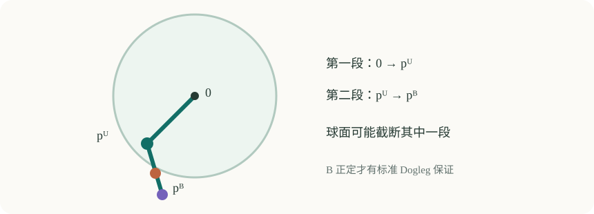

# 4.1.3 Dogleg 方法：在两段折线中选择信赖域步

当二次模型的 B 对称正定，Dogleg 用最速下降点和 Newton 点构成一条折线。半径小就截在负梯度方向，半径适中就与第二段相交，半径足够大则取完整 Newton 步。

## 两段折线的两个关键节点

模型 m(p)=fₖ+gᵀp+½pᵀBp；当 B 正定时，无约束极小点 pᴮ=−B⁻¹g。同时，沿负梯度进行不受半径限制的一维极小化，得到 pᵁ=−(gᵀg)/(gᵀBg)g。

Dogleg 路径先从 0 走到 pᵁ，再沿直线走到 pᴮ。若球中能容纳完整 Newton 步，就不需要截断；否则求折线与球边界的交点。

$$
p^U=-\frac{g^\top g}{g^\top Bg}g,\qquad p^B=-B^{-1}g.
$$

## 半径的三个区间

若 Δ≤‖pᵁ‖，取第一段与球面交点 p=−Δg/‖g‖；若 ‖pᵁ‖＜Δ＜‖pᴮ‖，取 p=pᵁ+τ(pᴮ−pᵁ)，其中 τ∈(0,1) 且 ‖p‖=Δ。

若 Δ≥‖pᴮ‖，直接返回 Newton 点。正定 B 使模型沿 Dogleg 路径下降，因此所选步的模型下降至少不差于 Cauchy 点。



*从原点到 pᵁ 再到 pᴮ 的两段折线，与信赖域球边界交于可行步；图中不按特定数值严格缩放。*

## 二维具体计算

取 g=(2,2)、B=diag(4,1)。得到 pᵁ=(−0.8,−0.8)，‖pᵁ‖≈1.1314；pᴮ=(−0.5,−2)，‖pᴮ‖≈2.0616。

Δ=1.3 时，求第二段与球面交点，可得约 p=(−0.7313,−1.0748)，模型下降约 1.9650。Δ=1 时则从负梯度第一段截断；Δ=2.5 时使用 pᴮ。

## 为什么球面交点只需解一个一元二次方程

令 d=pᴮ−pᵁ，展开 ‖pᵁ+τd‖²=Δ²，得到 (dᵀd)τ²+2(pᵁᵀd)τ+(‖pᵁ‖²−Δ²)=0。选出 τ∈[0,1] 的非负根即可。

必须检查判别式与根范围；在极端半径或浮点误差下，接近零的负判别式需要谨慎处理，而不能无条件开方。

## 正定性和外层接受不能省略

若 B 不定，所谓 Newton 点可能不是二次模型的极小点，Dogleg 两段单调下降的理由就会失效。此时应考虑负曲率处理、修正矩阵或其他信赖域子问题方法。

Dogleg 给出预测下降，真正的优化还须比较 f(x+p) 和模型预测值，再决定是否接受以及如何调整 Δ。

## 参数交互

调节半径，注意三种策略何时切换；即使 Dogleg 步位于球内，也不代表真实目标必定接受它。 [在 HTML 页面中操作](./02_4.1.3._The_Dogleg_Method.html)。

## Python 实验

```python
"""Dogleg solution for B=diag(4,1), g=(2,2)."""
from math import sqrt, hypot
U=(-0.8,-0.8)
P=(-0.5,-2.0)

def reduction(p):
    x,y=p
    return -(2*x+2*y+0.5*(4*x*x+y*y))

def dogleg(radius):
    if radius <= 0:
        raise ValueError("radius must be positive")
    nu,nb=hypot(*U),hypot(*P)
    if radius <= nu:
        return (-radius/sqrt(2),-radius/sqrt(2)), "first"
    if radius >= nb:
        return P,"Newton"
    d=(P[0]-U[0],P[1]-U[1])
    A=d[0]**2+d[1]**2
    B=2*(U[0]*d[0]+U[1]*d[1])
    C=U[0]**2+U[1]**2-radius**2
    t=(-B+sqrt(B**2-4*A*C))/(2*A)
    assert 0 <= t <= 1
    return (U[0]+t*d[0],U[1]+t*d[1]),"second"

if __name__ == "__main__":
    for r in (0.8,1.3,2.5):
        p,phase=dogleg(r)
        print(r,phase,p,reduction(p))
        assert hypot(*p)<=r+1e-10 and reduction(p)>0
    p,phase=dogleg(1.3)
    assert phase=="second"
    assert abs(reduction(p)-1.9650065164267754)<1e-9
```

## 适用边界

经典 Dogleg 要求 B 对称正定；它保证模型路径的下降，不适用于把不定 Hessian 的 Newton 点直接当作最优目标。

## 参考依据

- Nocedal & Wright, *Numerical Optimization*, 2nd ed., Chapter 4, Section 4.1, The Dogleg Method, pp. 73–76。[出版信息](https://doi.org/10.1007/978-0-387-40065-5)；[原书 PDF](https://deeplearningpku.github.io/literature/Nocedal_Wright_Numerical_optimization_v2.pdf)。

本页所有教学数值、图和程序均独立编写。
