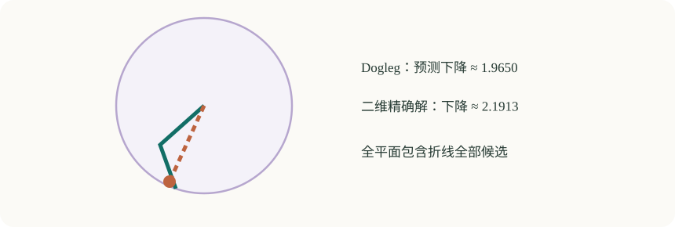

# 4.1.4 二维子空间最小化：比 Dogleg 折线更大的搜索范围

Dogleg 只考虑两段折线，而整个由梯度和 Newton 校正方向张成的二维平面包含所有 Dogleg 候选。若在该平面的信赖域截面上寻找最优步，预测下降不会比 Dogleg 差。

## 从折线拓展为整个可行子空间

设 B 对称正定、g≠0。Dogleg 的关键方向来自 g 和 B⁻¹g，其整条路径都落在 span{g,B⁻¹g}。与其只考察一条折线，不如在这个至多二维的子空间中直接最小化二次模型。

如果 g 与 B⁻¹g 共线，子空间实际上只有一维；在高维模型中，通常仍远小于原问题维数。

$$
\min_{\|p\|\le\Delta,\ p\in\operatorname{span}\{g,B^{-1}g\}}g^\top p+\tfrac12p^\top Bp.
$$

## 为什么模型下降不会差于 Dogleg

Dogleg 步是这个二维子空间的可行点，因此将搜索范围扩大到子空间后，最优模型值不可能更高。若 Dogleg 已经达到球内全局最优，则两种方法下降相同；否则二维方法可能进一步改善。

更大的候选范围可能增加每轮计算成本。单步模型下降更大不等于整个算法迭代一定更少，也不保证真实目标函数取得同样改进。



*Dogleg 的候选受折线路径限制；二维子空间内还可以到达更好的球内位置。图形仅表达包含关系，非精确数值轨迹。*

## 同一个二维模型的对照结果

继续用 g=(2,2)、B=diag(4,1)。在二维空间中 g 与 B⁻¹g 不共线，因此子空间恰好是整个 R²。球内的精确二次模型极小点满足 (B+λI)p=−g，λ≥0；当半径约束激活时 ‖p‖=Δ。

对 Δ=1.3，可令 p(λ)=(−2/(4+λ),−2/(1+λ)) 并用二分确定 λ≈0.631095，得到预测下降约 2.191309，大于相同设置下 Dogleg 的 1.965007。

## 为什么能对 λ 做二分

对正定 B，λ 增大时 p(λ) 的范数单调缩小。先判断完整 Newton 步是否已在球内；若不在，则找到足够大的 λ 使范数不超过 Δ，再对 λ 区间进行二分。

这一推导之所以简单，是因为例子选取了二维正定对角 B。在高维问题中，二维子空间通常并不等于整个空间；而 B 不定时需要引入负曲率方向和特殊情形处理。

## 不能忽视不定 Hessian

当 B 不定时，B⁻¹g 不再表示无约束模型的极小点。采用二维子空间仍然可能有用，但应对负特征值进行额外处理，并防止非奇异假设被悄悄破坏。

页面给出的程序只实现正定二维模型的标量乘子搜索，用来验证下界与模型下降，不能被当作通用高维信赖域子问题求解器。

## 参数交互

比较 Δ=1.3 与 Δ=2.5：后者是否还需要对 λ 进行二分？ [在 HTML 页面中操作](./03_4.1.4._Two_Dimensional_Subspace_Minimization.html)。

## Python 实验

```python
"""Exact trust-region solution for an SPD two-dimensional model."""
from math import hypot

def norm_at(lam):
    return hypot(2/(4+lam),2/(1+lam))

def solve(radius):
    if radius<=0:
        raise ValueError("radius must be positive")
    if norm_at(0)<=radius:
        return (-0.5,-2.0),0.0
    lo,hi=0.0,1.0
    while norm_at(hi)>radius:
        hi*=2
    for _ in range(90):
        mid=(lo+hi)/2
        if norm_at(mid)>radius: lo=mid
        else: hi=mid
    lam=(lo+hi)/2
    return (-2/(4+lam),-2/(1+lam)),lam

def reduction(p):
    x,y=p
    return -(2*x+2*y+0.5*(4*x*x+y*y))

if __name__ == "__main__":
    for radius in (0.5,1.3,2.5):
        p,lam=solve(radius)
        print(radius,lam,p,reduction(p))
        assert hypot(*p)<=radius+1e-10 and lam>=0
    p,lam=solve(1.3)
    assert abs(lam-0.6310945588223069)<1e-8
    assert abs(reduction(p)-2.1913087311268886)<1e-8
    assert reduction(p)>1.9650065164267754
```

## 适用边界

本例二维子空间恰好是整个 R²，不能据此推广说高维子空间法总是精确解。B 不定时需另行处理负曲率。

## 参考依据

- Nocedal & Wright, *Numerical Optimization*, 2nd ed., Chapter 4, Section 4.1, Two-Dimensional Subspace Minimization, pp. 76–77。[出版信息](https://doi.org/10.1007/978-0-387-40065-5)；[原书 PDF](https://deeplearningpku.github.io/literature/Nocedal_Wright_Numerical_optimization_v2.pdf)。

本页所有教学数值、图和程序均独立编写。
