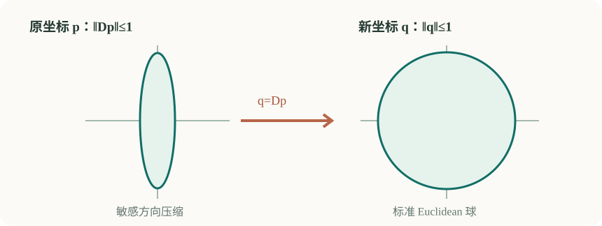

# 4.5.1 尺度变换：把原坐标中的椭球变成可计算的球

若不同变量的典型变化尺度相差百倍，以一个圆形半径限制它们可能很不合理。正对角尺度矩阵 D 把敏感方向缩短、不敏感方向放宽，并将原坐标的椭球变成新坐标下的标准欧氏球。

## 同样的绝对步长对不同变量不一定公平

假设一个模型对 x₁ 的小变化十分敏感，对 x₂ 的较大变化才有同等反应。采用 Euclidean 球 ‖p‖₂≤Δ，会允许两个方向相同的绝对位移，但这可能使一条方向上的局部二次近似明显更差。

选正对角矩阵 D=diag(d₁,…,dₙ)，dᵢ＞0，使用 ‖Dp‖₂≤Δ。较大的 dᵢ 意味着在第 i 个原始坐标上允许更短的移动。

$$
\|Dp\|_2\le\Delta,\qquad q=Dp,\quad B_{\mathrm{scaled}}=D^{-1}BD^{-1}.
$$

## 换元时必须同时变换梯度和 Hessian

定义缩放坐标 q=Dp，即 p=D⁻¹q。此时 ‖Dp‖≤Δ 变成标准球 ‖q‖≤Δ；但原二次模型 m(p)=fₖ+gᵀp+½pᵀBp 也必须变换为 fₖ+(D⁻¹g)ᵀq+½qᵀ(D⁻¹BD⁻¹)q。

由于这里 D 为正对角矩阵，D⁻ᵀ=D⁻¹。若只把信赖域画成圆而保留旧梯度和旧 Hessian，将求解不同的优化问题。



*当 D=diag(10,1)，原坐标中的信赖域是水平方向短、竖直方向长的椭圆。换元 q=Dp 后，同一组可行点在新坐标中构成圆。两个图示并未按精确比例标注坐标轴单位。*

## 二维各向异性模型的完全算例

考虑 g=(10,1)、B=diag(100,1)，以及 D=diag(10,1)。原模型第一个方向的曲率是第二个的 100 倍，而新坐标的梯度 ĝ=D⁻¹g=(1,1)、Hessian B̃=D⁻¹BD⁻¹=I。

当 Δ=1，圆内最优点是 q*=(-1/√2,-1/√2)，原坐标步长 p*=(-1/(10√2),-1/√2)。它满足 ‖Dp*‖=1，预测下降为 √2−½≈0.914214。

## 缩放矩阵如何影响数值求解

在正定模型中，选择与曲率尺度匹配的 D 可以使变换后的 Hessian 条件数更接近 1，减少不同方向的悬殊惩罚。交互例子让第一坐标的 d₁ 在 1 至 10 之间变化，并直接解对应变换后的正定球约束问题。

缩放本身不会把不定 Hessian 变成正定矩阵，也不能保证任何固定规则都改善实际优化效率。若 D 依赖 Hessian 对角线，必须考虑非正数、零元素和不同变量单位。

## 理论和实践的边界

正对角缩放改变的不是原目标函数本身，而是算法在当前点相信二次模型的区域形状。缩放后的候选仍应通过真实/预测下降比决定是否接受。

本页只处理两个变量、对角正定 B 的独立例子，不提供适合一般高维非凸问题的自适应尺度选取方法。

## 交互实验

[网页交互](./00_4.5.1._Scaling.html) 可直接调整 d₁。

## Python 代码

```python
"""Scale a 2D SPD trust-region model using q=D*p."""
from math import hypot,sqrt

def solve(d,delta=1.0):
    if d<=0 or delta<=0: raise ValueError("positive scale and radius")
    grad=(10.0/d,1.0)
    curv=(100.0/d**2,1.0)
    def scaled(lam):
        return (-grad[0]/(curv[0]+lam),-grad[1]/(curv[1]+lam))
    if hypot(*scaled(0))<=delta:
        lam=0.0
    else:
        lo,hi=0.,1.
        while hypot(*scaled(hi))>delta: hi*=2
        for _ in range(80):
            mid=(lo+hi)/2
            if hypot(*scaled(mid))>delta: lo=mid
            else: hi=mid
        lam=(lo+hi)/2
    q=scaled(lam)
    p=(q[0]/d,q[1])
    drop=-(10*p[0]+p[1]+.5*(100*p[0]**2+p[1]**2))
    return q,p,drop,lam

if __name__=="__main__":
    q,p,drop,lam=solve(10)
    print(q,p,drop,lam)
    assert abs(q[0]+1/sqrt(2))<1e-12
    assert abs(q[1]+1/sqrt(2))<1e-12
    assert abs(hypot(10*p[0],p[1])-1)<1e-12
    assert abs(drop-(sqrt(2)-.5))<1e-12
    assert abs(lam-(sqrt(2)-1))<1e-12
    for d in (1,2,5,10):
        _,p,drop,_=solve(d)
        assert hypot(d*p[0],p[1])<=1+1e-10
        assert drop>0
```

## 参考来源与边界

缩放矩阵必须可逆，且要同步改变 Hessian 与梯度，不能以几何图形替代模型计算。

Nocedal & Wright, *Numerical Optimization*, 2nd ed., Section 4.5, Scaling, equations (4.56)–(4.61), pp. 95–97。[Springer](https://doi.org/10.1007/978-0-387-40065-5)；[PDF](https://deeplearningpku.github.io/literature/Nocedal_Wright_Numerical_optimization_v2.pdf)。
