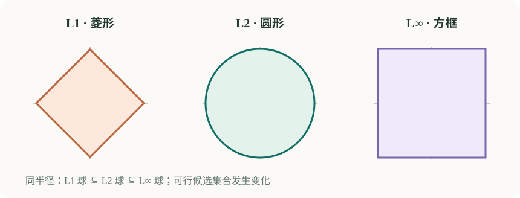

# 4.5.2 其他范数的信赖域：圆、菱形、方框为什么影响可行步

相同半径下，L1 范数限定菱形、L2 限定圆形、L∞ 限定方框。它们允许的候选步不同；若目标带非负变量界，L∞ 的盒状区域还可与变量边界直接形成逐坐标上下界。

## 三种范数的定义与集合包含关系

对二维 p=(p₁,p₂)，‖p‖₁=|p₁|+|p₂|，‖p‖₂=√(p₁²+p₂²)，‖p‖∞=max(|p₁|,|p₂|)。由于 ‖p‖∞≤‖p‖₂≤‖p‖₁，固定同一个 Δ 时，L1 球包含于 L2 球，后者又包含于 L∞ 球。

因此换范数不仅改变图形，还改变优化时可测试的步长集合。

$$
\|p\|_1=|p_1|+|p_2|,\quad
\|p\|_2=\sqrt{p_1^2+p_2^2},\quad
\|p\|_\infty=\max(|p_1|,|p_2|).
$$

## 为什么盒状信赖域容易和简单变量界结合

若要求 x≥0，当前点 xₖ 上的合法更新满足 xₖ+p≥0，即 pᵢ≥−xₖᵢ。再施加 ‖p‖∞≤Δ 就得到每坐标 −Δ≤pᵢ≤Δ。

合并两个条件可写成 max(−xₖᵢ,−Δ)≤pᵢ≤Δ，是直接的盒约束。L2 圆与非负正交象限相交则是圆弧边界，不再只是各坐标独立区间。



*固定半径下，L1 的菱形球嵌于 L2 圆，L2 圆又嵌于 L∞ 方框。对有坐标界的变量，方框的每一条边界都有直接的逐坐标约束解释。*

## 一个同时满足非负性但不满足欧氏半径的角落步

令 xₖ=(0.2,0.3)、Δ=0.3，并选 p=(−0.2,−0.3)。新点 xₖ+p=(0,0)，满足非负约束。p 的 L∞ 范数为 0.3，在盒内；L2 范数是 √0.13≈0.36056，超过半径；L1 范数是 0.5，也超过半径。

这说明同一半径下，一个角落候选可以被 L∞ 接受，却被 L1 和 L2 拒绝。

## 带对角二次模型的盒约束最优值

考虑 q(p)=gᵀp+½pᵀBp，g=(1,2)、B=diag(2,4)。无约束最优步为 (−0.5,−0.5)，但 xₖ=(0.2,0.3) 与 Δ=0.3 给出盒约束 p₁∈[−0.2,0.3]、p₂∈[−0.3,0.3]。

由于该 B 对角正定，分别截断无约束分量即可得到最优步 p*=(-0.2,-0.3)。其模型值为 −0.58，因此预测下降为 0.58。这是特殊的分离二次目标，不代表所有盒约束 QP 都能逐坐标截断。

## 使用不同范数的选择并无统一赢家

对于没有界约束的小中规模问题，L2 球便于推导正交谱与 Hessian 乘子条件；遇到简单变量界或高维结构性约束时，L∞ 方框可能更加自然。

若 B 含非零交叉项或负曲率，独立截断不再保证求解正确。任何近似子问题仍需检查充分模型下降与外层实际/预测比。

## 交互实验

[网页交互](./01_4.5.2._Trust_Regions_in_Other_Norms.html) 调整 Δ，计算盒约束二次模型。

## Python 代码

```python
"""Compare L1/L2/Linf radii with a nonnegative-variable box QP."""
from math import hypot,sqrt
X=(0.2,0.3)
P=(-0.2,-0.3)
def norms(p):
    return abs(p[0])+abs(p[1]),hypot(*p),max(abs(p[0]),abs(p[1]))
def boxed(delta):
    if delta<=0: raise ValueError("radius must be positive")
    low=(-min(X[0],delta),-min(X[1],delta))
    unconstrained=(-0.5,-0.5)
    p=tuple(max(low[i],min(delta,unconstrained[i])) for i in range(2))
    model=p[0]+2*p[1]+p[0]**2+2*p[1]**2
    return p,-model
if __name__=="__main__":
    n1,n2,ninf=norms(P)
    print("norms",n1,n2,ninf)
    assert abs(n1-0.5)<1e-12
    assert abs(n2-sqrt(.13))<1e-12
    assert ninf==.3 and n2>.3 and n1>.3
    p,drop=boxed(.3)
    assert p==P and abs(drop-.58)<1e-12
    for delta in (.1,.3,.6):
        p,drop=boxed(delta)
        assert max(abs(z) for z in p)<=delta+1e-12
        assert all(X[i]+p[i]>=-1e-12 for i in (0,1))
        assert drop>0
```

## 边界与出处

坐标裁剪只适用于本例分离的二次模型；耦合 B 需要其他有界二次规划求解方法。

Nocedal & Wright, *Numerical Optimization*, 2nd ed., Section 4.5, Trust Regions in Other Norms, equation (4.62), pp. 97–98。[Springer](https://doi.org/10.1007/978-0-387-40065-5)；[PDF](https://deeplearningpku.github.io/literature/Nocedal_Wright_Numerical_optimization_v2.pdf)。
