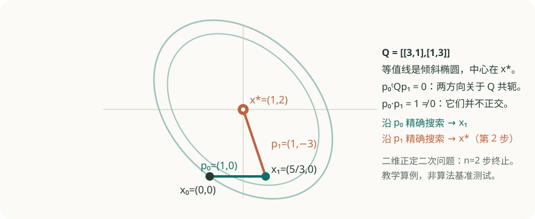

# 5.1.1 共轭方向法：把 n 维二次问题拆成 n 个一维搜索

对对称正定二次目标，只要搜索方向两两关于 Q 共轭，沿每个方向精确搜索一次，就能在第 n 步抵达精确解。这把一个 n 维问题归约成 n 个可独立求解的一维问题，也是共轭梯度法的理论起点。

## 正定二次目标与线性方程组

考虑二次目标 φ(x)=½xᵀQx−bᵀx，其中 Q 是对称正定矩阵（SPD），b 给定。Q 正定保证 φ 严格凸，且当 Qx=b 时 φ 取到唯一最小值。梯度是 ∇φ(x)=Qx−b，令梯度为零即得线性方程组 Qx=b。

因此“极小化正定二次函数”和“解对称正定线性方程组”是同一个问题。最优值可以写成 φ(x*)=−½bᵀQ⁻¹b，它只依赖 Q 与 b。

$$
\phi(x)=\tfrac12 x^\top Q x - b^\top x,\qquad \nabla\phi(x)=Qx-b.
$$

## 关于 Q 共轭的方向

设 p₀,…,p_{n−1} 为非零向量。若对所有 i≠j 都有 pᵢᵀQpⱼ=0，就称这组方向关于 Q 共轭（也称 Q-正交）。把欧氏内积 ⟨u,v⟩=uᵀv 换成 Q-内积 ⟨u,v⟩_Q=uᵀQv，共轭就是这组新内积下的正交性；当 Q=I 时它退化为普通正交。

当 Q 正定时，Q-内积是真正的内积，因此一组两两共轭的非零方向必线性无关，恰好构成 Rⁿ 的一组基。下面的定理正是利用这一点。

$$
p_i^\top Q p_j = 0 \quad (i\neq j),\qquad u^\top Q v = \langle u, v\rangle_Q.
$$

## 精确搜索下 n 步终止

定理（Nocedal & Wright, Theorem 5.1）。设 Q 对称正定，p₀,…,p_{n−1} 关于 Q 共轭。从任意起点 x₀ 出发，沿这些方向依次做精确线搜索，则第 n 步的迭代点就是唯一解 x*。

推导骨架如下。因为共轭方向构成 Rⁿ 的基，唯一解可写为 x*=x₀+Σₖ αₖpₖ。用 pₖᵀQ 左乘并利用共轭性，交叉项全部消失，得到整段步长 αₖ=pₖᵀQ(x*−x₀)/(pₖᵀQpₖ)。另一方面，第 k 步在射线 xₖ+tpₖ 上最小化 φ 得到的最优步长是 αₖ=−gₖᵀpₖ/(pₖᵀQpₖ)。两者相等，于是每一步的贪心精确搜索恰好恢复整段展开的系数。

等价的说法是：第 k 步之后梯度 gₖ 与 p₀,…,p_{k−1} 全部正交，而第 n 个梯度 gₙ 与所有基方向正交，因此只能是零向量，即 xₙ=x*。

$$
\alpha_k = -\frac{g_k^\top p_k}{p_k^\top Q p_k},\qquad g_k = Qx_k - b.
$$

## 二维可复现算例

取 Q=[[3,1],[1,3]]、b=(5,7)，则 x*=Q⁻¹b=(1,2)。起点 x₀=(0,0)，初始梯度 g₀=Qx₀−b=(−5,−7)。

选 p₀=(1,0)：p₀ᵀQp₀=3，g₀ᵀp₀=−5，故 α₀=5/3，x₁=x₀+α₀p₀=(5/3,0)。再取 p₁=(1,−3)：检查 p₁ᵀQp₀=(1,−3)ᵀ(3,1)=3−3=0，确实与 p₀ 关于 Q 共轭；注意 p₀·p₁=1≠0，它们并不正交。此时 g₁=Qx₁−b=(0,−16/3)，p₁ᵀQp₁=24，g₁ᵀp₁=16，所以 α₁=−2/3，x₂=x₁+α₁p₁=(1,2)=x*。两步结束。

作为对照，若误用 p₁=(0,1)，则 p₁ᵀQp₀=(0,1)ᵀ(3,1)=1≠0，共轭性不成立，两步不会恰好落在 x*。这正是定理假设不可省略的体现。



*同一个二维正定二次问题中，p₀ 与 p₁ 关于 Q 共轭但彼此不正交。沿两条共轭方向各做一次精确搜索，第二步即落在等值线中心 x*。*

## 这是共轭梯度法的起点，也是它的边界

共轭方向法要求方向提前给定；定理 5.1 依赖 Q 正定、方向精确共轭以及沿射线精确线搜索。共轭梯度法要解决的正是这个前提：它不预先构造共轭方向，而是在迭代中利用梯度信息自动生成一组共轭方向，从而在正定二次问题上仍然 n 步终止，且无需显式构造或存储全部方向。

对一般非线性函数，不存在固定的 Q，也就没有全局的“n 步终止”。那时需要 5.2 节的重启策略与全局收敛分析。本页的程序只处理一个固定的二维正定二次问题，用来核对精确步长与终止结论；它不是通用求解器，也不覆盖舍入误差、病态条件数或大规模情形。

## 参数交互

固定 p₀=(1,0)，把第二个方向取为 p₁=(1,t)，拖动滑块改变 t。当 t=−3 时达到共轭条件 p₁ᵀQp₀=3+t=0，两步迭代恰好落到 x*=(1,2)。[在 HTML 页面中操作](./00_5.1.1._Conjugate_Direction_Methods.html)。

## Python 实验

```python
"""Conjugate direction method on a 2x2 positive definite quadratic."""
from math import sqrt

Q = ((3.0, 1.0), (1.0, 3.0))
b = (5.0, 7.0)

def matvec(M, v):
    return (M[0][0]*v[0] + M[0][1]*v[1], M[1][0]*v[0] + M[1][1]*v[1])

def dot(u, v):
    return u[0]*v[0] + u[1]*v[1]

def gradient(x):
    qx = matvec(Q, x)
    return (qx[0] - b[0], qx[1] - b[1])

def exact_step(x, p):
    return -dot(gradient(x), p) / dot(p, matvec(Q, p))

def run(x0, directions):
    x = x0
    alphas = []
    for p in directions:
        a = exact_step(x, p)
        alphas.append(a)
        x = (x[0] + a*p[0], x[1] + a*p[1])
    return x, alphas

if __name__ == "__main__":
    p0, p1 = (1.0, 0.0), (1.0, -3.0)
    assert abs(dot(p0, matvec(Q, p1))) < 1e-12
    assert abs(dot(p0, p1) - 1.0) < 1e-12
    x_star, alphas = run((0.0, 0.0), (p0, p1))
    assert sqrt((x_star[0]-1.0)**2 + (x_star[1]-2.0)**2) < 1e-12
    assert abs(alphas[0] - 5/3) < 1e-12
    assert abs(alphas[1] + 2/3) < 1e-12
    print("x* =", x_star, "alpha =", [round(a, 6) for a in alphas])
```

## 适用边界

共轭方向法的 n 步终止严格依赖 Q 对称正定、方向关于 Q 共轭以及精确线搜索三个前提；缺任一条则结论失效。

## 参考依据

- Nocedal & Wright, *Numerical Optimization*, 2nd ed., Chapter 5, Section 5.1（含 Theorem 5.1 与共轭方向法的定义），pp. 105–109。[出版信息](https://doi.org/10.1007/978-0-387-40065-5)；[原书 PDF](https://deeplearningpku.github.io/literature/Nocedal_Wright_Numerical_optimization_v2.pdf)。

本页所有教学数值、图和程序均独立编写。
