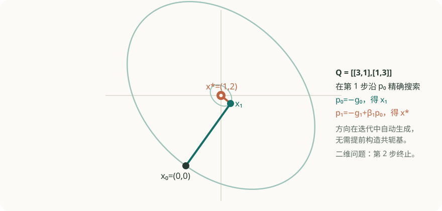

# 5.1.2 共轭梯度法的基本性质：自动共轭与残余正交

共轭梯度法不需要预先给定共轭方向；它用当前梯度构造新方向，并保证新方向与上一次方向关于 Q 共轭，同时让相邻梯度彼此正交。这两个性质把任意起点上的迭代导向 Krylov 子空间中的最优解，并在正定二次问题上 n 步终止。

## 从给定方向到生成方向

5.1.1 的共轭方向法假设方向已经给定。共轭梯度法反过来：每一步只保存一个方向，用当前梯度自动构造新的共轭方向。本页固定符号约定为 g_k=Qx_k−b（即二次目标的梯度，也是线性方程组 Qx=b 的残余的相反数；部分文献把残余记作 r_k=b−Qx_k，二者相差一个负号）。

递推从一个纯梯度方向开始，之后每一步把当前梯度再减去上一方向的成分，使其关于 Q 共轭：第一步 p₀=−g₀，此后 p_{k+1}=−g_{k+1}+β_{k+1}p_k。系数 β 由“让新方向与旧方向 Q-正交”这一要求确定。

$$
p_0=-g_0,\qquad p_{k+1}=-g_{k+1}+\beta_{k+1}p_k,\qquad \beta_{k+1}=\frac{g_{k+1}^\top Q p_k}{p_k^\top Q p_k}.
$$

## 三个关键性质

性质（Nocedal & Wright 定理 5.2）。设 Q 对称正定，方向按上面的递推从 p₀=−g₀ 生成。则：一，方向组 p₀,…,p_{n−1} 两两关于 Q 共轭；二，梯度两两正交，即 g_iᵀg_j=0 对 i≠j 成立；三，前 k 个方向张成的空间等于前 k 个“梯度—曲率”向量张成的空间，即 span{p₀,…,p_{k−1}}=span{g₀,Qg₀,…,Q^{k−1}g₀}。

第二条最直观：精确线搜索让 g_{k+1} 垂直于搜索方向 p_k，而 Q-共轭与线性组合关系再把“垂直于上一个方向”放大成“垂直于此前所有梯度”。

$$
g_i^\top g_j = 0 \quad (i\neq j),\qquad \operatorname{span}\{p_0,\dots,p_{k-1}\}=\operatorname{span}\{g_0,Qg_0,\dots,Q^{k-1}g_0\}.
$$

## Krylov 子空间中的最优性

性质三给出了更强的解释：第 k 步的迭代点 x_k 是在整个仿射集 x₀+K_k(g₀,Q) 上使 φ 最小的点，而不只是沿单一方向的最好点。这里 K_k(g₀,Q)=span{g₀,Qg₀,…,Q^{k−1}g₀} 称为第 k 个 Krylov 子空间。

这正是 CG 优于最速下降的地方：最速下降每一步只看当前梯度，容易在狭长椭圆的谷底来回摆动；CG 在逐步扩大的 Krylov 子空间上取最优，因此对正定二次问题最多 n 步就精确终止。

$$
x_k=\arg\min_{x\in x_0+K_k(g_0,Q)}\phi(x).
$$

## β 的实用递推形式

由残余正交性可以证明，共轭形式的分母与分子可以化简，得到只用两个内积的 Fletcher–Reeves 系数：β_{k+1}=g_{k+1}ᵀg_{k+1}/g_kᵀg_k。它不再需要显式地算 g_{k+1}ᵀQp_k，但计算步长 α_k 时仍然需要矩阵-向量乘积 Qp_k。

这个等价关系只在“精确线搜索 + 线性共轭梯度”下成立。一旦目标非线性或线搜索不精确（即 5.2 节的情形），不同 β 公式不再等价，需要另行选择，并配合重启策略。

$$
\beta_{k+1}=\frac{g_{k+1}^\top g_{k+1}}{g_k^\top g_k}.
$$

## 二维精确算例

仍取 Q=[[3,1],[1,3]]、b=(5,7)，则 x*=Q⁻¹b=(1,2)。从 x₀=(0,0) 出发：g₀=(−5,−7)，p₀=(5,7)。p₀ᵀQp₀=292，故 α₀=74/292=37/146≈0.2534，得 x₁≈(1.2671,1.7740)。

下一步梯度 g₁=(42/73,−30/73)≈(0.5753,−0.4110)。直接代入得 g₀ᵀg₁=(−5)(42/73)+(−7)(−30/73)=0，残余正交性成立。于是 Fletcher–Reeves 系数 β₁=g₁ᵀg₁/g₀ᵀg₀≈0.00676，p₁≈(−0.5416,0.4583)。再走一步得 α₁≈0.4934，x₂≈(1.0000,2.0000)=x*，两步终止。

下面的程序用分数（Fraction）精确算术复现同一过程，避免浮点误差对“正交性是否等于零”的判断造成干扰。



*CG 从 x₀ 出发，先沿纯梯度方向 p₀ 到 x₁，再用自动正交化后的方向 p₁ 修正。方向在迭代中生成，无需提前构造共轭基；二维问题第 2 步终止，与定理 5.1 一致。*

## 有限精度下的失效边界

上述正交性与共轭性在精确算术下严格成立。在浮点运算中，它们会逐步退化：舍入误差使 g_iᵀg_j 不再恰好为零，n 步终止也不再严格。病态问题（条件数很大）下退化更快。

这正是实际 CG 需要重启（见 5.2.3）与预条件（5.1.5–5.1.6）的原因。本页的程序用分数精确算术验证性质，不对浮点 CG 的收敛步数或稳健性作任何声明。

## 参数交互

把起点取为 x₀=(t,t)，拖动滑块改变 t。因为残余正交性是 CG 的不变量，无论从哪里出发，g₀ᵀg₁ 都为零，且两步都落到 x*=(1,2)。[在 HTML 页面中操作](./01_5.1.2._Basic_Properties_of_the_Conjugate_Gradient_Method.html)。

## Python 实验

```python
"""Exact-arithmetic conjugate gradient on a 2x2 positive definite quadratic."""
from fractions import Fraction as F

Q = ((F(3), F(1)), (F(1), F(3)))
b = (F(5), F(7))
xstar = (F(1), F(2))

def matvec(v):
    return (Q[0][0]*v[0] + Q[0][1]*v[1], Q[1][0]*v[0] + Q[1][1]*v[1])

def dot(u, v):
    return u[0]*v[0] + u[1]*v[1]

def gradient(x):
    q = matvec(x)
    return (q[0] - b[0], q[1] - b[1])

def run(x0, steps):
    x, g = x0, gradient(x0)
    p = (-g[0], -g[1])
    grads = [g]
    for _ in range(steps):
        alpha = -dot(g, p) / dot(p, matvec(p))
        x = (x[0] + alpha*p[0], x[1] + alpha*p[1])
        g_next = gradient(x)
        beta = dot(g_next, g_next) / dot(g, g)
        p = (-g_next[0] + beta*p[0], -g_next[1] + beta*p[1])
        g, grads = g_next, grads + [g_next]
    return x, grads

if __name__ == "__main__":
    x2, grads = run((F(0), F(0)), 2)
    assert dot(grads[0], grads[1]) == 0
    assert dot(grads[0], grads[2]) == 0
    assert x2 == xstar
    assert matvec(x2) == b
    print("x2 =", tuple(str(c) for c in x2), "| g0.g1 =", dot(grads[0], grads[1]))
```

## 适用边界

共轭梯度的共轭性、残余正交性与 Krylov 最优性都以精确线搜索为前提；浮点环境下需要重启与预条件来维持。

## 参考依据

- Nocedal & Wright, *Numerical Optimization*, 2nd ed., Chapter 5, Section 5.1（Theorem 5.2 与 Fletcher–Reeves 系数），pp. 106–110。[出版信息](https://doi.org/10.1007/978-0-387-40065-5)；[原书 PDF](https://deeplearningpku.github.io/literature/Nocedal_Wright_Numerical_optimization_v2.pdf)。

本页所有教学数值、图和程序均独立编写。
