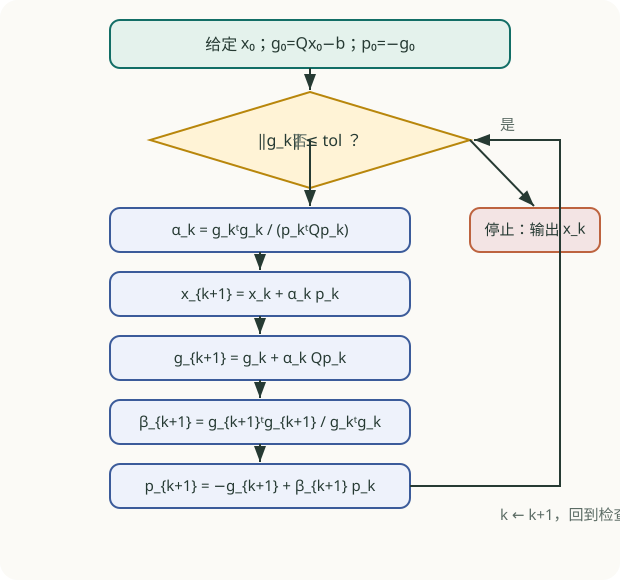

# 5.1.3 线性共轭梯度法的实用形式：只有向量运算

把共轭方向法改写成只维护当前解、梯度、方向和一次矩阵-向量乘积的形式：每轮一次 Qp_k、两个内积与几次向量更新，存储 O(n)。这就是算法 5.2 的线性共轭梯度法。

## 为什么要改写算法

5.1.1 的共轭方向法要求把 n 个方向全部存储下来，并在构造阶段求解共轭性。对大型稀疏正定问题，这既占内存又难以实现。共轭梯度法给出一个等价但从不需要存储全部方向的版本：它只保留“当前解 x_k、当前梯度 g_k、当前方向 p_k”三个长度为 n 的向量，以及一个临时的 Qp_k。

代价是每轮一次矩阵-向量乘积 Qp_k、两次内积（g_kᵀg_k 与 p_kᵀQp_k）和几次长度 n 的向量更新。当 Q 稀疏或只需一个算子作用时，这使得 CG 特别适合大规模问题。

## 算法 5.2 的完整流程

下面给出线性共轭梯度法的循环结构。初始化后每轮先检查停止准则，再依次计算步长、更新解与梯度、计算系数、生成新方向。所有公式都使用本课程的符号约定 g_k=Qx_k−b。



*算法 5.2 的迭代流程。每一轮只用到向量运算与一次矩阵-向量乘积 Qp_k；范数满足容差时输出当前解。*

## 更新公式与符号约定

梯度更新使用 g_{k+1}=g_k+α_k Qp_k，这比直接算 Qx_{k+1}−b 少一次矩阵-向量乘积。系数用 Fletcher–Reeves 形式 β_{k+1}=g_{k+1}ᵀg_{k+1}/g_kᵀg_k，新方向取 p_{k+1}=−g_{k+1}+β_{k+1}p_k。所有公式中的 g_k 都是梯度；若把残余定义为 r_k=b−Qx_k，则 r_k=−g_k，公式需要相应改号。

$$
\alpha_k=\frac{g_k^\top g_k}{p_k^\top Q p_k},\qquad g_{k+1}=g_k+\alpha_k Q p_k,\qquad p_{k+1}=-g_{k+1}+\beta_{k+1}p_k.
$$

## 计算代价与存储

每轮的主导开销是一次矩阵-向量乘积 Qp_k。此外只需两次内积（g_kᵀg_k 与 p_kᵀQp_k）和几次形如 u←u+αv 的向量更新。常驻存储只有 x_k、g_k、p_k 三个长度为 n 的向量，外加一个临时 Qp_k，所以总存储是 O(n)。

与直接分解（如 Cholesky）相比，CG 不修改 Q，也不要求显式存储分解因子。只要能把 Q 作用到任意向量上，就能运行 CG——这正是它在大型稀疏问题上流行的原因。

## 一次迭代的数值追踪

仍取 Q=[[3,1],[1,3]]、b=(5,7)，从 x₀=(0,0) 开始。初始化：g₀=(−5,−7)，p₀=(5,7)，g₀ᵀg₀=74。

第一轮：Qp₀=Q(5,7)=(22,26)，p₀ᵀQp₀=292，故 α₀=74/292=37/146≈0.2534；x₁=(1.2671,1.7740)。梯度用增量公式更新：g₁=g₀+α₀Qp₀=(42/73,−30/73)≈(0.5753,−0.4110)。系数 β₁=g₁ᵀg₁/g₀ᵀg₀≈0.00676，新方向 p₁=−g₁+β₁p₀≈(−0.5416,0.4583)。

第二轮重复同一套更新，得到 x₂=x*=(1,2)，此时 g₂=0，范数准则触发，循环结束。整个过程只用到两个不同的矩阵-向量乘积 Qp₀ 与 Qp₁。

$$
g_1=g_0+\alpha_0 Q p_0,\qquad \beta_1=\frac{g_1^\top g_1}{g_0^\top g_0}.
$$

## 停止准则与适用边界

实用算法用 ‖g_k‖≤tol 作为停止准则。对正定二次问题，误差的能量范数恰好等于梯度的 Q⁻¹ 范数：‖x_k−x*‖_Q²=g_kᵀQ⁻¹g_k，所以梯度范数是一个可靠的尺度。精确算术下最多 n 步终止；浮点环境下舍入误差使准则提前或延后触发，需要重启与预条件来控制。

本页程序是线性共轭梯度的教学实现，只处理对称正定线性方程组对应的二次目标；它不处理非线性目标（见 5.2）、不处理不定矩阵，也不声称对病态问题有特定收敛速度。

## 参数交互

把起点取为 x₀=(t,t)，拖动滑块改变 t。面板列出每轮的梯度范数与步长，最后给出第三次检查时的 ‖g‖ 与当前解。[在 HTML 页面中操作](./02_5.1.3._A_Practical_Form_of_the_Conjugate_Gradient_Method.html)。

## Python 实验

```python
"""Practical linear conjugate gradient (Algorithm 5.2) on a small quadratic."""
from math import sqrt

def cg(Q, b, x0, tol=1e-12, max_iter=10):
    n = len(b)
    mv = lambda v: [sum(Q[i][j]*v[j] for j in range(n)) for i in range(n)]
    dot = lambda u, v: sum(u[i]*v[i] for i in range(n))
    x = list(x0)
    g = [mv(x)[i] - b[i] for i in range(n)]
    p = [-g[i] for i in range(n)]
    gnorm = dot(g, g)
    for k in range(max_iter):
        if sqrt(gnorm) <= tol:
            return x, k
        Qp = mv(p)
        alpha = gnorm / dot(p, Qp)
        x = [x[i] + alpha*p[i] for i in range(n)]
        g = [g[i] + alpha*Qp[i] for i in range(n)]
        gnorm_new = dot(g, g)
        beta = gnorm_new / gnorm
        p = [-g[i] + beta*p[i] for i in range(n)]
        gnorm = gnorm_new
    return x, max_iter

if __name__ == "__main__":
    Q = [[3.0, 1.0], [1.0, 3.0]]
    b = [5.0, 7.0]
    x, iters = cg(Q, b, [0.0, 0.0])
    assert iters == 2
    assert abs(x[0] - 1.0) < 1e-9 and abs(x[1] - 2.0) < 1e-9
    print("x =", [round(v, 6) for v in x], "iterations =", iters)
```

## 适用边界

实用形式只把共轭方向法改写成向量递归，并未放松它的前提：Q 对称正定、精确算术与线性目标仍然必需。

## 参考依据

- Nocedal & Wright, *Numerical Optimization*, 2nd ed., Chapter 5, Section 5.1, Algorithm 5.2, pp. 110–111。[出版信息](https://doi.org/10.1007/978-0-387-40065-5)；[原书 PDF](https://deeplearningpku.github.io/literature/Nocedal_Wright_Numerical_optimization_v2.pdf)。

本页所有教学数值、图和程序均独立编写。
