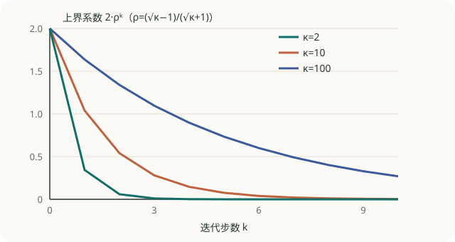

# 5.1.4 共轭梯度法的收敛速度：条件数与特征值

在能量范数下，CG 的误差被 2·((√κ−1)/(√κ+1))^k 控制，κ 是 Q 的谱条件数；若 Q 只有 N 个不同特征值，精确算术下至多 N 步终止。收敛速度取决于谱的分布，而不只是问题规模。

## 用什么度量误差

讨论 CG 的收敛速度时，合适的误差尺度不是欧氏距离，而是能量范数 ‖e‖_Q=√(eᵀQe)。它把不同方向的曲率纳入考虑：在曲率大的方向，同样的坐标偏差对应更大的能量误差。

由梯度关系 g_k=Q(x_k−x*)=−Qe_k，能量范数误差恰好等于梯度的 Q⁻¹ 范数：‖e_k‖_Q²=g_kᵀQ⁻¹g_k。因此下降 ‖g_k‖ 与下降能量误差是等价的，这是把停止准则建立在梯度范数上的依据。

$$
e_k=x_k-x^*,\qquad \|e_k\|_Q^2=e_k^\top Q e_k=g_k^\top Q^{-1}g_k.
$$

## 条件数给出的收敛界

定理 5.3（Nocedal & Wright）。设 Q 对称正定，κ=λ_max/λ_min 是其谱条件数。则共轭梯度的能量范数误差满足下面的界，其中 ρ=(√κ−1)/(√κ+1)＜1。

这个界说明：条件数越接近 1，收缩因子 ρ 越小，收敛越快；当 κ=1（Q 是单位阵的倍数）时 ρ=0，一次迭代即精确终止。

$$
\|x_k-x^*\|_Q\le 2\left(\frac{\sqrt{\kappa}-1}{\sqrt{\kappa}+1}\right)^k\|x_0-x^*\|_Q.
$$



*定理 5.3 的上界系数随迭代步数收缩。纵轴是 2ρ^k（k=0 时统一为 2），横轴是迭代步数；κ 越大，曲线越靠近上方的平缓线。*

## 从 κ 看收敛速度

把收缩因子 ρ=(√κ−1)/(√κ+1) 作为 κ 的函数，可以直观看到它的行为：κ=1 时 ρ=0；κ=2 时 ρ≈0.172；κ=10 时 ρ≈0.519；κ=100 时 ρ≈0.818，已经接近 1，收缩变得很慢。当 κ→∞ 时 ρ→1，界退化为无信息。

这提醒我们：CG 对于良态问题很快，但一个谱很宽的问题仍然可能需要很多步。改进的思路不是改变 CG，而是改变谱——这就是预条件（5.1.5）的动机。

## 特征值聚集与有限终止

定理 5.4（Nocedal & Wright）。若 Q 只有 N 个不同的特征值，则精确算术下 CG 至多 N 步终止。原因是误差多项式可以在这些特征值处为零，从而一次清除对应分量。

这是一个比“迭代 n 步”更强的结论。它解释了为什么特征值聚集的问题收敛很快：几个相距很远的边缘特征值会在早期迭代中被“扣除”，剩下紧密聚集的特征值等价于一个更小的有效条件数。预条件的思路正是把谱往一起压。

## 多项式观点

从 Krylov 性质可以推出：第 k 步误差可以写成 e_k=p_k(Q)e_0，其中 p_k 是次数不超过 k、且 p_k(0)=1 的多项式。于是在谱区间上取最小最大（Chebyshev）即可得上界，定理 5.3 正是取区间 [λ_min,λ_max] 的最小最大多项式得到。

这个观点把收敛速度归结为“能否找到一个在 [λ_min,λ_max] 上除 0 点外都小的多项式”，直接从谱的分布而不是矩阵规模读出速度。

$$
e_k=p_k(Q)e_0,\qquad \|e_k\|_Q\le \min_{p_k\in P_k,\ p_k(0)=1}\ \max_{\lambda\in[\lambda_{\min},\lambda_{\max}]}|p_k(\lambda)|\cdot\|e_0\|_Q.
$$

## 数值验证与边界

取 Q=[[3,1],[1,3]]，特征值为 2 与 4，所以 κ=2，ρ≈0.1716。定理 5.3 给出 ‖e₁‖_Q≤0.343‖e₀‖_Q、‖e₂‖_Q≤0.0589‖e₀‖_Q。但这个二维例子实际上在第 2 步精确终止，误差为零：因为 Q 只有 2 个不同特征值，定理 5.4 给出的是 N=2 的有限终止，比 κ-界更紧。这说明 κ-界是保守的。

边界：这两个定理都在精确算术下成立。浮点环境下，谱聚集带来的有限终止会被舍入误差破坏，κ-界也可能不再严格成立；实际算法依靠重启与预条件。本页程序用双精度在一系列条件数上对比实际能量范数误差与定理 5.3 的上界，用来观察界的保守程度，而不是声称某个收敛速度。

## 参数交互

选择一个条件数 κ，程序构造一个对角正定矩阵（特征值在 [1,κ] 上均匀分布，规模 n=20），运行 5 步 CG，输出实际能量范数误差与定理 5.3 的上界。[在 HTML 页面中操作](./03_5.1.4._Rate_of_Convergence.html)。

## Python 实验

```python
"""Compare CG energy-norm error with the kappa bound (Theorem 5.3)."""
from math import sqrt

def diag_problem(kappa, n=20):
    lam = [1.0 + (kappa - 1.0)*i/(n - 1) for i in range(n)]
    return lam, list(lam)               # x* = ones, so b = Q x* = eigenvalues

def energy_error(lam, x):
    return sqrt(sum(lam[i]*(x[i] - 1.0)**2 for i in range(len(lam))))

def run(lam, b, steps):
    n = len(lam)
    x = [0.0]*n
    g = [-b[i] for i in range(n)]
    p = [-g[i] for i in range(n)]
    gn = sum(v*v for v in g)
    hist = [energy_error(lam, x)]
    for _ in range(steps):
        if sqrt(gn) <= 1e-14:
            break
        Qp = [lam[i]*p[i] for i in range(n)]
        alpha = gn / sum(p[i]*Qp[i] for i in range(n))
        x = [x[i] + alpha*p[i] for i in range(n)]
        g = [g[i] + alpha*Qp[i] for i in range(n)]
        gn_new = sum(v*v for v in g)
        beta = gn_new / gn
        p = [-g[i] + beta*p[i] for i in range(n)]
        gn = gn_new
        hist.append(energy_error(lam, x))
    return hist

if __name__ == "__main__":
    lam, b = diag_problem(10)
    hist = run(lam, b, 5)
    rho = (sqrt(10) - 1)/(sqrt(10) + 1)
    bound = 2*rho**5*hist[0]
    assert hist[-1] <= bound
    assert hist[-1] < hist[0]
    print("rho =", round(rho, 4), "| bound =", round(bound, 6), "| actual =", round(hist[-1], 6))
```

## 适用边界

κ-界与特征值有限终止均以精确算术为前提；浮点环境下谱聚集带来的快速终止会被舍入误差侵蚀。

## 参考依据

- Nocedal & Wright, *Numerical Optimization*, 2nd ed., Chapter 5, Section 5.1, Theorem 5.3 与 Theorem 5.4, pp. 112–115。[出版信息](https://doi.org/10.1007/978-0-387-40065-5)；[原书 PDF](https://deeplearningpku.github.io/literature/Nocedal_Wright_Numerical_optimization_v2.pdf)。

本页所有教学数值、图和程序均独立编写。
