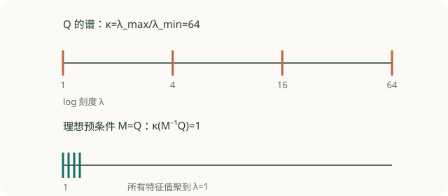

# 5.1.5 预条件：把谱往一起压

用一个对称正定矩阵 M 近似 Q，让求解 Mz=r 很便宜，从而把 M⁻¹Q 的条件数压小。收敛速度由预条件后的谱决定，所以好的预条件器比更快的迭代公式更有效。

## 为什么要预条件

5.1.4 的界说明 CG 的收敛速度由谱条件数 κ 决定。当问题本身病态（κ 很大）时，界退化为无信息，实际迭代也会很慢。与其修改 CG 的公式，不如改变它面对的矩阵：找一个对称正定矩阵 M，让 M 接近 Q（于是 M⁻¹Q 接近单位阵），同时让每次求解 Mz=r 都很便宜。

理想情况下 M=Q，这时 M⁻¹Q=I，条件数为 1，一步即终止。实际中 M 只是 Q 的近似——例如取 Q 的对角部分或它的不完全分解。

## 变换后的系统

把原方程 Qx=b 左乘 M⁻¹，得到 M⁻¹Qx=M⁻¹b。这不再是标准 CG 可直接处理的形式，因为 M⁻¹Q 一般不对称。标准做法是把变量变换 x̂=M^{1/2}x，得到对称正定的等价系统 (M^{-1/2}QM^{-1/2})x̂=M^{-1/2}b，对它用 CG。

因此预条件 CG 的收敛速度由 M^{-1/2}QM^{-1/2} 的谱决定，其条件数记作 κ(M⁻¹Q)。谱越聚集，收敛越快。

$$
Qx=b\ \longrightarrow\ \bigl(M^{-1/2}QM^{-1/2}\bigr)\hat{x}=M^{-1/2}b.
$$



*预条件把谱往一起压。上轴是原始矩阵 Q 的特征值（κ=64），下轴是理想预条件器 M=Q 时的谱（κ=1）。实际预条件器只近似达到这种聚集。*

## 预条件共轭梯度

为了不在迭代中显式构造 M^{1/2}，我们在原坐标系里改写 CG。定义 z_k=M⁻¹g_k（即每轮解一次 Mz_k=g_k），用它代替 g_k 出现在内积中。算法 5.3（预条件共轭梯度）如下：初始化 g₀=Qx₀−b，z₀=M⁻¹g₀，p₀=−z₀；每轮先算步长 α_k=g_kᵀz_k/(p_kᵀQp_k)，更新 x、g，再算 z_{k+1}=M⁻¹g_{k+1} 与系数 β_{k+1}=g_{k+1}ᵀz_{k+1}/(g_kᵀz_k)，最后 p_{k+1}=−z_{k+1}+β_{k+1}p_k。

与算法 5.2 相比，每轮只多了一步“求解 Mz=r”；其余完全相同。当 M=I 时 z_k=g_k，公式就退化成普通 CG。

$$
z_k=M^{-1}g_k,\qquad \alpha_k=\frac{g_k^\top z_k}{p_k^\top Q p_k},\qquad \beta_{k+1}=\frac{g_{k+1}^\top z_{k+1}}{g_k^\top z_k}.
$$

## 预条件器的选择标准

一个好的预条件器同时满足三点：一，M 对称正定（否则预条件后的系统不再适合 CG）；二，求解 Mz=r 必须便宜，最好与一次矩阵-向量乘积同阶；三，它要让 M⁻¹Q 的谱聚集——这比单纯把条件数变小更关键，因为聚集的谱能在很少的步数内被多项式消除。

最常见的两类是：对角预条件（M=diag(Q)，也称 Jacobi）与不完全分解预条件（M=LLᵀ，其中 L 是 Q 的不完全 Cholesky 因子）。下一节给出一个对角算例。

## 一个对角算例

取 Q=diag(1,4,16,64)，右端项 b=Q·1，最优解 x*=1。无预条件时 κ(Q)=64，收缩因子 ρ=7/9≈0.778。

选对角预条件 M=diag(1,2,4,8)，则 M⁻¹Q=diag(1,2,4,8)，κ(M⁻¹Q)=8，收缩因子降到 ρ=(√8−1)/(√8+1)≈0.478。若取理想预条件 M=Q，则 M⁻¹Q=I，条件数为 1，第一步即精确终止。这说明改进收敛的关键在于“把谱压到一起”，而不是把步长调得更聪明。

$$
Q=\operatorname{diag}(1,4,16,64),\qquad M^{-1}Q=\operatorname{diag}(1,2,4,8).
$$

## 边界与代价

预条件不是免费的：每轮多解一次 Mz=r，并多存 M 的相关数据。只有当这一步足够便宜时，降低迭代次数才划算。M 必须对称正定；无效或近奇异的 M 会让 z_k 失真，破坏 CG 的正确性。

本页程序用对角家族 M=diag(λᵢ^p) 演示“谱逐渐压紧”的机制。它不代表一般预条件器的性能，也不声称对角预条件对任意问题有效——对非对角占优的问题，Jacobi 可能几乎没有改善。

## 参数交互

选择幂次 p，程序用 M=diag(λᵢ^p)（λ=1,4,16,64）运行预条件 CG。p=0 是普通 CG，p=1 对应 M=Q 的理想情形。面板给出有效条件数与停止所需的迭代次数。[在 HTML 页面中操作](./04_5.1.5._Preconditioning.html)。

## Python 实验

```python
"""Preconditioned CG on a diagonal problem with M = diag(lam**p)."""
from math import sqrt

def pcg(lam, p, tol=1e-10, max_iter=10):
    n = len(lam)
    m = [l**p for l in lam]
    x = [0.0]*n
    g = [-l for l in lam]                  # b = lam since x* = ones
    z = [g[i]/m[i] for i in range(n)]
    pdir = [-z[i] for i in range(n)]
    gz = sum(g[i]*z[i] for i in range(n))
    for k in range(max_iter):
        if sqrt(sum(v*v for v in g)) <= tol:
            return x, k
        Qp = [lam[i]*pdir[i] for i in range(n)]
        alpha = gz / sum(pdir[i]*Qp[i] for i in range(n))
        x = [x[i] + alpha*pdir[i] for i in range(n)]
        g = [g[i] + alpha*Qp[i] for i in range(n)]
        z = [g[i]/m[i] for i in range(n)]
        gz_new = sum(g[i]*z[i] for i in range(n))
        beta = gz_new / gz
        pdir = [-z[i] + beta*pdir[i] for i in range(n)]
        gz = gz_new
    return x, max_iter

if __name__ == "__main__":
    lam = [1.0, 4.0, 16.0, 64.0]
    x1, it1 = pcg(lam, 1.0)                 # M = Q: exact in one step
    assert it1 == 1
    assert abs(x1[0] - 1.0) < 1e-9 and abs(x1[3] - 1.0) < 1e-9
    _, it0 = pcg(lam, 0.0)                  # M = I: plain CG
    assert it0 >= it1
    print("p=1 iterations:", it1, "| p=0 iterations:", it0)
```

## 适用边界

预条件通过变换改变 CG 面对的谱，而不是改变 CG 本身；M 必须对称正定且求解便宜，否则得不偿失。

## 参考依据

- Nocedal & Wright, *Numerical Optimization*, 2nd ed., Chapter 5, Section 5.1（Preconditioning 与 Algorithm 5.3），pp. 115–118。[出版信息](https://doi.org/10.1007/978-0-387-40065-5)；[原书 PDF](https://deeplearningpku.github.io/literature/Nocedal_Wright_Numerical_optimization_v2.pdf)。

本页所有教学数值、图和程序均独立编写。
