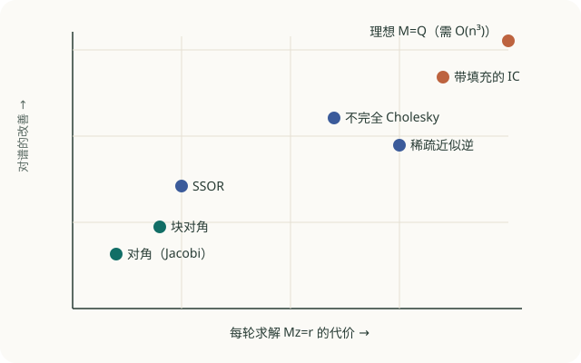

# 5.1.6 实用预条件器：从 Jacobi 到不完全分解

从对角（Jacobi）到不完全 Cholesky、SSOR 与稀疏近似逆：实用预条件器在代价与谱改善之间取舍，没有放之四海皆准的选择。选择取决于问题的稀疏结构与每次求解 Mz=r 的可承受成本。

## 从对角到不完全分解

预条件是“用便宜的 M 近似 Q”。最便宜的选择只看 Q 的对角；最强的选择是完全分解 Q，但那与直接求解无异。实用预条件器都落在这两极之间，用结构信息换取谱改善。下图把常见选择按“每轮代价”和“对谱的改善”排列。



*常见预条件器在代价与有效性上的大致位置。横轴是每轮求解 Mz=r 的代价，纵轴是对谱的改善；点的位置是定性示意，用于比较取舍方向，不是实测性能数据。*

## 对角预条件

取 M=diag(Q)，即只保留对角，称为对角预条件或 Jacobi 预条件。求解 Mz=r 只需逐分量相除，代价 O(n)。它能消除对角尺度的差异：如果 Q 的非对角结构相对均匀，而各行尺度相差很大，Jacobi 就能显著降低有效条件数。

但当尺度差异来自非对角结构时，Jacobi 可能毫无帮助。一个典型反例是一维 Laplacian：它的对角是常数，因而 M 只是单位阵的倍数，M⁻¹Q 与 Q 只差一个标量，条件数完全不变。

$$
M=\operatorname{diag}(Q),\qquad (M^{-1}r)_i=r_i/Q_{ii}.
$$

## 不完全 Cholesky

不完全 Cholesky（IC）取 Q 的 Cholesky 分解 Q=LLᵀ，但强制 L 的稀疏结构与 Q 的下三角部分一致，或在消元时丢掉小于容差的元素。于是 M=LLᵀ 是 Q 的近似，而求解 Mz=r 只需两次三角形回代，代价与非零元个数成正比。

IC 通常比 Jacobi 强得多，因为它利用了非对角结构。两个风险必须注意：其一，一般矩阵的不完全分解可能中途遇到负主元而“中断”（breakdown）；其二，保留的填充越多，M 越接近 Q，但设置代价与存储也越大。

$$
Q=LL^\top+E,\qquad M=LL^\top,\qquad L\ \text{稀疏且易解}.
$$

## 块、SSOR 与稀疏近似逆

对角预条件只用了对角，IC 用了非零结构。另外几类常见选择：块预条件把 Q 的对角块当成 M，适合天然分块的问题；SSOR 用一次对称 Gauss–Seidel 扫描构造 M，既用对角也用三角部分；稀疏近似逆（SPAI）直接近似 Q⁻¹，求解 Mz=r 变成一次稀疏矩阵-向量乘积，便于并行，代价在构造阶段。

SSOR 的标准形式取 Q=D+L+Lᵀ（D 为对角，L 为严格下三角），M=(1/(ω(2−ω)))(D+ωL)D⁻¹(D+ωL)ᵀ，其中 ω∈(0,2) 是松弛参数。求解 Mz=r 需要两次三角形回代。

## 一个可复现算例

取一维 Laplacian Q=tridiag(−1,2,−1)，规模 n=10。它的特征值有闭式：μ_k=2−2cos(kπ/(n+1))，k=1,…,n，所以 κ(Q)=cot²(π/(2(n+1)))≈48.4。

对角预条件在这里不起作用：Q 的对角是常数 2，M=2I，于是 M⁻¹Q=Q/2，与 Q 只差一个标量，条件数仍为 48.4。这说明只看对角无法利用非对角结构。

若用不完全 Cholesky 但不允许填充，对三对角矩阵而言因子仍是双对角（无填充），因此 IC 恰好等于精确 Cholesky，M=Q，κ(M⁻¹Q)=1。同一个问题上，预条件器的强弱完全取决于它是否保留了有用的结构。

$$
\mu_k=2-2\cos\!\left(\frac{k\pi}{n+1}\right),\qquad \kappa(Q)=\cot^2\!\left(\frac{\pi}{2(n+1)}\right).
$$

## 边界与工程注意

没有“最好”的预条件器：要在设置代价、存储、每轮求解成本、并行性与鲁棒性之间权衡。IC 可能在零或负主元处中断；SSOR 的 ω 需要调参；SPAI 的构造可能比一次 CG 还贵。工程上常从 Jacobi 开始，再根据实测的谱与迭代次数决定是否升级。

本页程序只用一维 Laplacian 的闭式特征值对比“只对角”与“保留结构”两种情形，它不实现 IC 或 SSOR，也不声称对一般问题给出最优预条件器。

## 参数交互

拖动滑块改变一维 Laplacian 的规模 n。面板给出无预条件（=Jacobi）的条件数与“保留三对角结构的精确分解”后的条件数，观察前者随 n 增长而后者恒为 1。[在 HTML 页面中操作](./05_5.1.6._Practical_Preconditioners.html)。

## Python 实验

```python
"""Compare no-fill preconditioners on the 1D Laplacian via closed-form spectra."""
from math import cos, pi, tan

def laplacian_eigs(n):
    return [2 - 2*cos(k*pi/(n + 1)) for k in range(1, n + 1)]

def condition(eigs):
    return max(eigs) / min(eigs)

if __name__ == "__main__":
    n = 10
    eigs = laplacian_eigs(n)
    kappa_q = condition(eigs)
    # Jacobi: M = 2I, so M^{-1}Q = Q/2 and the condition number is unchanged.
    kappa_jacobi = condition([e/2 for e in eigs])
    # Exact tridiagonal factorization keeps the pattern, so M = Q and kappa = 1.
    kappa_exact = 1.0
    assert abs(kappa_q - 1/tan(pi/(2*(n + 1)))**2) < 1e-9
    assert abs(kappa_jacobi - kappa_q) < 1e-9
    assert kappa_exact == 1.0
    print("kappa(Q) =", round(kappa_q, 4), "| Jacobi =", round(kappa_jacobi, 4), "| exact =", kappa_exact)
```

## 适用边界

实用预条件器的选择取决于问题的稀疏结构与成本预算；本页只对比了“只对角”与“保留结构”两种极端，不构成通用建议。

## 参考依据

- Nocedal & Wright, *Numerical Optimization*, 2nd ed., Chapter 5, Section 5.1（Practical preconditioners），pp. 118–120。[出版信息](https://doi.org/10.1007/978-0-387-40065-5)；[原书 PDF](https://deeplearningpku.github.io/literature/Nocedal_Wright_Numerical_optimization_v2.pdf)。

本页所有教学数值、图和程序均独立编写。
